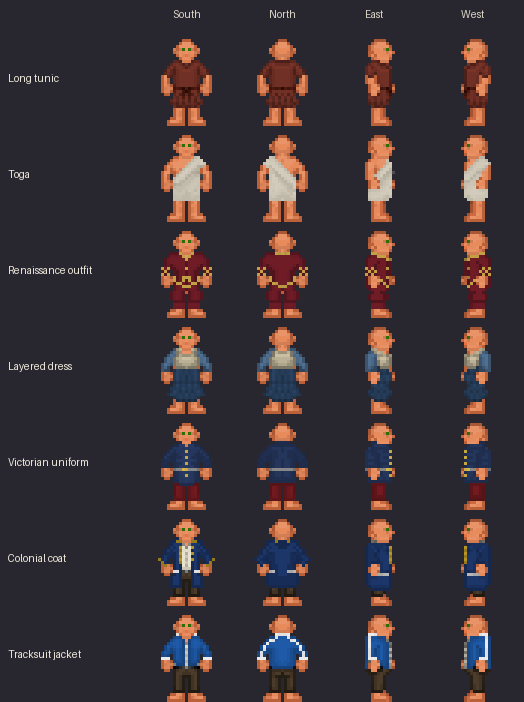
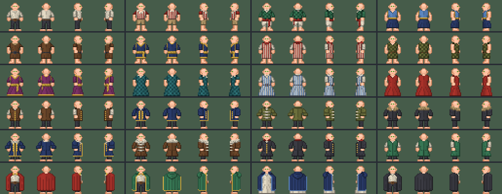

# Miscellaneous Crafting

Details on crafting certain things that fall somewhat outside the main guide.

## Leather tanning

Animals provide untanned raw hides or species pelts. Turn them into ordinary
leather by scraping, washing, drying and applying bark tannin. Each raw hide or
pelt piece yields **1 leather sheet**. Keep pelts if you want to use their fur
clothing or other pelt recipes instead; scraping consumes the chosen pelt piece.
Finished leather you already own remains usable without further processing.

### What you need

- Raw hides or pelts from [animal harvesting](guides/Guide_to_Ranching.md#harvesting-dead-animals).
  Adult male and female turkeys each give **1 raw hide piece**; turkey chicks
  give **no hide**. Species pelts retain their existing yields and uses.
- A held sharp tool, such as a knife or sharpened flint, for scraping.
- An accessible **open reagent vessel** containing water or tannin as required
  below. Wood mugs, canteens, buckets and other suitable open liquid containers
  work. Hold the vessel and apply it to nearby bark or a hide, or hold the bark,
  prepared hide or dry hide and click a reachable open vessel or unlocked barrel
  on the ground. Keep both objects within reach.
- A [tanning rack](guides/Guide_to_Crafting.md#tanning-rack), made with **8 wood
  logs** in the ordinary wood catalog. Basic Toolmaking is required where
  research applies; mode and crafting restrictions still apply.
- Bark collected while cutting logs into planks, and water for extracting tannin.

Sealed vessels, locked barrels, another player's inventory and nested storage
cannot supply these liquids. The water or tannin must be in the vessel's actual
reagent contents. Terrain water and a cooking pot's separate cooking-water
counter do not count; use an ordinary reagent vessel for these steps.

### Process

| Step | Action and cost | Result |
| --- | --- | --- |
| Scrape | Use a held sharp tool on a nearby raw hide or pelt. The action takes **50 ticks**, normally five seconds, and consumes **1 piece** only on successful completion. | **1 prepared hairless hide** |
| Wash | Use an accessible reagent vessel containing at least **5 units of water** with a prepared hide, using either interaction above. This consumes **1 prepared hide** and **5 water**. | **1 wet hide** |
| Dry | Put a held wet-hide stack on the tanning rack. The whole stack, up to **50 pieces**, takes **300 ticks**, normally 30 seconds. Retrieve it with an empty hand when ready. | The same number of **dry hides** |
| Tan | Use an accessible reagent vessel containing at least **5 units of tannin** with a dry hide, using either interaction above. This consumes **1 dry hide** and **5 tannin**. | **1 ordinary leather sheet** |

Washing and tanning process **one piece per application**. Apply the vessel again
for another piece. Prepared hairless hides you already own enter at the washing
step. Drying alone does not produce finished leather, and splashing a stack does
not process the whole stack.

Keep the tool and hide in place while scraping. Cancellation or losing the tool,
actor or input leaves the hide unspent. To cancel rack drying, click the rack
with an empty hand and take back the wet hides; loading them again starts a fresh
full drying interval. A saved wet batch also restarts its full interval when the
server restarts. Rack destruction releases its contents. Remove the completed
batch before loading another.

### Bark and tannin

Cut logs into planks with the usual tools. A **hatchet** consumes **2 log units**
for **1 plank and 2 bark pieces**; a **saw** consumes **1 log unit** for **4 planks
and 1 bark piece**. Bark is a byproduct of paid log cutting, not a free supply.

Use an accessible reagent vessel containing at least **10 units of water** with
one bark piece, using either interaction above. **1 bark + 10 water** produces
**10 units of tannin** in that vessel. The
liquid volume stays the same, so extraction also works with a full vessel.
Each application processes one bark piece.

For two hide pieces, budget **2 hides, 1 bark and 20 water**: ten water washes the
hides, and ten water makes the ten tannin needed to finish both. Tool, rack,
research and normal resource-acquisition requirements still apply.

### Parchment

Stop before tanning to make **parchment**, a blank writing sheet that works like
paper for notes, books and research. Use any held sharp tool, such as a knife or
hatchet, on a nearby **dry hide**. Cutting takes **50 ticks**, normally five
seconds, and turns **1 dry hide** into **4 sheets of parchment** at your feet.
Interrupted cutting consumes nothing. The cut itself needs no research; the
scraping, washing and drying before it need Basic Toolmaking where research
applies.

The [Crafting Atlas](https://civ13.github.io/Civ13/crafting/) lists the hide
stages, bark and tannin acquisition, parchment and leather recipes. In game, use a tanning
rack's **Processing Reference** to open its drying route and find the rack's
construction recipe and research requirement.

### Tanning drum

Once your faction has **Factories** research, a powered
[tanning drum](guides/Guide_to_Factory_Automation.md#tanning-drum) does every
step for you: load hides at any stage, bark, water and tannin, give it power, and
it makes one leather sheet every two seconds at the same liquid cost as tanning
by hand. Factory arms and pipes can keep it supplied.

With **Synthetic Fabrics** research, a factory
[fabricator](guides/Guide_to_Factory_Automation.md#fabricators) makes
**synthetic leather** from cloth and plastic, with no hides at all. It crafts
everything ordinary leather does.

## Woodworking without an axe

Before you have an axe or saw, you can whittle logs into tools and planks by
hand. Where research applies, every step needs **Basic Toolmaking**; on worlds
where research is kept in books, anyone can do it without that chapter. Keep the tool in your active hand and stay
still while you work. Stronger characters work faster.

1. **Cut a small wood piece:** use **sharpened flint**, or a knife harder than
   wood (a flint knife works, a wooden one does not), on a stack of **wood
   logs**. After about 12 seconds one log becomes **1 small wood piece** and
   **1 piece of bark**.
2. **Whittle tools:** use sharpened flint or the knife on your small wood pieces
   and choose:
   - **Wooden wedge:** 1 piece, about 12 seconds.
   - **Wooden mallet:** 5 pieces, about 24 seconds.
3. **Split a crude plank:** hold the **wooden wedge** in one hand and use the
   **wooden mallet** from your other hand on a stack of at least **2 logs**.
   After about 24 seconds you get **1 crude plank** and **2 bark**. The wedge
   wears a little each time.
4. **Flatten it:** use sharpened flint, or any sharp tool that is not made of
   wood, on the crude plank. After about 8 seconds it becomes **1 wooden
   plank**. Crude planks cannot be used as finished planks until flattened.

Knives lose a little durability with each cut; sharpened flint does not.

A **bound flint axe** is faster once you have one: make a sharpened stick
(sharpened flint on a stick), carry crude twine, sinew or rope, and use
sharpened flint on the sharpened stick. An axe cuts **2 logs into 1 plank**
and collects bark. Bark soaks into tannin for
[leather tanning](#bark-and-tannin).

## Lard candle
<table>
<tbody>
<tr>
<td width="5%"></td>
<td><b>Lard candle</b></td>
<td>Fill a vessel with at least 5u of lard (made from <b><a href="guides/Guide_to_Crafting.md#animals">animal fat</a></b>), then click the vessel with rope (1 rope per 1 candle; rope is made from <b><a href="guides/Guide_to_Farming.md">flax and cotton</a></b>. Light it from any open flame: use a lit match, lighter, torch, tiki torch, oil lamp or another lit candle on it, or hold the candle to a lit tiki torch, campfire, stove, brazier or wall torch. Electric flashlights and glowsticks will not light it. A lard candle lasts about 30-40 minutes.</td>
</tr>
</tbody>
</table>

## Lard soap
<table>
<tbody>
<tr>
<td width="5%"></td>
<td><b>Lard soap</b></td>
<td>To make 1 soap bar, mix 20u of lard and 2u of lye (obtained from <b><a href="guides/Guide_to_Crafting.md#wood">wood ash</a></b>) in a vessel like a bucket, a barrel etc.</td>
</tr>
</tbody>
</table>

## Tailoring your own clothes

Design, cut and sew clothing, overclothes and hats in your own colours. You need
**Weaving** to start a project, and each garment needs the same knowledge as
its ready-made version, so the list of garments grows as you learn more.

1. Open the cloth crafting menu and make a **tailoring project** under
   **Clothing**. It costs one cloth sheet; woolcloth works too.
2. Bigger garments need more fabric. Use cloth or woolcloth sheets on the
   project to add them, up to eight. A loincloth needs 1, a toga 3, most
   outfits 4 and a colonial coat 7. Every sheet must be the same fabric as
   the first one.
3. Hold the project and use it in hand. **Choose garment** lists the clothing,
   overclothes and headwear you know how to make, with the fabric each one
   needs.
4. **Colours** lets you colour the body of the garment and each of its pieces,
   such as sleeves, skirt, trim, buttons or stripes. A preview of all four
   sides stays at the top left of your screen while you design. Nothing is
   spent while you design, and you can change your mind as often as you like.
5. **Cut fabric** asks you to confirm, then takes about 3 seconds. Cutting locks
   the garment and colours for good, and any spare sheets are set aside.
6. Use the cut pieces in hand and choose **Sew**. After about 6 seconds you hold
   the finished garment.

| Knowledge | Garments |
| --- | --- |
| Weaving | loincloth, long tunic, tribal robe, shirt, knee tunic, cloak, hood, bandana, beanie |
| Classical Dress | shendyt, celtic trousers, toga, stola, gown, skullcap, veil, keffiyeh |
| Tailoring | arabic tunic, haori, renaissance outfit, short colonial outfit, poncho, haori jacket, colonial jacket, colonial coat, jacket, coat, beret, feathered cap, hennin |
| Fine Garments | tunic, layered, buttoned and laced dresses, pontifical robes, pyjamas, colonial outfit, noble hat, infantry cap |
| Textile Mills | victorian uniform, peaked cap |
| Ready-Made Clothing | modern, baggy and short modern outfits, cloth jacket, blazer, hoodie, field cap |
| Synthetic Fabrics | tracksuit jacket |

Hats take one or two sheets. The feathered cap's feather, the keffiyeh's
checks and the peaked cap's band and badge each take their own colour, and a
veil covers the hair.

### Fabric and dyes

The fabric you start the project with decides how the garment wears. Wool is
warmer, especially as a coat or cloak, and gives a little padding against cuts
and arrows. Linen (cloth) is lighter and shows dyes brighter, while wool gives
every colour a warmer, duller look.

Each colour is a dye, and the dyes you can use depend on your knowledge.
**Textile Mills** lets you mix any colour you like.

| Knowledge | Dyes |
| --- | --- |
| Weaving | undyed, oatmeal, walnut brown, ochre yellow, red ochre, charcoal grey, pale woad blue, moss green |
| Classical Dress | madder red, weld yellow, woad blue, forest green, lichen purple, oak-gall black, rose madder, saffron orange |
| Fine Garments | kermes crimson, indigo navy, royal purple, cochineal scarlet, verdigris teal, gold yellow, sky blue, rose pink |

### Choosing pieces

Shirts, knee tunics, gowns, jackets, coats and cloaks are put together from
pieces. With one of them chosen, **Pieces** lets you pick each part, and
every part you add gets its own colour under **Colours**.

| Garment | Pieces |
| --- | --- |
| Shirt | sleeves, neckline, legwear (trousers, shorts, breeches or skirt), belt or sash, pattern |
| Knee tunic and gown | sleeves, neckline, belt or sash, pattern |
| Jacket and coat | sleeves, collar, buttons or toggles, edge trim |
| Cloak | hood, clasp, border |

Necklines can be round, V or high; patterns can be stripes, checks or a hem
band; and collars can be a stand collar, lapels or fur. Leaving off the sleeves
of a jacket makes a waistcoat. Long sleeves, a hood and legwear take extra
fabric, and the menu shows how much. A few pieces need more knowledge than
the garment itself: V necks, breeches and checks need
**Tailoring**; high collars, lapels, double buttons and cuffed sleeves need
**Fine Garments**; and a sash needs **Classical Dress**.

**Naming a design.** Before cutting, choose **Name** to give your design its
own name of up to 32 letters. The finished garment carries that name, and
anyone who examines it sees who designed it. Leave the name empty to keep the
garment's usual name.

### Sewing patterns

A sewing pattern lets you sew the same design again or hand it to another
tailor. Hold a blank sheet of paper or parchment and use it on a designed
project, a finished tailored garment or another pattern. After about 3
seconds the sheet becomes a sewing pattern with the garment, its name and
every piece's colour noted on it. Examine a pattern to see the colours and how
much fabric it needs.

Use a pattern on a project that has not been cut yet to copy its design onto
the project. You still need the knowledge for that garment and its dyes, so
a pattern for something you have not learned will not work for you yet. A
pattern does not record the fabric, so the same design can be sewn in linen or
wool. Patterns can
be traded like any other item.

### Pattern book

Your pattern book keeps up to 20 of your designs, and every character you play
on the same server can use it, even a new one. Use an uncut project in hand and
choose **Pattern book** to save the current design, copy a saved design onto
the project or remove one. Using a sewing pattern in hand also offers to copy
it into your book. Loading a design from the book needs the same knowledge as
loading a pattern.

Stand still and keep the project in your hand while cutting or sewing. If you
are interrupted, the project and any finished cutting are kept, so just start
that step again. A finished garment cannot be recoloured, but it takes the
usual clothing accessories such as sashes, aprons and capes.
