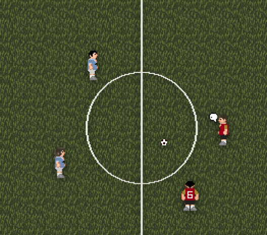

# Football

Football pits two teams against each other on a pitch. Identify your team and position, keep your football equipment on, and enable [hotkey mode](../Hotkeys.md) before kickoff.

</img>

## Your first match

Watch the kickoff and score announcements. Spread out to give teammates passing options, and agree on who will defend while others attack. The team with more goals at the end wins; equal scores produce a draw. After a goal, play pauses and the players and ball return to their starting positions.

## Controls

| Situation | Input | Action |
| --- | --- | --- |
| With the ball | Mouse click or **Z** | Kick towards the mouse. |
| With the ball | **C** | Pass to the nearest teammate. |
| Without the ball | **Z** | Tackle the player in front of you. A tackle can put both players on the ground and requires enough stamina. |
| Without the ball | Mouse click | Pressure the selected player for possession without tackling them. |
| Without the ball | **C** | Pressure the nearest opponent with the ball. |
| Goalkeeper without the ball | **Z** | Attempt to pick up the ball with goalkeeper gloves. |

## Goalkeepers

Goalkeepers can pick up the ball while in their goal area. Moving out of that area with the ball in hand drops it automatically. Coordinate with defenders and return the ball to play rather than leaving the goal unattended.

If a control does not work, check your equipment, stamina, whether you have the ball and whether play is currently stopped.
