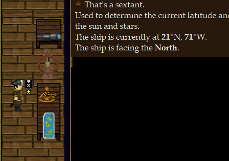
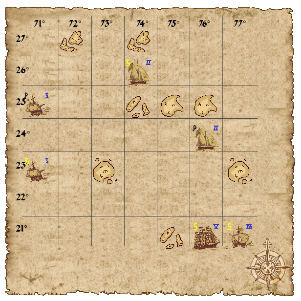
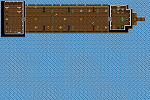
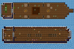
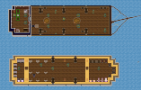
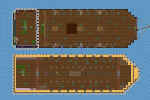
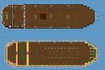

# Voyage

Voyage puts your crew aboard a pirate ship in the Caribbean. Coordinate navigation, supplies, repairs and gunnery to keep the ship afloat during encounters.

## Before leaving port

Report to the Boatswain for an assignment. Check the crew and supply logs, identify the medical and repair supplies, and agree on the destination with the Captain. Keep enough crew aboard to operate the ship while a shore party explores. Return when departure is announced: crew outside the ship can be left behind.

## Roles

### Superior Officer Roles

The **Captain** is responsible for plotting the ship's course.

The **Boatswain** is the Head of Personnel of the ship. He can use the Officer tab to assign jobs to regular sailors (but not officers). He can use the *Crew Log Book* to check the active crew members and respective jobs.

The **Quartermaster** is Head of Logistics. He is responsible for ensuring the ship's stocks are kept at a decent level. He can use the *Log Book* to check the current stocks stored below deck.

### Sailor Roles

**Sailor** is a generic role assigned by default to sailors. They're supposed to help wherever it might be needed.

The **Surgeon** is a specialist role, responsible for keeping the crew healthy.

A **Nurse** is a sailor assigned to support the Surgeon. While he doesn't have the same level of medical knowledge, he can still be useful in a ship with not enough Surgeons.

**Carpenters** maintain the ship and respond to damage.

**Marines** protect the crew during encounters.

**Cannoniers** operate the guns and coordinate ammunition supplies.

**Navigators** help monitor the map, course and sextant.

**Officers** coordinate the crew's assigned work.

**Cooks** prepare food and report supply needs to the Quartermaster.

The **Deputy Boatswain** and **Deputy Quartermaster** are the second in command to the Boatswain and Quartermaster respectively, and can replace them if they get injured or killed.

## The Ship
Learn the route between your station, the supply stores and the deck before an encounter.

### Decks
Keep access routes between navigation, guns and stores clear so supplies and injured crew can be moved during an emergency. Check below deck when the sextant reports increasing sinking progress.

### Navigation

#### Sextant
The Sextant shows you the current coordinates, ship orientation, progress to the next coordinates and state of the ship's flooding.

#### Wheel
The wheel lets you change the ship's course. The ship must be underway to turn. Read the map first, select the direction and allow the steering action to finish.

#### Anchor Capstan
Use the capstan to raise and lower the anchor. Raising it during an encounter asks for confirmation and starts a two-minute departure timer. Warn the shore party before confirming; everyone outside must return before the ship leaves.

#### Map
The map shows you the current known islands and ships.

### Sails, Rigging and Maintenance
Sail, rigging and mast condition affect travel speed. Inspect damage after an encounter and arrange repairs before setting off again. Hull damage and flooding threaten the ship; monitor the sextant's sinking progress and prioritise damage control when it rises. Carry repair supplies rather than using all available material on other projects.

### Log Books
The **crew log** lists crew members and their assigned jobs. The Boatswain, Captain and Deputy Boatswain can use it to coordinate assignments.

The **supply log** helps the Quartermaster track stores. Report shortages early, particularly food and supplies needed for repairs and gunnery.

### Gunnery and Tools
The ship's bell relays a signal to the crew. Agree on what a signal means before relying on it during combat.

Coordinate cannon crews and ammunition before engaging another vessel. Read the [Weapons Guide](../guides/Guide_to_Weapons.md) for weapon operation. Keep firing lanes clear of friendly crew, and arrange support before boarding or sending a shore party.

## The Map

### Ships
There are 6 ship classes ingame. The starting player's ship is a **Flute** (size 3)

| Ship | Size | Image | Cannons (top/bottom - total) | Crew | Description |
| -------- | --- | ---------------- | ------------ | --- | ------------------------------- |
| Xebec | 1 |  | 6/0 - 6 | 10 | The smallest ship, this single-deck, single-mast ship packs 6 cannons and a small crew. There is no cargo hull so loot will be smaller. |
| Schooner | 2 |  | 4/0 - 4 | 20 | This fast ship has a sizeable cargo hull, but also packs a decent amount of crew for its size. Only has cannons on top deck. |
| Flute | 3 |  | 6/4 - 10 | 15 | This swift, double masted ship has a small-ish crew, but packs a good punch in terms of firepower. |
| Brig | 4 | No illustration | 6/10 - 16 | 40 | The Brig is a long ship with a large crew. |
| Galleon | 5 |  | 16/16 - 32 | 50 | The Galleon is a large, wide ship with a massive amount of cannons and a considerable cargo hull. |
| Man-O-War | 6 |  | 24/24 - 48 | 65 | This is a massive ship, and you probably shouldn't take it head-on unless you have a sizable crew and several cannons. |

### Islands
Use the ship's map to plan visits and approach an encounter through the wheel's available choices. Take supplies and communicate with the crew remaining aboard. Plan the return journey before departure is announced.
