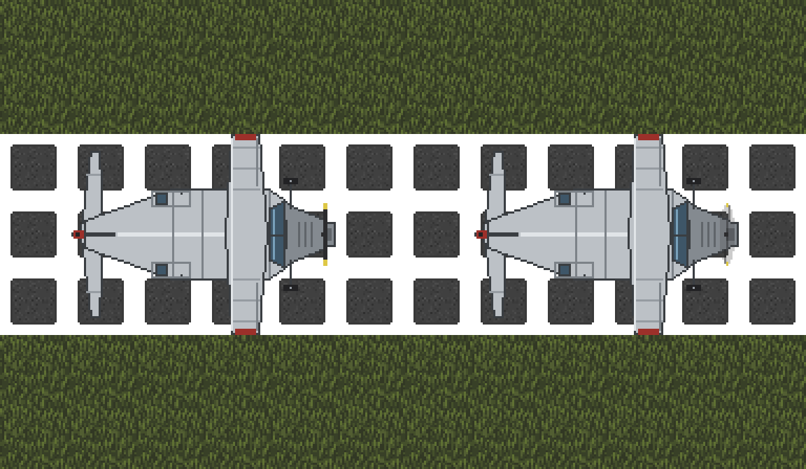

# Aircraft

A light plane is the first thing in Civ13 that leaves the ground. It is built at an **aircraft hangar**, takes off best from a **runway** and lands on one, and flies on the air level above the map. Flying is only possible on maps that have an air level: at the moment that is **Gaia**, the main Nomads persistent world. Elsewhere the plane rolls along but never lifts off, and the pilot is told that there is no airspace.

Two light planes on a runway, nose to the east. Offline render using Civ13 sprites, not a live screenshot.

## Research and materials

| Part | Cost | [Tech tree](Guide_to_Research.md) node | [Legacy research](../gamemodes/Civilizations_and_Nomads.md#research) |
| --- | --- | --- | --- |
| Aircraft hangar | 40 steel | Powered Flight | Industrial 126 |
| Runway (one tile) | 1 stone | Powered Flight | Industrial 126 |
| Light plane | 50 steel, 6 glass, 4 cloth, 8 cable, 4 unattached wheels | Built at the hangar | Built at the hangar |

**Powered Flight** is an Industrial node in the Vehicles line. It needs **Automobiles** and **Combustion Engine**, and Aviation & Rocketry is researched after it. The hangar is in the **production** crafting category and runway in **roads**. The hangar only assembles planes for a faction that has finished the Powered Flight node.

## Building the hangar and the plane

1. Lay a power cable, then craft the aircraft hangar from 40 steel while standing on or next to the cable. The **4x4** square to its **northeast** must be dry, open floor: the finished plane appears there. The hangar is not built if the research, the bay or the cable is missing, and you are told which.
2. Feed steel, glass, cloth and cable stacks into the hangar, and drag four unused, unbroken, unattached wheels onto it. Drag an adjacent laid cable onto it to connect a network with **20 available power**, as for the automobile workshop. Examine the hangar to see what it holds.
3. Click the hangar, choose **Light plane** and stay next to it while it works. Loose objects or people in the bay stop the assembly, and nothing is spent until the plane is finished. **Unload inputs** returns the stock.
4. The plane is delivered with a gasoline engine, an **empty** fuel tank and its key. Fill the tank with gasoline before you try to taxi; see [Engines](Guide_to_Crafting.md#engines) for fuel.

The light plane is four tiles long and three wide: the nose with the engine and propeller, the cockpit between the wings, a fuselage section with one passenger seat, and the tail. The pilot sits in the cockpit and flies from the **control column**.

## Laying a runway

Runway is a road cover crafted from **1 stone per tile** in the roads category, like a modern road. A take-off needs **8 tiles** of straight runway in front of the plane at full throttle, against **16 tiles** of open ground without one. Landing still needs a runway, and is easier with a longer one. Lay it three tiles wide so the whole plane is over tarmac, and keep the ends clear of walls, trees and vehicles.

## Flying

| Control | What it does |
| --- | --- |
| Use the control column | Throttle up one gear |
| Right-click the control column | Throttle down one gear |
| Arrow keys | Steer |
| **Climb** (verb on the control column, or the HUD button) | In the air, go from low flight to cruise height. On the ground it tells you what is still needed to take off |
| **Descend** (verb or HUD button) | Come down one level; over a runway at low speed, land |

The HUD shows the plane's current height while you are in the pilot's seat.

- **Take-off:** start the engine, line up, throttle to full and roll straight ahead. The plane takes off by itself: after 8 tiles on runway, or 16 tiles on open ground, the wheels leave the ground and the plane is in **low flight**, one level above the surface. Climb then takes you to **cruise** height.
- **Low flight and cruise:** at low height the plane flies just above the surface, can be shot at by anyone and crashes into anything tall standing in its path, such as walls and trees. At cruise it clears every obstacle and only heavy weapons reach it, but you have to come down to low flight before you can land. The pilot sees the ground below from the cockpit, and people on the ground see the plane's shadow pass over them.
- **Stalling:** a plane that flies slower than **second gear** for 3 seconds, or whose engine stops, stalls and crash-lands on the nearest clear ground below. You get one warning to throttle up first.
- **Map edge:** the plane stops at the edge of the world and warns you. Turn back at once, because a plane that stays there stalls.
- **Fuel:** flying burns fuel faster than driving, and low flight burns the most. A full tank lasts about four minutes of low flight. Watch the tank, because an engine that runs dry in the air is a stall.

## Landing

Fly over a runway at **second gear or slower** in low flight and **Descend**. At least half of the airframe has to be over runway for the wheels to find it. Too fast, and the plane stays in the air and tells you to slow down; off the runway, it warns you and keeps flying so you can go round again.

Away from a runway, **Descend twice within 5 seconds** to force a crash landing. The plane comes down on the nearest clear ground with its engine off and its landing gear broken, and the crew are bruised. With no clear ground within reach the airframe breaks up and everyone aboard falls.

## Damage and repair

People on the ground can shoot at a plane as it passes over them:

- In **low flight** any gun that fires across the ground under the plane has a **40%** chance of hitting it.
- At **cruise** height only heavy weapons reach it, such as heavy machine guns, cannon and shells, with a **20%** chance.

Every hit tears the airframe and can break a wheel, and hits on the nose can stop the engine. When accumulated damage reaches the airframe's limit the plane fails and comes down as a crash landing. Examine the plane to read its damage, and **weld** any frame section on the ground to mend the airframe. A crash breaks the landing gear, and the plane will not roll until it is fixed. The landing gear counts as one part: once the airframe is whole, one more weld on any frame section, or welding any one wheel, fixes every wheel.

## Hangaring a plane

The aircraft hangar also stores up to **2 planes** off the map. A plane in the hangar is not on the airfield, so it cannot be shot, stolen or caught by a save while it is in the air.

1. Land, then taxi the plane into the 4x4 bay to the northeast of the hangar, where planes are built. The whole airframe has to be inside the bay. Runway under the bay is fine.
2. Switch the engine off, get everyone out and take loose items off it.
3. Click the hangar and choose **Hangar the parked aircraft**. Stay next to it for a few seconds.
4. To fly again, clear the bay and choose **Roll out a hangared aircraft**. The plane comes back where it was parked, with the same fuel and damage.

You need to hold the plane's key to hangar it and to roll it out. Examine the hangar to see which planes it holds. Cars go in a [vehicle garage](Guide_to_Crafting.md#vehicle-garage).

## Tips

- Hangar the plane when you are done flying. A hangared plane is kept safe across saves.
- Land before a save. A plane saved in the air is set down on the ground below when the world loads, and that is a hard landing with broken wheels unless the ground directly beneath it is clear.
- Keep a second runway at the far end of your trips. You can take off again from open ground, but landing anywhere else is a crash landing.
- Build the runway right out of the hangar bay. The plane is delivered facing south on the 4x4 square northeast of the hangar, so a strip running south from there is the shortest taxi.
