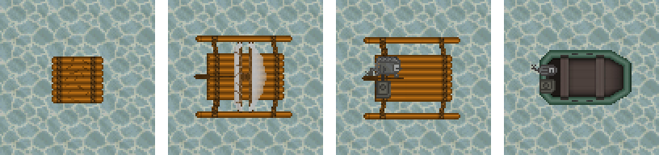
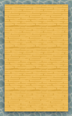
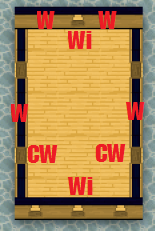
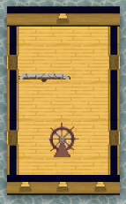
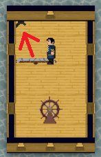
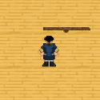
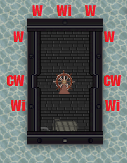
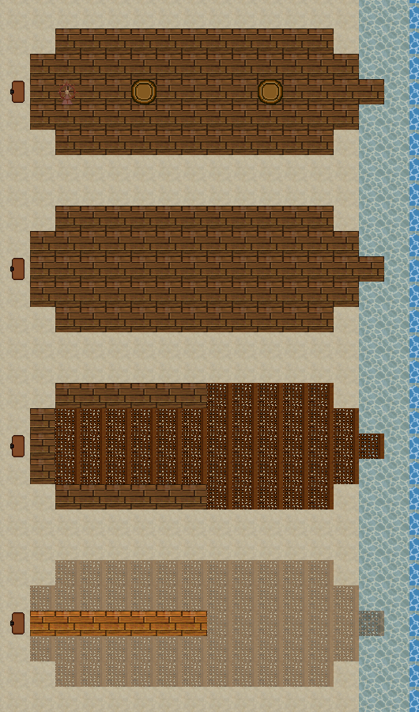
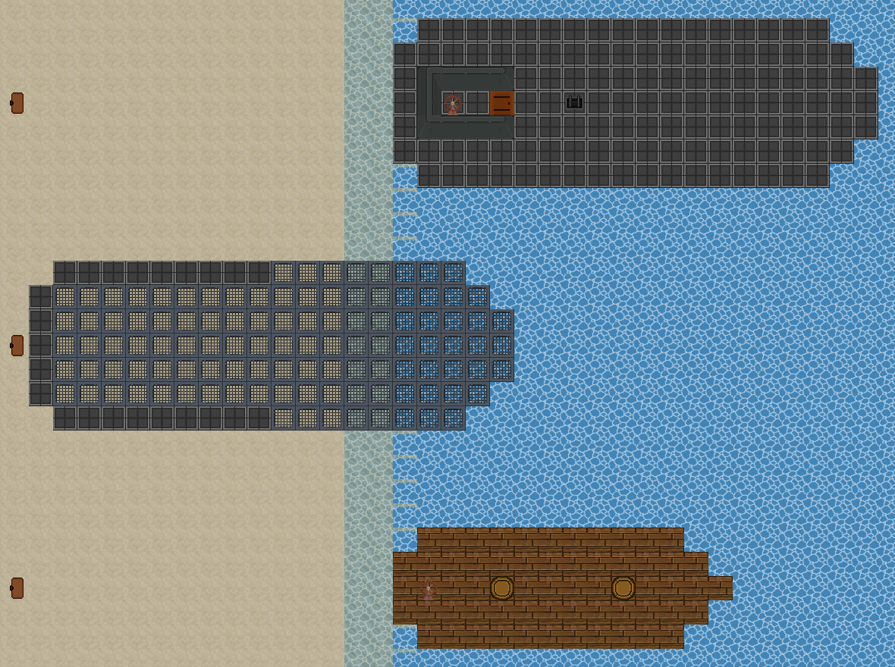

# Boats & Ships

Anything that floats is built from the crafting menu's **vehicle parts** section. Pick the boat that fits your needs:

| Boat | Best for | Crew | Propulsion |
| --- | --- | --- | --- |
| [Raft](#raft) | Crossing a river or lake early on | 1 | Paddling (direction keys) |
| [Sailing outrigger](#outriggers) | Cheap travel along a coast | 2 + 1 cargo | Wind |
| [Motor outrigger](#outriggers) | Fast, wind-free travel | 2 + 1 cargo | Engine |
| [Rigid hull inflatable boat (RHIB)](#rigid-hull-inflatable-boat) | Sturdier motorboat with a bigger engine | 2 + 1 cargo | Engine |
| [Modular ship](#modular-ships) | Carrying a crew, cargo and guns | As many as fit | Masts and sails, or an engine |
| [Submarine](#submarines) | Travelling unseen under the open ocean (Gaia) | As many as fit | Diesel engine |
| [Slipway ships](#slipway-ships) | A big ship built piece by piece on the shore | As many as fit | Sails (schooner) or a diesel engine (freighter) |

From left to right: raft, sailing outrigger, motor outrigger, RHIB. Offline render using Civ13 sprites, not a live screenshot.

## Research and materials

| Part | Cost | [Tech tree](Guide_to_Research.md) node | [Legacy research](../gamemodes/Civilizations_and_Nomads.md#research) |
| --- | --- | --- | --- |
| Raft | 10 wood logs | Carts | Industrial 22 |
| Outrigger boat frame | 22 planks | Wagons & Ships | Industrial 22 |
| Small sail | 15 cloth or 15 wool | Wagons & Ships | Medical 22 |
| Wood ship frame | 4 planks per tile | Wagons & Ships | Industrial 41 |
| Ship rudder control (the wheel) | 10 planks | Wagons & Ships | Industrial 41 |
| Ship mast | 15 planks | Wagons & Ships | Industrial 41 |
| Tiller (for a [hull you build yourself](#building-your-own-hull)) | 10 planks | Wagons & Ships | Industrial 41 |
| Light ship rudder axis (1200 weight) | 25 planks | Wagons & Ships | Industrial 41 |
| Ship rudder axis (2500 weight) | 45 planks | Wagons & Ships | Industrial 55 |
| Steel ship frame | 2 steel per tile | Wagons & Ships | Industrial 97 |
| Rigid hull inflatable boat frame | 22 planks | Automobiles | Industrial 175 |
| Engine maker | 5 iron | Machined Tools | Industrial 115 |
| Fuel tanks | 2-36 steel | Combustion Engine | Industrial 120 |

The small sail is in the cloth (or wool) crafting menu, not in vehicle parts. Engines are built with the engine maker; see [Engines](Guide_to_Crafting.md#engines) for engine types and the fuel each one burns.

## Where to build

- Boats only move onto **water**: shallow or deep water, swamp water and flooded trenches. Ice and dry land stop them.
- You **can't craft while standing in deep water**, so build at the shoreline or in the shallows, facing open water.
- **Rivers flow** on Gaia, Europe, Jungle and Asia. Every few seconds the current carries loose items and swimmers one tile downstream, but not boats or anyone aboard one. Animal carcasses stay where they fell, so you can butcher a kill in the shallows. Lakes, ponds and the sea are still. Examine the water to see which way it runs.
- Rafts and finished boats can't be pushed or pulled, so build them where you mean to launch them.
- A flooded trench is navigable. Dig a channel from a lake or the sea to a sheltered building spot, or around a ship to give it room to turn.

## Raft

1. Craft a **raft** from 10 wood logs at the water's edge.
2. Drag yourself onto the raft to climb aboard. A raft carries only you.
3. Paddle with the **direction keys**. Each step must land on water.
4. Click the raft to get off.

On some maps the open sea is closed to rafts, and you will be told you can't go further. To recover the wood, hit the raft with a hammer: you get 5 planks and a rope back.

## Outriggers

An outrigger starts as an **outrigger boat frame** (22 planks). Making a boat frame needs a **Crafting skill of 1.35**, and you name the boat when you craft it. The frame then becomes either a sailing boat or a motorboat. You can't turn one into the other later.

### Sailing outrigger

Click the frame with a **small sail**. After a few seconds it becomes a **sailing outrigger**.

- Drag yourself onto the boat. The first person aboard is the helmsman and takes the **rudder and sail control** in hand, so keep a hand free. A second person can ride as a passenger.
- Press **Z** (use the item in your hand) to hoist the sails, and press it again to take them in.
- The boat sails the way **you face**. Turn with the direction keys.
- Speed depends on the wind. See [Sailing and the wind](#sailing-and-the-wind).
- If the next tile isn't water, the boat runs aground and the sails come down.

Hit a sailing outrigger with a hammer to take it apart. You get the sail and 10 planks back.

### Motor outrigger

1. Build an **engine** of **100 to 400 cc** with the engine maker. Smaller or larger engines are refused. See [Boat engines](#boat-engines) for which types fit.
2. Drag the engine onto the frame.
3. Click the frame with a **fuel tank of up to 150 units**. The 120u small fuel tank and the bike tanks fit. The boat is finished as soon as the tank goes in.
4. Fill the tank by clicking the boat with a barrel or other container of the fuel your engine burns. Examine the boat to see how much fuel is left.

## Rigid hull inflatable boat

The **RHIB** is built exactly like a motor outrigger, from a **rigid hull inflatable boat frame** (22 planks, the same Crafting skill 1.35), but it is much sturdier and takes bigger parts:

- An engine of **150 to 600 cc**. See [Boat engines](#boat-engines) for which types fit.
- A fuel tank of up to **200 units**, such as the 180u medium fuel tank.

## Boat engines

Motorboats take any engine made with the [engine maker](Guide_to_Crafting.md#engines). The **steam engine doesn't fit**, because it needs a separate furnace. The type decides which fuel the boat burns. Some types have a minimum size, which rules out the smaller outrigger sizes:

| Engine type | Smallest you can build | Outrigger (100-400 cc) | RHIB (150-600 cc) |
| --- | ---: | --- | --- |
| 2-stroke gasoline | 49 cc | 100-400 cc | 150-600 cc |
| 4-stroke gasoline, high-efficiency 4-stroke, ethanol-gasoline | 80-100 cc | 100-400 cc | 150-600 cc |
| Hot bulb, Hesselman | 200 cc | 200-400 cc | 200-600 cc |
| Turbine | 250 cc | 250-400 cc | 250-600 cc |
| Diesel, biodiesel | 300 cc | 300-400 cc | 300-600 cc |

An engine of 300 cc or more gives the fastest boat, so a 300-400 cc engine is a good choice for either hull.

## Driving a motorboat

These controls work on both the motor outrigger and the RHIB. See [Hotkeys](../Hotkeys.md) if you use different keys.

| Action | How |
| --- | --- |
| Board | Drag yourself onto the boat. The first person aboard drives and takes the **boat rudder** in hand. A second person rides along. |
| Start the engine | Press **Z** with the rudder in hand. The tank must have fuel. |
| Go and speed up | Press **Z** again for first gear, and again to speed up (three speeds). |
| Slow down and stop | Press **C**. |
| Steer | The boat drives the way you face. Turn with the direction keys. |
| Turn off and get off | Click the boat with the rudder. The first click shuts the engine off and the next one gets you off. |

A bigger engine moves faster: engines of 300 cc or more are quickest, and engines of 200 cc or more beat the smallest ones. The boat stops when the next tile isn't water.

**Cargo:** each outrigger or RHIB can carry **one** loose structure, such as a crate or a small cannon. Drag it onto the boat to load it. Click the boat to unload it beside you.

## Modular ships

Ships are built tile by tile out of frames, like [modular tanks](Guide_to_Crafting.md#modular-tanks), but they float. A ship can be at most **5x5 tiles** (25 frames) and should be a **rectangle**. Every ship is assembled facing **north**, so the top row of frames is the bow.

| | | | |
| --- | --- | --- | --- |
|  |  |  |  |
| **1** | **2** | **3** | **4** |

### Building the hull

1. Lay out **wood ship frames** (4 planks each) or **steel ship frames** (2 steel each) in the shallows, one per tile. A new frame is fixed in place, so nobody can drag it out of line; use a wrench on an unlinked frame to release it if you need to move it.
2. Add the walls **before assembly**, because a frame stops taking walls once it joins a ship. Click a wood frame with **wood logs**, or a steel frame with **steel**. Then pick a side, a thickness from 1 to 50 mm and a type:
   - **Wall**: solid and impassable, with the most health.
   - **Crenelated wall**: a wall with a gap you can walk through. Use it where the crew boards and leaves.
   - **Open window**: a weaker wall section, mostly for looks.

   A wall on the left side costs 1 log or sheet per 5 mm of thickness. The other sides cost 1 per 10 mm.

### Fitting it out

3. Place the **ship rudder control** (the wheel) on one of the frames. The wheel must be on the ship **before** you assemble it, or it won't be connected.
4. Give the ship a way to move:
   - **Sail:** place one or more **ship masts** on frames and click each mast with a **small sail**. The mast sprite is larger than one tile, so it looks offset; this is how it sits when the ship faces north:

     

   - **Engine:** place an engine on a frame and connect a fuel tank to it by clicking the engine with the tank (see [Engines](Guide_to_Crafting.md#engines)). Steel ships in later ages usually run on engines.

   A ship can carry both masts and an engine.

### Assembling the ship

5. Build a **ship rudder axis** on the **top-left (north-west) frame**. There must be no frame to its west or north.
   - The **light axis** carries up to **1200** weight.
   - The **heavy axis** carries up to **2500** weight.

   Both axes are made of planks, even for a steel ship.
6. Click the axis, confirm, and name your ship. Every frame, mast, engine, fuel tank and wheel in the 5x5 square running east and south of the axis joins the ship.

If you forgot a mast, drag it onto one of the ship's frames afterwards. Engines can be added the same way. A wheel can only be connected during assembly.

<table>
<tbody>
<tr>
<td></td>
<td>A steel ship, built from steel ship frames.</td>
</tr>
</tbody>
</table>

### Weight

Examine any frame of the ship to see its **current weight**. Every frame, every object aboard and every person adds to it.

- Under sail, the ship won't move if it weighs more than the axis can carry.
- Under engine, it also stalls if it weighs more than **twice the engine's power**. An engine of 12,000 to 15,000 cc is enough for almost any ship.

### At the helm

Stand next to the wheel and click it to open the helm. A ship starts with its **anchor down**.

| Control | What it does |
| --- | --- |
| **Turn Left / Turn Right** | Turns the ship a quarter turn. This only works **while moving**, at most once every 3 seconds, and fails if another ship or obstacle is in the way. |
| **Reverse** | Sails backwards (astern) on the same heading. Click again to go forwards. |
| **Anchor** | Drops or lifts the anchor. A ship can't move with the anchor down, and dropping it stops the ship at once. |
| **Sails** | Hoists or takes in the sails on every mast. |
| **Engine** | Turns the engine on or off. |
| **Increase / Decrease Speed** | Engine speed: slow, half and full. Decreasing from slow stops the ship, and decreasing again turns the engine off. |

**To set sail:** hoist the sails, then lift the anchor.

**Under engine:** turn the engine on, lift the anchor, then increase speed.

To stop, drop the anchor or take in the sails. With an engine, decrease the speed to zero. Under engine, the light axis is quicker than the heavy one.

### Hazards

- A ship stops when its bow meets land, ice, another ship or a solid obstacle it can't break.
- A ship weighing **400 or more** smashes through most solid objects in its path. At **800 or more** it runs over anyone in the way, and lighter ships still hit them hard. Keep swimmers clear of the bow.
- Explosions can break or destroy masts. A ship with a broken mast, or a mast without a sail, won't sail.

## Submarines

A submarine is a steel boat that can dive under the open ocean. On the surface it handles like any engine-driven [modular ship](#modular-ships). Submerged, it travels on the dark water under the sea, where ships on the surface can't see it.

Diving only works on **Gaia**, which has open sea under its deep ocean. Anywhere else a submarine is just a surface boat.

### Building one

1. Research **Submarines** (needs Wagons & Ships, Combustion Engine and Electricity).
2. Craft a **submarine pen** (40 steel, in the production section) on the shore. The 5x5 square northeast of the pen must be **deep saltwater** with nothing in it, and the pen needs a power cable on or next to it, like the [automobile workshop](Guide_to_Crafting.md#automobile-workshop).
3. Feed the pen **90 steel, 4 glass and 12 cable**, then click it and choose **Submarine**.

The boat is launched into the square with an **empty diesel tank** and a vehicle key. It is three tiles wide and five long. The bow has the ship wheel, the middle has the **ballast and periscope station**, and the stern has the engine and tank. The hull is roofed. Amidships the sides are open on both beams, and those hatches are how the crew and cargo get on and off.

### Diving and surfacing

Click the **ballast and periscope station** to dive or surface. Each takes a few seconds.

- **Stop the boat first.** You can't dive or surface while it's moving.
- **Dive in open ocean.** The water has to be deep enough under every tile of the hull. The sea floor rises about one tile out from every coast, island and shallow, so move a little way offshore.
- **Surface into open water.** You can't come up under another ship, a raft, a bridge or anything else floating above you.
- Everything aboard goes down with the boat: crew, crates, machinery and anyone standing on the deck. Nobody can step straight off a submerged boat; divers go out through the [lock-out hatches](#diving-on-the-seabed).

Submerged, you steer and set speed at the ship wheel as usual. If the sea floor rises ahead, the sonar warns you and the boat stops. Turn away, or surface and continue on the surface.

### Periscope and contacts

While submerged, choose **Raise periscope** at the station to see the surface straight above the boat. The view follows the boat as it moves. Step away from the station, or choose **Lower periscope**, to put it down.

**Contacts** lists what's around you, with the range in tiles, the bearing and the heading:

- **Ships** on the surface within 30 tiles.
- **Aircraft** flying within 30 tiles.
- **Submerged boats** within 20 tiles, by sonar, only while you are submerged yourself. Sonar can't tell you whose boat it is.

### Loading and unloading

Surface next to a pier, a beach or another ship. Then walk off through the open hatches amidships and carry or pull crates on and off. Cargo left on the deck stays aboard when you dive.

### Diving on the seabed

Under the open ocean lies the seabed: cold, dark water where nothing can breathe. You can walk it if you are sealed in diving gear. All three pieces need **Submarines** research:

- **Diving dress**: 12 cloth.
- **Diving helmet**: 8 brass. Use it in your hand to turn its lamp on or off. The seabed is pitch dark.
- **Diving air bottle**: 5 steel. Wear it on your back. Refill it at the submarine's **ballast and periscope station**, at a habitat module's core or at a landed lander.

Wear the dress, the helmet and a bottle with air in it, and you are sealed.

**Leaving the boat.** When the boat is submerged, the two side sections amidships work as **lock-out hatches**. Stand next to one and click it. The chamber floods, and after a few seconds you step out onto the seabed beside the hull. To get back in, stand next to the same hatch on the outside and click it. The chamber pumps dry and you are back aboard. You can't use a lock-out hatch without sealed gear, or if rock or wreckage is pressed against it.

**Depth.** The farther you are from land, the deeper the water gets. Examine the water to see how deep you are. The four depths are:

1. **The shelf**, close to coasts and islands.
2. **Open water**.
3. **The deep**.
4. **The abyss**, far from any land.

A diving dress is only built for the shelf. Deeper than that it groans, loses integrity every few seconds, and finally tears, and then you drown. Patch a worn suit with a suit patch kit.

**Air.** A full bottle lasts about 30 minutes. A badly worn suit leaks and empties the bottle three times faster.

**Getting out in trouble.** If you can't get back to your boat, use **Drop Weights and Ascend** (IC tab). After about 15 seconds you swim up to the open sea straight above, as long as nothing is floating there. The dress keeps you afloat and breathing while your air lasts, so swim for a boat or the shore.

Anything you drop on the seabed stays where it fell.

## Slipway ships

Bigger ships are built on a **slipway**: a berth on the shore where the crew add the ship one piece at a time, then launch her into the sea. Two ships can be built this way:

| Ship | Research | Size | Pieces | Materials in all |
| --- | --- | --- | --- | --- |
| Sailing schooner | Wagons & Ships | 14 x 5 tiles, one deck | 16 | 180 planks, 20 cloth, 4 rope |
| Motor freighter | Combustion Engine | 20 x 7 tiles, deck and hold | 20 | 214 steel, 20 cable, 10 glass |

### Setting up the slipway

1. Craft a **slipway** (20 planks, in the vehicle parts section) on the shore, **facing the water**. The ground in front of it is the berth: the ship is built there with her stern at the slipway and her bow towards the sea. Use a **wrench** on an empty slipway to turn it.
2. The berth can be sand, grass, any other floor, shallow water or a dug trench. It must be clear of walls and solid objects.
3. Click the slipway and choose **Lay the keel** of the ship you want. It refuses with a reason if the berth is blocked, your faction lacks the research, or there is no **open deep water** straight ahead for the finished ship to float in. The freighter also needs a level below the sea for her hold, which Gaia has.

### Building her

The slipway tells you what the next piece needs, for example "the next keel timber (1 of 2) needs 10 wood". Hit the slipway, or any part of the ship on the berth, with that material. After a few seconds the stack pays what the piece still needs and you keep the rest. Anyone can help, and the pieces can be brought over as many trips and days as you like: the project is saved with the world.

The ship grows on the berth from stern to bow: the keel down the middle, then the ribs, the hull and the deck, then the masts, wheel or wheelhouse. You can walk over her while she is being built.

From bottom to top: half the keel laid, half the planking on the ribs, the deck finished, and a finished schooner with her masts and wheel. Offline render using Civ13 sprites, not a live screenshot.

| Schooner stage | Pieces | Each piece |
| --- | --- | --- |
| Keel | 2 | 10 planks |
| Frames | 4 | 10 planks |
| Planking | 4 | 15 planks |
| Deck | 3 | 10 planks |
| Masts and rigging | 2 | 10 planks, 10 cloth, 2 rope |
| Wheel | 1 | 10 planks |

| Freighter stage | Pieces | Each piece |
| --- | --- | --- |
| Keel | 2 | 10 steel |
| Frames | 4 | 10 steel |
| Hull plating | 6 | 12 steel |
| Hold and bulkheads | 2 | 10 steel |
| Deck | 4 | 8 steel |
| Engine | 1 | 20 steel, 20 cable |
| Wheelhouse and fittings | 1 | 10 steel, 10 glass |

To give up on a ship, click the slipway and choose **Abandon**. Everything fitted so far is lost.

### Launching

When the last piece is fitted, click the slipway and choose **Launch**. The ship slides straight down the ways until she floats on open deep water, up to twelve tiles past the end of the berth. Everyone and everything standing on her goes with her. She floats with her anchor down and empty bunkers, and the slipway is ready for the next keel.

- Every tile she slides over must be clear: a wall, a tree, a wreck or another boat in the way stops the launch.
- **Dry dock:** instead of the open shore you can dig a trench for the berth. Build the ship in the dry trench, then dig through to the sea so the trench floods. A dry dock that is not flooded refuses the launch.

A freighter and a schooner afloat after their launch, with another freighter on the slipway between them. Offline render using Civ13 sprites, not a live screenshot.

### Sailing them

Both ships sail like the [aircraft carrier](Guide_to_Aircraft_Carriers.md#sailing): click the **ship's wheel** to weigh anchor, set a speed and turn, and read the chart. The ship moves in hops every 30 seconds with everyone aboard. Register her to your faction in the [ship's papers](Guide_to_Aircraft_Carriers.md#ships-papers) at the wheel so nobody can sail her away while you are gone.

- **Sailing schooner:** two masts and the wheel at the stern. She needs **no fuel**, but makes half ahead at most.
- **Motor freighter:** the wheel is in the wheelhouse at the stern, and a ladder amidships leads down to the **cargo hold**. Behind a bulkhead door at the back of the hold is the **engine room** with the bunker filling point. Pour **diesel** or **petroleum** into it (400 units). If both the hold and the engine room flood, she sinks.

## Building your own hull

You can also design a ship yourself. A hull is nothing more than **floors laid over water**, in any shape you like, with a **tiller** on one of them.

1. Craft **floor covers** (2 wood each, construction) and lay them over water: a river, a lake or the shallows. Floors cannot be laid on deep salt water, so build near the shore and sail out.
2. Keep the hull **free of the shore**. A floor that touches a floor on land makes it a jetty, and a jetty cannot be commissioned. Leave a one-tile gap and step across, or cut the last plank when you are ready.
3. Craft a **tiller** (10 planks, vehicle parts) and set it on one of the floors. The tiller is the point the ship turns about, so somewhere near the middle is best.
4. Click the tiller, choose where the **bow** points and **name her**. Every floor joined edge to edge with the tiller's tile becomes the ship, up to **200 tiles**.

Click the tiller to sail:

| Choice | What it does |
| --- | --- |
| **Weigh anchor / Drop anchor** | A new hull lies at anchor and never moves until it is weighed |
| **Slow ahead**, **Half ahead**, **Full ahead**, **All stop** | Under way she moves along her heading every 30 seconds with every floor, wall, crate and person aboard: **2 tiles** at slow ahead, **4** at half, **6** at full. Half ahead needs sails or an engine, full ahead needs engines (below) |
| **Head north / east / south / west** | She comes about around the tiller five seconds later; everything aboard turns with her |
| **Sea chart** | Where she is, the ships her lookout sees and every harbour on this sea (see [Harbours and the sea chart](#harbours-and-the-sea-chart)) |
| **Make for a berth** | Slides her alongside a mooring post within 20 tiles |
| **Hail a ship** | Calls across to a ship her lookout sees (see [Hails and running dark](#hails-and-running-dark)) |
| **Run dark / Show her lights** | Hides her name from other ships, at slow ahead only |
| **Grapple a ship** | Throws lines at a ship within 3 tiles and holds both fast (see [Grappling and boarding](#grappling-and-boarding)) |
| **Ship's papers** | Register her so nobody can sail her away while you are gone (see [Ship's papers](Guide_to_Aircraft_Carriers.md#ships-papers)) |
| **Refit the hull** | At anchor: surveys the hull again after you added or cut away floors |
| **Strike the hull** | She stops being a ship; the floors stay where they are |

- **Sails:** with nothing to drive her she is poled along at slow ahead. Craft a **ship mast** (15 planks, vehicle parts), stand it on one of her floors and rig a **small sail** on it (click the mast with the sail). One rigged mast gives half ahead to a hull of up to **31 tiles**, two masts up to 62, and so on. The tiller tells you how many sails are drawing and the best speed she makes. Sails are set while she is under way and furled at anchor, and need no fuel.
- **Engines:** stand any engine on one of her floors and start it as you would ashore: a steam engine with its fire lit beside it, or a fuel engine with a fuel tank connected. A running engine pushes as much as its power output. Half ahead needs **1 push for every tile of hull** from sails and engines together; full ahead needs **2 for every tile from engines alone**. So a 66-power hot bulb engine drives 66 tiles at half ahead or 33 at full. The tiller shows what her drives push and what her hull needs.
- **Fuel:** a fuel engine burns from its own tank at every hop, three times as much at full ahead as at slow, on top of what it burns idling. When the tank cannot pay for a hop the engine stalls and she drops to the best speed her other drives make. Stop the engine at anchor to save fuel.
- The water she is about to cover is **marked in yellow** five seconds before each hop and before a turn.
- She stops by herself, and tells everyone aboard why, at land, at somebody else's floor, at another ship, at anything solid in the water and at the edge of the world. A blocked hop tries a shorter one first.
- Build what you like aboard: walls, a cabin, crates, cannon. Anything standing on her floors rides along at once. New floors that widen the hull join her when you **refit**.
- **Wiring:** cables, engines, generators and batteries aboard stay connected when she moves, so lamps and machines keep running under way. A cable that runs from her to the shore parts at the first hop. The same holds for slipway ships and the aircraft carrier.
- Once commissioned she can sail onto deep salt water. If you strike her out there, the floors are plain planks again and will not last on the deep sea.
- If the tiller is destroyed she is a raft of planks again. Set a new tiller and commission her.

## Harbours and the sea chart

Slipway ships, the aircraft carrier and hulls you built yourself share one sea chart and can lie moored at a harbour.

**The sea chart.** Choose **Chart** at a ship's wheel or **Sea chart** at a tiller. The sea is divided into squares of 10 tiles, lettered across and numbered up, so "E3" is the fifth square from the west and the third from the south. The chart shows:

- the square and position your ship lies in, and the harbour she is moored at;
- every other ship within **40 tiles** of her: distance, bearing, square, where her bow points and whether she is under way, stopped or moored;
- every **harbour** on that sea, however far, and whether its berth would take your ship.

**Building a harbour.** Craft a **mooring post** (6 wood, vehicle parts, the same research as boats) and set it at the water's edge, on the shore or at the end of a pier, with open water on one side. Click the post to:

| Choice | What it does |
| --- | --- |
| **Claim the berth** | The post belongs to your faction. An unclaimed post takes any ship |
| **Name the harbour** | The name ships read on their charts |
| **Welcome only our ships / our guests / every ship** | Who may berth. A ship counts as yours when she is registered to your faction in her [ship's papers](Guide_to_Aircraft_Carriers.md#ships-papers) |
| **Add a guest / Strike a guest** | A guest faction is picked from the registered ships lying within 20 tiles of the post |
| **Give up the berth** | Anyone may claim it again |

One post takes one ship, up to 40 tiles long and 12 across. Set several posts well apart for a bigger harbour.

**Berthing.** Bring the ship within **20 tiles** of the post and choose **Make for a berth** at the wheel or tiller. If the post will have her, the water she is about to lie in is **marked in yellow for ten seconds**, then she slides in along the shore with her middle abreast of the post, stops and drops anchor. If not, you are told why: too far, not welcome, promised to another ship, taken, or something in the way.

A moored ship holds the berth until she next moves: weigh anchor and sail and she has cast off. After a server restart she lies at anchor beside the post; make for the berth again to moor her.

### Hails and running dark

**Hail a ship.** At a wheel or tiller choose **Hail a ship**, pick one of the ships within 40 tiles and type what you call across. Everyone aboard her reads it with the distance and bearing it came from, and your own crew reads what was said. Anyone at the helm may hail, and hails must be five seconds apart.

**Run dark.** Choose **Run dark** to keep your ship's name to herself:

- other ships' sea charts and the carrier's radar still show where she is, but list her as an **unknown contact** with no name, heading or speed;
- her hails come from "an unknown ship";
- ships registered to your own faction still know her;
- she makes **slow ahead at most**, and a slipway ship or carrier puts out her deck lights.

Lamps you set on a hull you built are yours to put out. Choose **Show her lights** to be known and fast again. Running dark is an order like setting a speed, so on a registered ship it answers only to her crew. It ends at a server restart.

### Grappling and boarding

Bring your ship alongside another so that **3 tiles of open water or less** lie in a straight line between the two hulls, then choose **Grapple a ship** at the wheel or tiller and pick her.

- **Both ships are held fast.** Neither hops, comes about or makes for a berth while the lines hold, whatever her telegraph says. When they are let go, a ship with her anchor up and a speed rung sails on.
- **Boarding lines** lie across the gap. Walk over them to board her, or to be boarded. Whoever stands on a line when it parts goes into the water.
- The ship that threw the lines chooses **Cast off the grapple** at her helm and is free at once.
- The ship that was caught chooses **Cut the grapple** at her helm, or anyone clicks one of the boarding lines with an empty hand. Cutting takes five seconds.
- A line that is destroyed parts the ships, and so does striking or sinking either of them.
- After her lines are let go a ship needs **one minute** to coil them before she can grapple again.

A ship takes one set of lines at a time. Grappling is an order like setting a speed, so on a registered ship it answers only to her crew, but anyone can cut a line they can reach. The lines do not last through a server restart.

## Sailing and the wind

Sails depend on the wind. The **Status** tab shows the current wind, for example "A moderate Northern breeze". The game also announces in chat when the wind changes. The wind is named after the direction it **blows from**, so a northern wind pushes ships south.

| Course | Speed |
| --- | --- |
| With the wind behind you (northern wind, heading south) | Full speed |
| Across the wind (northern wind, heading east or west) | About 2.5 times slower |
| Into the wind (northern wind, heading north) | About 10 times slower |

A stronger wind is faster. A gale is the quickest, and with no wind at all sails barely move. These rules apply to both sailing outriggers and sailing ships. If you need to go upwind, an engine is the reliable choice.
