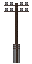

# Guide to Communications
## Towers

<table class="sortable">
<thead>
<tr class="header">
<th>
Type of Tower
</th>
<th>
Image
</th>
<th>
Description
</th>
</tr>
</thead>
<tbody>
<tr>
<td>
Utility pole
</td>
<td>

</td>
<td>
Will only work with <strong>2</strong> tiles in between each pole. <strong>Cannot be diagonal.</strong> Be extremely careful building as it cannot be deconstructed and only destroyed with a catapult or cannon/explosives.
  

<strong>Building a good telegraph line:</strong>

  
Click to expand!

<ul>
<li>First setup the telegraph in the desired location. Typically the corner of a building.</li>
<li>Build the utility pole adjacent to the telegraph on the other side of the wall.</li>
<li>Use spare materials to map out your utility pole line.</li>
<li>Create the telegraph at the other end.</li>
<li>Build your new building around it.</li>
<li>Construct the telegraph lines and make sure to place a telegraph printer next to each of the telegraphs. (Make sure to load paper into it.)</li>
</ul>

</td>
</tr>
<tr>
<td>
Cell Tower
</td>
<td>

</td>
<td>
Built from steel. Mobile phones get a signal anywhere without one, so a tower is not needed for calls.
</td>
</tr>
</tbody>
</table>

## Devices

- **Shouting:** a quick way to alert nearby players. Tell them what help you need.

- **Bone horn:** blow it to signal a charge or an enemy invasion.

- **Campfire:** use a cloth or leather sheet on a lit campfire to make smoke
signals. Players within 25 tiles are told which direction the smoke is in.

- **Lanterns:** lit lanterns can be used for limited communication for certain
situations. (Use a telescope to see them from afar)

- **Messengers:** these are men who dedicate their lives to delivering letters
to people who need them in time usually on horseback.

- **Telegraph:** to use a telegraph it must be within 2 tiles of a
communications pole, you need a telegraph and a telegraph printer with
paper in it to actually send messages. Doesn't need power

- **Cameras:** a simple form of relaying information through photographs,
either for keeping memories of the past or for spying on enemy nations
and war journalism.

- **Stationary phone:** must be within 2 tiles of a utility pole on a
connected pole line. Use it in hand to dial a 4-digit number, and use it again
to pick up or hang up. Examine a phone to see its number.

- **Stationary Radio:** requires power and a microphone in order to respond to
calls, it has a set frequency which you can change at any time.

- **Mobile Radio backpack:** requires no power and takes up the backpack slot.

- **Mobile phone:** works anywhere on the map and needs no power. Use it in
hand to call a number, call a saved contact or add a contact. Examine the
phone to see its own number.

- **Smartphone:** a Digital Age mobile phone (15 electronics, Consumer
Electronics research). It calls like a mobile phone, and its secondary action
(**C**) switches a built-in flashlight on or off.

- **Walkie Talkie:** small version of a radio and can be placed in a pocket or
coin pouch slot.

- **Tape recorder:** made from 4 electronics from 1969 onward, once the
Automation research is complete. Cassette tapes are made from 1 plastic. Use a
tape on the recorder to load it, then use the recorder in hand to **Record**,
**Stop**, **Play**, **Erase tape** or **Eject tape**. While recording it picks
up everything said within earshot, even from a pocket or belt; whispers are
only picked up when the recorder sits on the ground next to the speaker.
Playback repeats each line aloud with the speaker's voice, and listeners who
do not speak the recorded language hear it garbled. A tape holds ten minutes
of recording; examine a tape or the recorder to see how much is used. Write on
a tape with a pen to label it.

## Long-range radio relay

Radios normally only reach the land you are in. A **long-range radio relay**
carries radio traffic to other lands that are linked to yours, but only while
a relay is working on both sides.

- **Building it:** the relay is a Modern age structure made from electronics
once the Factories research is complete. It needs a laid, powered cable
(40 power, like the broadcast station) and a broadcast antenna within one
tile of it.
- **Network key:** use the relay and set a key of up to 16 characters (lower
case letters, digits, `-` and `_`). Only relays in other lands with the same
key exchange traffic with yours. A relay with no key is off the air.
- **What crosses:** every radio broadcast in your land, on any frequency. A
listener in the other land hears it on a radio tuned to the same frequency,
with the speaker's name, the land it came from and the relay that carried it.
Languages carry across as usual. Each relay forwards at most ten messages
every ten seconds.
- **Wear and repair:** a running relay slowly loses condition, faster in rain
and much faster in extreme weather, and explosions damage it. Below 40%
condition it garbles what it carries; at 0% it falls silent. Switch it off and
use electronics or copper wire on it to repair it (crafting 100).
- **Checking the link:** examine the relay to see its key, its condition and
whether each other land is linked, has no key set, has no working relay, or
is down.
