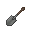
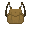

# Guide to Farming
Being a grower of crops is an important role. You farm both food and
cash crops. Growing food is vital for a nation to increase in wealth and
power.

## Tools

### Starting a farm

In the default global catalog, **2 raw wood** makes a wooden knife. A Stone Age hatchet costs **2 stone** through baseline Basic Tools; use it to split **2 raw wood into 1 plank**. A starter research bench costs **8 planks**. At a tier-zero bench, **Basic Agriculture** has no prerequisite and costs **95 study ticks**, unlocking the **4-plank wooden plough**. Faction permissions, bench upgrades, map catalogs and skills still apply. Established factions do not gain this research merely because another faction advances the era.

Use a knife on a small bush with **Help intent** for random seeds; the bush regrows its seed supply after **10 minutes**. Continental, Pangea, New World, Mediterranean, Gaia and Europe use biome seed catalogs when this forage route is present. Pangea also has placed seed stacks; check actual resources on your map. Healing herbs use jungle-bush forage or planting a herb stack, consuming one herb, rather than random herb seeds. Seeds still need suitable soil, biome and season.

### Wild plants

On Nomads maps a few ripe wild crops grow on their own in open countryside, away from players and settlements. Depending on the biome and season you may find wild herbs, mushrooms, wheat, oat, barley, rice, potatoes, carrots, cabbage, turnips, parsnips, beans, tomatoes, corn, pumpkins, zucchini, red peppers, celery, parsley, grapes, watermelons, agave, juniper, flax or cotton. They are sparse, so explore away from built-up areas to find them. Harvest one with a knife, scythe, hatchet or bayonet to get its produce and two seeds (herbs give healing herbs, flax and cotton give fibre), which is a quick way to start a farm. Wild plants do not grow or need water; out of season (for example in winter) they wither away.

### Trees grow back

Chopping down a tree on a Nomads map leaves a **tree stump**. Outside winter, a stump slowly grows back into the same kind of tree, usually over a few hours, while nobody is nearby. To keep cleared land clear, dig the stump out with any shovel or chop it with a hatchet. Either way the roots give you 2 wood logs.

To farm, you will require some basic tools.

<table>
<tbody>
<tr>
<td width="5%">

</td>
<td>
<b>Knife</b>
</td>
<td>Used for harvesting crops. Can be made out of Wood, Bone, Copper, Bronze, Iron, Steel, Silver, Gold and Diamond (metal knives are made via casting in the <b><a href="Guide_to_Metallurgy.md#molds">knife molds</a></b>.</td>
</tr>
<tr>
<td>

</td>
<td>
<b>Plough</b>
</td>
<td>A plough is made out of wood and used to plough fields for farming! Used once on the grass and once on the dirt underneath the grass. You can also plough snowy dirt and flooded plains dirt (found along the jungle rivers). In case of snowy grass, you will have to shovel the snow first. Lastly, there are places where you cannot plough: infertile soil, permafrost etc. You can also make an iron plough out of iron ingots to plough land faster.</td>
</tr>
<tr>
<td>

</td>
<td>
<b>Trench shovel</b>
</td>
<td>A trench shovel is made out of iron ingots and a wooden handle. A trench shovel, as the name suggests, digs trenches. To dig a trench, simply click a dirt tile twice. If you dig a trench next to water tiles, the trench will get flooded, providing crops with water and serving as an extra barrier.</td>
</tr>
<tr>
<td>

</td>
<td>
<b>Shovel</b>
</td>
<td>Made with either 2 bone pieces or a <b><a href="Guide_to_Metallurgy.md#molds">cast shovel head</a></b>, plus a wooden handle. Used to dig irrigation channels that water crops and do not hinder your movement, unlike flooded trenches. To dig an irrigation channel, hold a shovel in the active hand and click it, or press Ctrl-Z or Z in the hotkeys mode, then choose the respective option.</td>
</tr>
<tr>
<td>

</td>
<td>
<b>Seeds</b>
</td>
<td>Some sort of seeds to plant and grow. You may find seeds simply lying on the ground, but you can also collect them in the wilderness by using any type of knife on bushes and small bushes.</td>
</tr>
<tr>
<td>

</td>
<td>
<b>Seed collector</b>
</td>
<td>Made out of leather. Very useful for picking up seeds during large-scale farming. Have a seed collector in your active hand, stand over the seeds on the ground, then click the collector or press Ctrl-Z, and you will put the seeds in the bag. Just do not misplace it.</td>
</tr>
</tbody>
</table>

## Farming

Just plough a plot of land by yourself or by attaching the plough to a cow or bull for quicker soil disruption, surround said plot of land with trenches with a trench shovel (Can't be walked over easily) or with irrigation channels with a basic shovel (can be walked over easily)
filled with fresh water or plough near a river, put some seeds in the
ground and watch them grow! Well, it is a bit more nuanced.

### Watering

Plants need water, some more, others less. Weather conditions and
climate also affect the crops in this regard. Each crop has a maximum
water level when planted.

Normally, the water level decreases at the rate of 15 per minute, and
when it reaches zero, the plants wither away. However, in the hot
climates of the Desert and Semi-Arid biomes, water consumption is 25 per
minute. On top of that, in the event of a heatwave, plants will require
more water than usual - additional 10 per minute.

There are a few ways to provide the crops with water:

  - Plough land within two tiles of fresh water, which is any water,
    except for saltwater. Accepted freshwater within two tiles refills crops; empty channels do not water them. Mushrooms do not require watering.
    
  - Dig a flooded trench from the nearest fresh water to irrigate remote
    fields. Use a suitable shovel and complete **Field Defenses** for the
    trench-digging action. Crafting the tool still depends on the active
    catalog, research selection and skill requirements. Dig the first trench
    on a lakeshore or on a riverbank, then the second trench next to the
    first one and so on. Farming fields should be within two tiles of
    the water channel as well. A trench could be removed by filling it with 2 piles of dirt.
    
  - Dig an irrigation channel from the nearest fresh water with a shovel. In tech-tree mode, **Irrigation** requires **Basic Agriculture**, a **tier-one bench** and **165 study ticks**. It is a specialist Agriculture node and is not automatically granted by reaching Modern. Channels function like flooded trenches without blocking movement; fill a channel with 1 dirt to remove it.
    
  - Water the plants manually. Bring the fresh water in buckets and
    barrels and splash it on the ploughed field (the ground, not the plant).
    
  - Rain adds **15 water per crop water check**, capped at the crop's capacity.

Cardinally connected channels propagate flooding and salinity. Only flooded fresh channels or trenches irrigate; salty ones do not. Adding a fresh source does not clear existing salt, and removing a source does not drain water already present. Filled-in channels and ordinary floor do not supply phantom irrigation. Natural water is not consumed as a finite volume by this system.

### Soil Nutrition
The soil, as in real life, has its level of nutrition. The plants that you plant in the soil will consume its nutrition little by little, until it reaches zero.
If you let the soil rest, without farm plants, it will recover little by little.
World saves preserve soil nutrition rather than restoring depleted plots to maximum. Partial trench digging and filling progress also survives saves.
The maximum soil nutrition is 150.

**To examine the soil, stand close to it and examine it.**
When it is at or above 130:
"The soil looks very alive and the plants will grow very easily."
When it is at or above 80:
"The soil looks alive, plants would grow very well."
When it is above or equal to 25:
"The soil seems half dead and the plants would not develop as well as they should."
When it is greater than 0 and less than 25:
"The soil looks pretty dead and the plants would have a tough time growing."
When it is 0:
"The soil looks dead and plants would hardly grow."

### Impact of soil nutrition on plant growth
Plants have various stages of growth. And to grow from one stage to the next, soil nutrition will be very important.
When soil nutrition is,
- above 80: Guaranteed growth.
- greater than or equal to 40: Growth probability equal to soil fertility.
- greater than 0 and less than 40: 40% growth probability.
- equal to zero: 20% chance of growth.

### Soil recovery
You can let a plot of land rest, with no farm plants on it, and it will recover every 20 minutes.
After the time has passed, the soil will receive 20 to 40 nutrition points automatically.
Considering a soil with 0 nutrition, it would take from 2.5 to 1.25 hours for it to fully regenerate.

### Pollution
Furnaces, factories, engines and spilled fuel pollute the ground nearby. On grimy, polluted soil crops grow at about half speed, and on heavily polluted soil they do not grow at all. Keep fields away from industry, and see the [Guide to Pollution](Guide_to_Pollution.md) for how to clean polluted ground.

### Fertilizing

Many kinds of animals leave manure on the ground, which could be used to
fertilize a field. This is one way to restore nutrition to your soil.
You can use manure, fertilizer, or dung to nourish it.
By fertilizing the soil, you will automatically fertilize all the soil in 3x3, around the soil that you have fertilized.

Manure: 10 points of nutrition,
Dung: 20 nutrition points,
Fertilizer: 60 nutrition points.

The **compost bin** (10 wood, "economy and production" section) also turns food scraps, plant matter (seeds, some plants) and something unpleasant else into fertilizer. Just place it in the bin and wait for a while. Fertilizer could also be used to refuel ovens etc.

When the soil health is above 80 points, out of a maximum of 150, you can harvest up to two extra products, out of the normal harvest product.

### Severe weather

Be aware that blizzards will freeze the plants and kill them. A
heatwave, as noted in the Watering section, will cause the crops to
consume more water than usual. Sandstorms will also destroy the plants.
Any roof shelters crops from blizzards and sandstorms, but no rain falls
under a roof, so roofed crops must be watered by hand or from fresh water
within two tiles.

### Greenhouses

A crop under a **glass roof** keeps growing out of season, at half speed, as
long as the land's climate suits it. Everything else stays the same: it still
needs watering and good soil, and glass does not let a crop grow in a climate
it does not suit. Other roofs only shelter crops; they do not extend the
season. Glass roofing is made from glass and needs the Imperial Architecture
research. Examining a crop that the glass is keeping alive tells you so.

### Underground and indoor farms

**Cave wheat** is a pale grain that grows without sunlight. Its seeds turn up
when foraging bushes in any land. Sow it on a ploughed plot in a cave or under
a roof; it refuses open sky. It grows in every season at half the speed of
ordinary wheat, but unlike mushrooms it needs water, so put the plot within two
tiles of fresh water or water it by hand. Harvest it with a knife or scythe for
cave wheat and two seeds back. Cave wheat mills into flour and feeds livestock
just like wheat.

Plump helmets and mushrooms also grow indoors and underground without water.

### Skill

Every time you make a ploughed field, plant seeds or harvest a crop you gain more
insight into the business of agriculture. When your farming skill
reaches 1.6, examining a plant will, in general terms, tell you whether
it has enough water. At 2.2, you will be able to determine the exact
water level and nutrition of a plant.
At 1.3 or higher skill, you will be able to tell when a plant is sufficiently well nourished to give extra crops.

At 1.3, dead crops also advise uprooting before replanting. At 1.6, living crops give qualitative water and depleted-soil guidance; 2.2 reveals numerical water and nutrition. Mushrooms report their water exemption. Soil advice reflects the crop's last nutrition sample, so fertilizer appears in diagnostics after the next growth cycle.

Harvest a ready crop, or uproot an unready or dead one, with a knife, hatchet, bayonet or scythe. This removes the plant; it is not a perennial harvest.

Each harvest also trains farming, and a skilled farmer gathers more. Above 1.0 skill, every 0.01 adds 1% more seeds and crops: at 1.5 a crop gives about half again as much, and at 2.0 or higher it gives double (for example 4 seeds instead of 2). The bonus stacks with the extra crops from well-fed soil.

### Biomes and seasons

Different biomes have different plants that could be cultivated in them.
Take notice, that some plants grow only in certain seasons. Biome
restriction applies on Continental, Pangea, New World, Mediterranean, Europe
and Gaia. Check the crop's listed biomes and seasons on these maps.

Wet (winter and spring) and dry (summer and fall) seasons apply to the
Desert, Savanna and Jungles biomes.

## Hydroponics

Powered hydroponics trays grow vegetables and wheat indoors, all year round.

1. Research **Hydroponics** (needs Advanced Agriculture and Electricity).
2. Craft a **hydroponics tray frame** from 4 steel, fit two glass sheets, then one length of cable to finish the tray. Fasten it with a wrench.
3. Plant potato, carrot, cabbage, tomato, bean or wheat seeds.
4. Pour water into the tray from any open container, and dissolve compost from a compost bin into it for nutrients (one compost gives 3 nutrient). The tray holds 60 units of water and nutrient combined.
5. Connect a cable carrying 5 PU of power.

A crop grows through six cycles. Each cycle takes a minute of power, 2 units of water and 1 unit of nutrient, so a crop needs about two composts. Without power, water or nutrient the crop pauses and keeps its progress, but **tomatoes and beans** die if they go about ten minutes without water. Examine the tray to see its reservoir and progress. Harvest a ready crop by hand; clear a dead one with a knife, hatchet or scythe. A tray outdoors with no roof loses its crop to snowstorms and sandstorms like a field.

## Farmer's almanac

Skilled farmers (high Farming skill, with Basic Agriculture researched) can craft a **farmer's almanac** from 12 soft wood. Reading it describes the local climate's seasonal weather and which seeds will thrive there, which helps when you settle somewhere new.

## Crop catalogue
**The table is sortable - click the headers to sort the column's contents.**

**X - grows; O - doesn't grow.**
<table class="sortable">
<thead>
<tr>
<th style="background-color=#cc7000;">Crop</th>
<th style="background-color=#cc7000;text-align:center">Tundra</th>
<th style="background-color=#cc7000;text-align:center">Taiga</th>
<th style="background-color=#cc7000;text-align:center">Temperate</th>
<th style="background-color=#cc7000;text-align:center">Sea</th>
<th style="background-color=#cc7000;text-align:center">Semi-Arid</th>
<th style="background-color=#cc7000;text-align:center">Desert</th>
<th style="background-color=#cc7000;text-align:center">Savanna</th>
<th style="background-color=#cc7000;text-align:center">Jungle</th>
<th style="background-color=#cc7000;">Season</th>
<th style="background-color=#cc7000;text-align:center">Max Water Level</th>
<th style="background-color=#cc7000;">Description</th>
</tr>
</thead>
<tbody>
<tr>
<td>Rice</td>
<td style="text-align:center">O</td>
<td style="text-align:center">O</td>
<td style="text-align:center">O</td>
<td style="text-align:center">X</td>
<td style="text-align:center">O</td>
<td style="text-align:center">O</td>
<td style="text-align:center">X</td>
<td style="text-align:center">X</td>
<td>All</td>
<td style="text-align:center">30</td>
<td>Used as food and to make sake.</td>
</tr>
<tr>
<td>Apricot</td>
<td style="text-align:center">O</td>
<td style="text-align:center">O</td>
<td style="text-align:center">X</td>
<td style="text-align:center">O</td>
<td style="text-align:center">O</td>
<td style="text-align:center">X</td>
<td style="text-align:center">X</td>
<td style="text-align:center">X</td>
<td>All</td>
<td style="text-align:center">40</td>
<td>Used as food.</td>
</tr>
<tr>
<td>Cherry</td>
<td style="text-align:center">O</td>
<td style="text-align:center">O</td>
<td style="text-align:center">X</td>
<td style="text-align:center">O</td>
<td style="text-align:center">O</td>
<td style="text-align:center">X</td>
<td style="text-align:center">X</td>
<td style="text-align:center">X</td>
<td>All</td>
<td style="text-align:center">40</td>
<td>Used as food.</td>
</tr>
<tr>
<td>Banana</td>
<td style="text-align:center">O</td>
<td style="text-align:center">O</td>
<td style="text-align:center">O</td>
<td style="text-align:center">O</td>
<td style="text-align:center">O</td>
<td style="text-align:center">O</td>
<td style="text-align:center">X</td>
<td style="text-align:center">X</td>
<td>All</td>
<td style="text-align:center">45</td>
<td>Used as food.</td>
</tr>
<tr>
<td>Barley</td>
<td style="text-align:center">O</td>
<td style="text-align:center">X</td>
<td style="text-align:center">X</td>
<td style="text-align:center">X</td>
<td style="text-align:center">X</td>
<td style="text-align:center">O</td>
<td style="text-align:center">O</td>
<td style="text-align:center">O</td>
<td>Spring, Summer, Fall, Wet</td>
<td style="text-align:center">50</td>
<td>Used as food and to make beer.</td>
</tr>
<tr>
<td>Beans</td>
<td style="text-align:center">O</td>
<td style="text-align:center">X</td>
<td style="text-align:center">X</td>
<td style="text-align:center">X</td>
<td style="text-align:center">X</td>
<td style="text-align:center">X</td>
<td style="text-align:center">X</td>
<td style="text-align:center">O</td>
<td>All</td>
<td style="text-align:center">50</td>
<td>Used as food.</td>
</tr>
<tr>
<td>Cotton</td>
<td style="text-align:center">O</td>
<td style="text-align:center">O</td>
<td style="text-align:center">X</td>
<td style="text-align:center">X</td>
<td style="text-align:center">X</td>
<td style="text-align:center">X</td>
<td style="text-align:center">O</td>
<td style="text-align:center">O</td>
<td>Spring, Summer, Wet, Dry</td>
<td style="text-align:center">50</td>
<td>Used to make cloth.</td>
</tr>
<tr>
<td>Oat</td>
<td style="text-align:center">X</td>
<td style="text-align:center">X</td>
<td style="text-align:center">X</td>
<td style="text-align:center">X</td>
<td style="text-align:center">O</td>
<td style="text-align:center">O</td>
<td style="text-align:center">O</td>
<td style="text-align:center">O</td>
<td>Spring, Summer, Fall, Wet</td>
<td style="text-align:center">50</td>
<td>Used as food.</td>
</tr>
<tr>
<td>Wheat</td>
<td style="text-align:center">X</td>
<td style="text-align:center">X</td>
<td style="text-align:center">X</td>
<td style="text-align:center">X</td>
<td style="text-align:center">X</td>
<td style="text-align:center">X</td>
<td style="text-align:center">O</td>
<td style="text-align:center">O</td>
<td>Spring, Summer, Fall, Wet</td>
<td style="text-align:center">50</td>
<td>Used to feed cattle, make flour and beer.</td>
</tr>
<tr>
<td>Tea</td>
<td style="text-align:center">O</td>
<td style="text-align:center">O</td>
<td style="text-align:center">O</td>
<td style="text-align:center">X</td>
<td style="text-align:center">X</td>
<td style="text-align:center">O</td>
<td style="text-align:center">X</td>
<td style="text-align:center">X</td>
<td>All</td>
<td style="text-align:center">50</td>
<td>Drinkable, used to cure illnesses and treat toxin damage.</td>
</tr>
<tr>
<td>Tomato</td>
<td style="text-align:center">O</td>
<td style="text-align:center">O</td>
<td style="text-align:center">X</td>
<td style="text-align:center">X</td>
<td style="text-align:center">X</td>
<td style="text-align:center">X</td>
<td style="text-align:center">X</td>
<td style="text-align:center">X</td>
<td>Spring, Summer, Wet, Dry</td>
<td style="text-align:center">55</td>
<td>Used as food.</td>
</tr>
<tr>
<td>Tobacco</td>
<td style="text-align:center">O</td>
<td style="text-align:center">O</td>
<td style="text-align:center">O</td>
<td style="text-align:center">O</td>
<td style="text-align:center">X</td>
<td style="text-align:center">X</td>
<td style="text-align:center">X</td>
<td style="text-align:center">X</td>
<td>All</td>
<td style="text-align:center">55</td>
<td>Used to make cigars and cigarettes.</td>
</tr>
<tr>
<td>Mushroom</td>
<td style="text-align:center">X</td>
<td style="text-align:center">X</td>
<td style="text-align:center">X</td>
<td style="text-align:center">X</td>
<td style="text-align:center">O</td>
<td style="text-align:center">O</td>
<td style="text-align:center">X</td>
<td style="text-align:center">X</td>
<td>Spring, Summer, Fall, Winter, Wet</td>
<td style="text-align:center">55</td>
<td>Used as food. Also, the only crop that grows underground and in caves.</td>
</tr>
<tr>
<td>Flax</td>
<td style="text-align:center">X</td>
<td style="text-align:center">X</td>
<td style="text-align:center">X</td>
<td style="text-align:center">O</td>
<td style="text-align:center">O</td>
<td style="text-align:center">O</td>
<td style="text-align:center">O</td>
<td style="text-align:center">O</td>
<td>All</td>
<td style="text-align:center">60</td>
<td>Used to make <b><a href="Guide_to_Crafting.md#retting-trough">retted fabric</a></b>.</td>
</tr>
<tr>
<td>Hemp</td>
<td style="text-align:center">O</td>
<td style="text-align:center">O</td>
<td style="text-align:center">O</td>
<td style="text-align:center">X</td>
<td style="text-align:center">X</td>
<td style="text-align:center">X</td>
<td style="text-align:center">X</td>
<td style="text-align:center">X</td>
<td>Spring, Summer, Fall, Wet, Dry</td>
<td style="text-align:center">60</td>
<td>Used to make rope, <b><a href="Guide_to_Crafting.md#retting-trough">retted fabric</a></b> and joints.</td>
</tr>
<tr>
<td>Sugarcane</td>
<td style="text-align:center">O</td>
<td style="text-align:center">O</td>
<td style="text-align:center">O</td>
<td style="text-align:center">X</td>
<td style="text-align:center">O</td>
<td style="text-align:center">O</td>
<td style="text-align:center">X</td>
<td style="text-align:center">X</td>
<td>All</td>
<td style="text-align:center">60</td>
<td>Used to make sugar.</td>
</tr>
<tr>
<td>Grapes</td>
<td style="text-align:center">O</td>
<td style="text-align:center">O</td>
<td style="text-align:center">X</td>
<td style="text-align:center">X</td>
<td style="text-align:center">X</td>
<td style="text-align:center">X</td>
<td style="text-align:center">O</td>
<td style="text-align:center">O</td>
<td>Spring, Summer, Fall, Wet, Dry</td>
<td style="text-align:center">65</td>
<td>Used as food and to make wine.</td>
</tr>
<tr>
<td>Corn</td>
<td style="text-align:center">O</td>
<td style="text-align:center">X</td>
<td style="text-align:center">X</td>
<td style="text-align:center">X</td>
<td style="text-align:center">X</td>
<td style="text-align:center">X</td>
<td style="text-align:center">X</td>
<td style="text-align:center">X</td>
<td>Spring, Summer, Wet, Dry</td>
<td style="text-align:center">70</td>
<td>Used as food.</td>
</tr>
<tr>
<td>Cabbage</td>
<td style="text-align:center">X</td>
<td style="text-align:center">X</td>
<td style="text-align:center">X</td>
<td style="text-align:center">X</td>
<td style="text-align:center">X</td>
<td style="text-align:center">O</td>
<td style="text-align:center">O</td>
<td style="text-align:center">O</td>
<td>All</td>
<td style="text-align:center">70</td>
<td>Used as food.</td>
</tr>
<tr>
<td>Olives</td>
<td style="text-align:center">O</td>
<td style="text-align:center">O</td>
<td style="text-align:center">X</td>
<td style="text-align:center">X</td>
<td style="text-align:center">X</td>
<td style="text-align:center">X</td>
<td style="text-align:center">O</td>
<td style="text-align:center">O</td>
<td>All</td>
<td style="text-align:center">70</td>
<td>Used as food and to make olive oil.</td>
</tr>
<tr>
<td>Carrot</td>
<td style="text-align:center">X</td>
<td style="text-align:center">X</td>
<td style="text-align:center">X</td>
<td style="text-align:center">X</td>
<td style="text-align:center">X</td>
<td style="text-align:center">X</td>
<td style="text-align:center">X</td>
<td style="text-align:center">X</td>
<td>All</td>
<td style="text-align:center">75</td>
<td>Used as food.</td>
</tr>
<tr>
<td>Potato</td>
<td style="text-align:center">O</td>
<td style="text-align:center">X</td>
<td style="text-align:center">X</td>
<td style="text-align:center">O</td>
<td style="text-align:center">X</td>
<td style="text-align:center">O</td>
<td style="text-align:center">O</td>
<td style="text-align:center">O</td>
<td>All</td>
<td style="text-align:center">75</td>
<td>Used as food and to make vodka.</td>
</tr>
<tr>
<td>Poppy</td>
<td style="text-align:center">O</td>
<td style="text-align:center">O</td>
<td style="text-align:center">O</td>
<td style="text-align:center">O</td>
<td style="text-align:center">O</td>
<td style="text-align:center">X</td>
<td style="text-align:center">X</td>
<td style="text-align:center">X</td>
<td>All</td>
<td style="text-align:center">75</td>
<td>A painkiller.</td>
</tr>
<tr>
<td>Lime</td>
<td style="text-align:center">O</td>
<td style="text-align:center">O</td>
<td style="text-align:center">X</td>
<td style="text-align:center">X</td>
<td style="text-align:center">X</td>
<td style="text-align:center">X</td>
<td style="text-align:center">O</td>
<td style="text-align:center">X</td>
<td>All</td>
<td style="text-align:center">75</td>
<td>Used as food.</td>
</tr>
<tr>
<td>Lemon</td>
<td style="text-align:center">O</td>
<td style="text-align:center">O</td>
<td style="text-align:center">X</td>
<td style="text-align:center">X</td>
<td style="text-align:center">X</td>
<td style="text-align:center">X</td>
<td style="text-align:center">O</td>
<td style="text-align:center">X</td>
<td>All</td>
<td style="text-align:center">75</td>
<td>Used as food.</td>
</tr>
<tr>
<td>Apple</td>
<td style="text-align:center">X</td>
<td style="text-align:center">X</td>
<td style="text-align:center">X</td>
<td style="text-align:center">X</td>
<td style="text-align:center">X</td>
<td style="text-align:center">O</td>
<td style="text-align:center">O</td>
<td style="text-align:center">O</td>
<td>All</td>
<td style="text-align:center">75</td>
<td>Used as food.</td>
</tr>
<tr>
<td>Orange</td>
<td style="text-align:center">O</td>
<td style="text-align:center">O</td>
<td style="text-align:center">X</td>
<td style="text-align:center">X</td>
<td style="text-align:center">X</td>
<td style="text-align:center">X</td>
<td style="text-align:center">O</td>
<td style="text-align:center">X</td>
<td>All</td>
<td style="text-align:center">75</td>
<td>Used as food.</td>
</tr>
<tr>
<td>Coca</td>
<td style="text-align:center">O</td>
<td style="text-align:center">O</td>
<td style="text-align:center">O</td>
<td style="text-align:center">O</td>
<td style="text-align:center">O</td>
<td style="text-align:center">O</td>
<td style="text-align:center">X</td>
<td style="text-align:center">X</td>
<td>All</td>
<td style="text-align:center">75</td>
<td>Used to make cocaine.</td>
</tr>
<tr>
<td>Bamboo</td>
<td style="text-align:center">O</td>
<td style="text-align:center">O</td>
<td style="text-align:center">O</td>
<td style="text-align:center">X</td>
<td style="text-align:center">O</td>
<td style="text-align:center">O</td>
<td style="text-align:center">O</td>
<td style="text-align:center">X</td>
<td>Spring, Summer, Fall, Winter, Wet</td>
<td style="text-align:center">80</td>
<td>A construction material.</td>
</tr>
<tr>
<td>Coffee</td>
<td style="text-align:center">O</td>
<td style="text-align:center">O</td>
<td style="text-align:center">O</td>
<td style="text-align:center">O</td>
<td style="text-align:center">X</td>
<td style="text-align:center">X</td>
<td style="text-align:center">X</td>
<td style="text-align:center">X</td>
<td>All</td>
<td style="text-align:center">80</td>
<td>A stimulant, temporarily increase movement speed.</td>
</tr>
<tr>
<td>Tree</td>
<td style="text-align:center">X</td>
<td style="text-align:center">X</td>
<td style="text-align:center">X</td>
<td style="text-align:center">X</td>
<td style="text-align:center">X</td>
<td style="text-align:center">X</td>
<td style="text-align:center">X</td>
<td style="text-align:center">X</td>
<td>Spring, Summer, Fall, Wet, Dry</td>
<td style="text-align:center">80</td>
<td>Cultivated to obtain wood.</td>
</tr>
<tr>
<td>Melon</td>
<td style="text-align:center">O</td>
<td style="text-align:center">O</td>
<td style="text-align:center">O</td>
<td style="text-align:center">O</td>
<td style="text-align:center">X</td>
<td style="text-align:center">X</td>
<td style="text-align:center">O</td>
<td style="text-align:center">X</td>
<td>Spring, Summer, Wet</td>
<td style="text-align:center">90</td>
<td>Used as food.</td>
</tr>
<tr>
<td>Pumpkin</td>
<td style="text-align:center">X</td>
<td style="text-align:center">X</td>
<td style="text-align:center">X</td>
<td style="text-align:center">O</td>
<td style="text-align:center">O</td>
<td style="text-align:center">O</td>
<td style="text-align:center">O</td>
<td style="text-align:center">O</td>
<td>All</td>
<td style="text-align:center">90</td>
<td>Used as food.</td>
</tr>
<tr>
<td>Peyote</td>
<td style="text-align:center">O</td>
<td style="text-align:center">O</td>
<td style="text-align:center">O</td>
<td style="text-align:center">O</td>
<td style="text-align:center">O</td>
<td style="text-align:center">X</td>
<td style="text-align:center">O</td>
<td style="text-align:center">O</td>
<td>All</td>
<td style="text-align:center">100</td>
<td>A painkiller, slowly heals brain damage.</td>
</tr>
<tr>
<td>Coconut</td>
<td style="text-align:center">O</td>
<td style="text-align:center">O</td>
<td style="text-align:center">O</td>
<td style="text-align:center">X</td>
<td style="text-align:center">O</td>
<td style="text-align:center">O</td>
<td style="text-align:center">O</td>
<td style="text-align:center">X</td>
<td>All</td>
<td style="text-align:center">100</td>
<td>Used as food.</td>
</tr>
</tbody>
</table>
