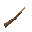
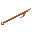
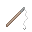
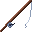
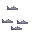
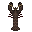
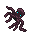

# Guide to Fishing

Feeding a large population could be challenging, especially when there is a lack of arable land, wild game is nearing extinction and ancestors ate all the poultry and livestock long ago. Despair not, though, for there remains a sizeable source of food to tap - seas and rivers, whose unsuspecting inhabitants are in for a big surprise.

Remember to check the **[Guide to Cooking](Guide_to_Cooking.md)** once you come home loaded with seafood.

## Fishing

Fish live in the water itself. Any river, lake or sea can be fished; there is no special tile to look for.

* Equip yourself with one of the fishing tools.
* Stand next to water: on the bank, in the shallows, on a bridge or pier, or on a boat.
* Click the water with the tool and wait. A cast takes about 15 seconds with a pole or net and 12 with a modern rod. Bites are not guaranteed.
* A sharpened stick, harpoon or flint spear only works in shallow water. A line reaches deep water too, as long as you have a deck, bridge or pier under you.

Alternately, you can build a **fishing cage** in water for a more passive approach.

### Reading the water

Look at water within a couple of tiles and you can tell how well stocked it is:

* **Alive with fish** - a full stretch, the best odds.
* **Fish move below the surface** - still worth fishing.
* **A few shapes move below** - fished hard; bites are getting rare.
* **Nothing stirs** - fished out. Move along.

Each stretch of water, about 16 by 16 tiles, shares one stock of fish. The more of it you take, the harder the rest are to catch, and fish come back on their own over time. A stretch left half full recovers fastest, about a fish every four minutes. A stretch fished to nothing recovers very slowly, and only while the water next to it still has fish. Fish a little from several stretches rather than emptying one.

Different water holds different amounts. The coast is the richest water, then deep rivers and lakes, then shallow rivers and the open ocean. Swamps hold very little, and frozen water cannot be fished.

### What bites where

* **Rivers and lakes:** salmon and ordinary fish.
* **The coast:** ordinary fish and some cod.
* **The open ocean:** mostly cod. A baited line sometimes brings up a squid.
* **Swamps:** ordinary fish.

### Bait

Use raw meat or raw fish on your pole, net or rod to bait it. One piece lasts three casts, used up whether or not anything bites, and makes bites much more likely on any water.

### Fishing from a boat

Stand on a boat on the water (a ship or small boat, moored or under way) and cast into the open water beside it, not onto the hull. The open ocean is wide and bites come less often there than on the coast, so bait helps. See [Boats & Ships](Guide_to_Boats.md) for building a boat.

A **fish weir** set in a river catches a few fish on its own while you are away. See [Trapping](Guide_to_Trapping.md#fish-weirs).

## Fish pens

A **fish pen** lets you farm fish instead of only catching wild ones. It costs farm output, but it never runs dry.

* Build it from 10 wood with tools, next to the fishing cage in crafting (Basic Tools research).
* Push it onto fresh water: a lake, river or pond, or a flooded trench or irrigation channel. Salt water and ice do not work.
* Stock it by using a raw fish you caught on it. The first fish decides which kind of fish the pen gives. Salted fish cannot stock it, and it holds up to 8 fish.
* Feed it grain (wheat, oat, barley, rice), seeds or raw meat. Grain is worth 2 feed, meat 3 and each seed 1, and the pen holds up to 20 feed.
* Every 5 minutes the fish eat one feed for every two fish. When they are fed and there are at least two, one more fish is born. Outdoors in winter they eat but do not breed.
* Fish starve: after three hungry cycles in a row the pen loses a fish. A pen moved out of fresh water loses a fish every cycle.
* To harvest, use any fishing tool on the pen. Leave at least two fish so it keeps breeding.

A full, fed pen gives about one fish every 5 minutes for two grain. Examine the pen to see its fish and feed.

## Equipment

Ways of parting fish and the like with their element.

<table>
<tbody>
<tr>
<td width="5%"></td>
<td><b>Sharpened stick</b></td>
<td>The least effective way to catch fish, and only in shallow water. See <b><a href="Guide_to_Crafting.md#tools">here</a></b> to learn the art of making a sharpened stick.</td>
</tr>
<tr>
<td></td>
<td><b>Harpoon or flint spear</b></td>
<td>Stand by shallow water and use a harpoon (a bone harpoon is made from 4 bone) or a flint spear on it to spear a fish. Each strike takes about 10 seconds and lands a fish about a third of the time in well-stocked water, which is better than a sharpened stick. Deep water cannot be speared.</td>
</tr>
<tr>
<td></td>
<td><b>Fishing pole</b></td>
<td>Made with 3 wood. You have a better chance of catching something with this than with a stick.</td>
</tr>
<tr>
<td></td>
<td><b>Fishing net</b></td>
<td>Made with 4 rope. About as good as the pole.</td>
</tr>
<tr>
<td></td>
<td><b>Fishing rod</b></td>
<td>Made with 5 iron. A modern fishing contraption. Only blast fishing would be better than this.</td>
</tr>
<tr>
<td></td>
<td><b>Fishing cage</b></td>
<td>Made with 12 wood. Placed in water tiles (except swamp water) to lure in a clueless organism, who may not fall for it. The catch depends on the location. Placing a cage in <b>deep saltwater</b> may yield <b>octopuses, lobsters and cod</b>. Placing it in <b>shallow water</b> may yield generic <b>fish</b> or <b>salmon</b>. <b>Wait at least 30 minutes before checking a cage.</b> A floating buoy will signal if there is something in the cage.</td>
</tr>
</tbody>
</table>

## Inhabitants

All those aquatic edibles.

<table>
<tbody>
<tr>
<td width="5%"></td>
<td><b>Fish</b></td>
<td>Just some generic fish confirmed to be edible.</td>
</tr>
<tr>
<td></td>
<td><b>Salmon</b></td>
<td>A kind of fish found in rivers and lakes.</td>
</tr>
<tr>
<td></td>
<td><b>Cod</b></td>
<td>A large fish of the sea, most common in the open ocean. Can be <b><a href="Guide_to_Cooking.md#basic">salted</a></b> to preserve.</td>
</tr>
<tr>
<td></td>
<td><b>Lobster</b></td>
<td>Caught with the fishing cage. Boiled lobster goes good with beer.</td>
</tr>
<tr>
<td></td>
<td><b>Octopus</b></td>
<td>Caught with the fishing cage. This seafood delicacy is a part of countless dishes around the world.</td>
</tr>
</tbody>
</table>
