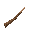
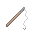
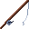
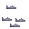
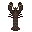
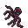

# Guide to Fishing

Feeding a large population could be challenging, especially when there is a lack of arable land, wild game is nearing extinction and ancestors ate all the poultry and livestock long ago. Despair not, though, for there remains a sizeable source of food to tap - seas and rivers, whose unsuspecting inhabitants are in for a big surprise.

Remember to check the **[Guide to Cooking](Guide_to_Cooking.md)** once you come home loaded with seafood.

## Fishing

* Equip yourself with one of the fishing tools.
* Head to a waterbody.
* Locate a tile teeming with fish.
* Click the tile with the fishing tool... again... and again.

Alternately, you can build a **fishing cage** in water for a more passive approach.

If you have fished out a tile completely and there is no more fish, come back later - clueless creatures should appear at the same spot.

### Fishing from a boat

You can also fish the open sea from a boat, without looking for a fish-filled tile.

* Stand on a boat on the water (a ship or small boat, moored or under way).
* Click open, deep saltwater next to the boat with a fishing pole, rod or net.
* A cast takes about 15 seconds (12 with a modern rod). Bites are not guaranteed; a rod bites more often than a pole.
* You usually catch cod or ordinary raw fish.

**Bait:** use raw meat, offal or raw fish on your pole to bait it. One piece lasts three casts, used up whether or not anything bites, and makes bites much more likely. Baited lines sometimes bring up a squid.

Each stretch of sea (about 8 by 8 tiles) only holds three fish. A fish comes back every ten minutes, so keep the boat moving. See [Boats & Ships](Guide_to_Boats.md) for building a boat.

## Fish pens

A **fish pen** lets you farm fish instead of only catching wild ones. It costs farm output, but it never runs dry.

* Build it from 10 wood with tools, next to the fishing cage in crafting (Basic Tools research).
* Push it onto fresh water: a lake, river or pond, or a flooded trench or irrigation channel. Salt water and ice do not work.
* Stock it by using a raw fish you caught on it. The first fish decides which kind of fish the pen gives. Salted fish cannot stock it, and it holds up to 8 fish.
* Feed it grain (wheat, oat, barley, rice), seeds or raw meat. Grain is worth 2 feed, meat 3 and each seed 1, and the pen holds up to 20 feed.
* Every 5 minutes the fish eat one feed for every two fish. When they are fed and there are at least two, one more fish is born. Outdoors in winter they eat but do not breed.
* Fish starve: after three hungry cycles in a row the pen loses a fish. A pen moved out of fresh water loses a fish every cycle.
* To harvest, use any fishing tool on the pen. Leave at least two fish so it keeps breeding.

A full, fed pen gives about one fish every 5 minutes for two grain. Examine the pen to see its fish and feed.

## Equipment

Ways of parting fish and the like with their element.

<table>
<tbody>
<tr>
<td width="5%"></td>
<td><b>Sharpened stick</b></td>
<td>The least effective way to catch fish. See <b><a href="Guide_to_Crafting.md#tools">here</a></b> to learn the art of making a sharpened stick.</td>
</tr>
<tr>
<td></td>
<td><b>Fishing pole</b></td>
<td>Made with 3 wood. You have a better chance of catching something with this than with a stick.</td>
</tr>
<tr>
<td></td>
<td><b>Fishing net</b></td>
<td>Made with 4 rope. About as good as the pole.</td>
</tr>
<tr>
<td></td>
<td><b>Fishing rod</b></td>
<td>Made with 5 iron. A modern fishing contraption. Only blast fishing would be better than this.</td>
</tr>
<tr>
<td></td>
<td><b>Fishing cage</b></td>
<td>Made with 12 wood. Placed in water tiles (except swamp water) to lure in a clueless organism, who may not fall for it. The catch depends on the location. Placing a cage in <b>deep saltwater</b> may yield <b>octopuses, lobsters and cod</b>. Placing it in <b>shallow water</b> may yield generic <b>fish</b> or <b>salmon</b>. <b>Wait at least 30 minutes before checking a cage.</b> A floating buoy will signal if there is something in the cage.</td>
</tr>
</tbody>
</table>

## Inhabitants

All those aquatic edibles.

<table>
<tbody>
<tr>
<td width="5%"></td>
<td><b>Fish</b></td>
<td>Just some generic fish confirmed to be edible.</td>
</tr>
<tr>
<td></td>
<td><b>Salmon</b></td>
<td>A kind of fish usually found in jungle waters.</td>
</tr>
<tr>
<td></td>
<td><b>Cod</b></td>
<td>A large fish found in deep saltwater, usually in colder regions. Can be <b><a href="Guide_to_Cooking.md#basic">salted</a></b> to preserve.</td>
</tr>
<tr>
<td></td>
<td><b>Lobster</b></td>
<td>Caught with the fishing cage. Boiled lobster goes good with beer.</td>
</tr>
<tr>
<td></td>
<td><b>Octopus</b></td>
<td>Caught with the fishing cage. This seafood delicacy is a part of countless dishes around the world.</td>
</tr>
</tbody>
</table>
