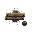
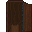

# Guide to Hygiene

Clean water, a place to wash and somewhere private to use the toilet help keep your character and settlement clean. Your neighbours will appreciate the effort, even if they never thank the plumber.

Crafting options depend on the map, epoch, skills and research mode.

You can wash with a bucket of clean water (pots and barrels also work), a shower or a bath. [Soap](../Miscellaneous_Crafting.md#lard-soap) improves washing.

## Getting dirty

You get dirty slowly just by living, faster in hot weather, and mostly from work. Farming and mining dirty you a little, butchering more, and using the toilet more still. A miner or butcher will want a wash at the end of the day.

## Dirty hands

Butchering, using the toilet and picking up dung leave your hands dirty. Gloves keep them clean. Examine yourself to check.

The first bite of each meal with dirty hands can give you food poisoning, and hands that touched waste can give you cholera or worms. Wash your hands first: use a sink or tap, click any fresh water with an empty hand on **Help intent**, or target a hand and click yourself with a bucket of clean water. Any wash at a bath or shower cleans your hands too.

## Washing one part of the body

The body part you target says what you mean to do. On **Help intent**, target any part and:

- click yourself, or someone next to you, with a bucket, pot or cup of clean water. Each wash uses a little water; or
- click a sink, tap, fountain, wash basin or fresh water to wash that part of yourself.

Washing a hand cleans it. Washing any other part cleans the blood off the clothes over it, or makes you a little cleaner where the skin is bare. Rinsing a wound with clean water washes out some of its germs, which lowers the chance it becomes infected. Hold soap in your other hand to disinfect the wound fully and get cleaner. Once a wound is already infected, washing will not cure it; you need medicine.

To drink from a cup, canteen or bucket, or to give someone else a drink, target the **mouth**.

## Bathing in rivers and lakes

Undress, stand in fresh water and use **Bathe** (IC tab). After fifteen seconds you are clean: running river water gets you properly clean, still water a little less. Soap makes it a full wash. Bathing in foul water, like a swamp or a river with scum on it, can make you ill.

Getting properly clean gives you a small mood lift for being freshly bathed.

## Bucket and the like

1. Fill a bucket with at least 30 units of clean water. Use well water, or boil water collected from a puddle or river in a pot.
2. Remove your clothing before washing. Find a private spot first.
3. Target your chest on Harm intent and click yourself with the bucket.
4. A bucket wash gets you only part of the way clean. For a full wash, bathe in a river, use a bath or shower, or use soap.

## Shower

 

To craft a shower, hold 10 glass and press **Z**, then select the shower option. **It is built behind you**, so face away from the wall where you want it placed.

Remove your clothing, turn the shower on and stand underneath it. Stay for several seconds until the dirt cloud disappears and the shower becomes steamy.

## Baths

Bath materials depend on the epoch. Search for "bath" in the [Full Crafting List](../Full_Crafting_List.md). Public baths are larger versions of regular baths.

1. Remove your clothing.
2. Click the bath to fill it with water.
3. Step inside and stay for a few seconds. Buckling is optional.

Every bath and shower gets you equally clean. On the persistent world a bath or shower needs water: pour it in with a bucket, or build it beside running water (a river with a current, an aqueduct channel, a fountain, a tap or a sink) and it fills itself. Each run takes a tubful, 100 units, or 80 for bronze and steel baths, so better baths use less water.

## Soap

 

Soap improves washing and lets you wash on any water tile. You can also use it in a filled bath or under a running shower. Remove your clothing, stand in the water and click yourself with the soap. A bar has up to 30 uses, and washing with soap gives a mood boost.

To make soap, mix 20 units of corn oil with 2 units of lye in a container. Using 20 olive oil instead makes deluxe soap.

## Using the washroom

Use a pit latrine, wooden outhouse or glass toilet. Keep the area private and clean up afterwards. Open the toilet lid before using it.

**Digging a latrine:**

 

1. Hold a shovel, press **Z** and choose **Pit Latrine**.
2. Stand over it and use the **pee** or **poop** emote. Use the Emote tab, or type `*pee` or `*poop` in chat.
3. Use an enclosed, private space.

Fill a pit latrine with four dirt piles to remove it.

**Building an outhouse:**

 

Hold at least 35 wood, press **Z**, then choose an outhouse in the **Hygiene** category. The three options differ in appearance. Use a hammer to deconstruct it.

**Crafting a toilet:**

 

Hold glass, press **Z** and choose **Toilet**.

A glass (porcelain) toilet is plumbed: waste in it or on it does not contaminate nearby wells or puddles. Pit latrines and outhouses still do, so keep them away from water.

## Shaving

Cast a razor using a [knife mold](Guide_to_Metallurgy.md#molds), then click yourself with it on **Help intent**. Yesterday's dinner is better kept on a plate than in your beard.

Hair and beards grow back slowly while you play: a shaved face grows a short beard after about three hours, then grows to medium, long and very long about every three hours after that. Head hair grows one length about every four hours. The razor only offers styles your hair is long enough for, so a shaved face has to grow out before you can trim it into a beard.

## Washing clothes

Dirty clothing and footwear can carry parasites and disease. Examine an item with **Shift+Click** to check its dirtiness. Hold it and click a water tile, well or puddle to wash it.

Washing with soap or laundry detergent also keeps clothes clean for longer. For a while after the wash, worn clothing gets dirty much more slowly. Examine the item to see whether this still applies.

- **By hand:** hold the soap or detergent in your other hand while you wash the clothing at a sink, well, puddle or water tile. Each wash uses 2 of a soap bar's 30 uses.
- **Washing machine:** click the machine with soap or detergent to load one dose. Its next finished wash treats every item inside. Examine the machine to see whether a dose is loaded.

| Cleaner | Dirt prevented | Lasts (worn time) |
| --- | --- | --- |
| Lard soap | 35% | About an hour |
| Soap or deluxe soap | 50% | About an hour |
| Laundry detergent | 75% | About two hours |

Laundry detergent is an industrial product. Mix 10 units of petroleum, 5 units of sulfuric acid and 5 units of lye in a container to make a box. A box is good for 20 washes.

## Keeping the place clean

Waste and sanitation structures such as outhouses within four tiles of a well can contaminate its water. Keep them away from drinking-water supplies. Examining a well that has been fouled by waste gives off a foul smell; a well that does not smell is not guaranteed to be safe.

Food scraps and animal remains can be thrown into a **lit stone brazier**, where they burn as a little fuel.
