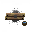
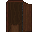

# Guide to Hygiene

Clean water, a place to wash and somewhere private to use the toilet help keep your character and settlement clean. Your neighbours will appreciate the effort, even if they never thank the plumber.

Crafting options depend on the map, epoch, skills and research mode.

You can wash with a bucket of clean water (pots and barrels also work), a shower or a bath. [Soap](../Miscellaneous_Crafting.md#lard-soap) improves washing.

## Bucket and the like

1. Fill a bucket with at least 30 units of clean water. Use well water, or boil water collected from a puddle or river in a pot.
2. Remove your clothing before washing. Find a private spot first.
3. Target your chest on Harm intent and click yourself with the bucket.
4. Repeat as needed. Several washes, usually three, help remove the visible cloud of dirt and improve hygiene.

## Shower

 

To craft a shower, hold 10 glass and press **Z**, then select the shower option. **It is built behind you**, so face away from the wall where you want it placed.

Remove your clothing, turn the shower on and stand underneath it. Stay for several seconds until the dirt cloud disappears and the shower becomes steamy.

## Baths

Bath materials depend on the epoch. Search for "bath" in the [Full Crafting List](../Full_Crafting_List.md). Public baths are larger versions of regular baths.

1. Remove your clothing.
2. Click the bath to fill it with water.
3. Step inside and stay for a few seconds. Buckling is optional.

Baths made from more advanced materials clean more effectively. In increasing order: wood, stone, copper, bronze and steel.

## Soap

 

Soap improves washing and lets you wash on any water tile. You can also use it in a filled bath or under a running shower. Remove your clothing, stand in the water and click yourself with the soap. A bar has up to 30 uses, and washing with soap gives a mood boost.

## Using the washroom

Use a pit latrine, wooden outhouse or glass toilet. Keep the area private and clean up afterwards. Open the toilet lid before using it.

**Digging a latrine:**

 

1. Hold a shovel, press **Z** and choose **Pit Latrine**.
2. Stand over it and use the **pee** or **poop** emote. Use the Emote tab, or type `*pee` or `*poop` in chat.
3. Use an enclosed, private space.

Fill a pit latrine with four dirt piles to remove it.

**Building an outhouse:**

 

Hold at least 35 wood, press **Z**, then choose an outhouse in the **Hygiene** category. The three options differ in appearance. Use a hammer to deconstruct it.

**Crafting a toilet:**

 

Hold glass, press **Z** and choose **Toilet**.

## Shaving

Cast a razor using a [knife mold](Guide_to_Metallurgy.md#molds), then click yourself with it on **Help intent**. Yesterday's dinner is better kept on a plate than in your beard.

## Washing clothes

Dirty clothing and footwear can carry parasites and disease. Examine an item with **Shift+Click** to check its dirtiness. Hold it and click a water tile, well or puddle to wash it.

## Keeping the place clean

Waste and sanitation structures such as outhouses within four tiles of a well can contaminate its water. Keep them away from drinking-water supplies.
