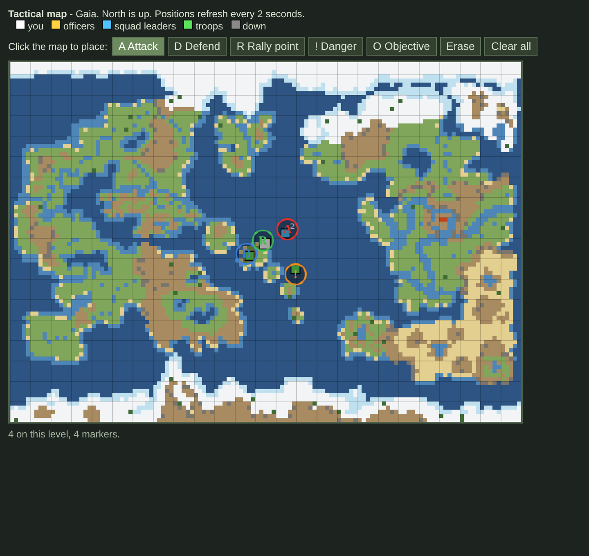

# Leading a Squad

In [Team Combat](../gamemodes/Team_Combat.md) rounds, many factions are split into numbered squads, each with a squad leader, and some roles are officers, commanders or radio operators. This page explains the tools those roles get and how to use them. If you are a regular soldier, the first section is all you need.

Leadership commands appear in extra tabs at the top-right of your screen: **Officer** for officers, squad leaders and commanders, and **Scout** for scouts. You can also type a command's name into the command bar.

## Squads

When you join a faction that uses squads, the game tells you **"You have been assigned to Squad N!"** and names your squad leader. If no squad leader has joined yet, the first squad leader to join takes the first free squad.

### Squad colours and the tracker

Each squad has a colour: squad 1 is red, 2 yellow, 3 purple, 4 blue, 5 orange, 6 green and 7 white. Squadmates you can see have a chevron in your squad's colour under their feet. Examining someone names their squad.

A small arrow around your character points to your squad leader, in your squad colour. Squad leaders and officers get a white arrow to their commander, and so does a soldier whose squad leader is dead. The arrow disappears when you are within two tiles of them or on a different level.

### Fire teams and the roster

Squad leaders can split their squad into **fire teams** 1, 2 and 3, each with one leader. Open **Roster** in the IC tab, then click a team number next to a person to put them in that team, **none** to take them out, or **lead** to make them the team's leader. Teammates you can see show a numbered badge (gold for the leader), and examining someone shows their team. The tracker arrow points fire team members to their fire team leader, and fire team leaders to the squad leader. Squad fire teams last for the round. Officers and commanders can do the same for every squad on their side.

The **Roster** also lists each person's condition (fine, wounded, down or dead), distance and direction. A soldier in a fire team sees their own team in it.

### Spotting enemies and rally points

Right-click a tile, a person or an object you can see and choose **Spot Enemy** to warn your fire team, squad and faction. They get a chat message with the distance and direction from them, and they see a flashing red marker there for 30 seconds. You can spot once every 5 seconds.

Squad leaders, fire team leaders and faction leaders can choose **Rally Point** in the IC tab to plant a green rally point where they stand. For ten minutes their people see the marker, and their tracker arrow turns green and points to it instead of to their leader. Use **Rally Point** again to move it or choose **Clear** to remove it. If you lead more than one group, you pick which one the rally point is for.

| Command | Who gets it | What it does |
| --- | --- | --- |
| **Find Squad Leader** | Everyone in a squad | Tells you how many meters away your squad leader is, and in which direction. |
| **Squad Announcement** | Squad leaders | Sends a message to every member of your squad. One announcement per minute. |
| **Faction Announcement** | Officers and commanders | Sends a message to everyone on your side. |
| **Tactical Map** | Officers, commanders and squad leaders | Opens a live map of your side's positions and your officers' markers. See [Tactical map](#tactical-map). |

On maps set in the twentieth century before the modern era, officers and squad leaders also spawn with a backpack radio. See [Communications](Guide_to_Communications.md) for using radios.

## Leading as a squad leader

1. **Announce a plan early.** One short Squad Announcement before the grace period ends ("Squad 2, follow me to the north trench") keeps people together.
2. **Keep the squad together.** Your soldiers can find you with Find Squad Leader, so move with purpose and avoid running off alone.
3. **Assign jobs.** Name who carries ammunition, who covers the flanks and who helps casualties.
4. **Update the plan.** When the situation changes, announce it. Announcements are limited to one a minute, so make each one count.
5. **Hand over if you must.** If you are badly wounded, tell your squad who is in charge until you return.

## Giving orders

Squad leaders, officers and commanders can call an order to the allies around them with **Issue Order** in the **IC** tab. In Civilizations and Nomads, a faction leader can do the same. Pick one of three orders:

| Order | Effect on allies within 7 tiles |
| --- | --- |
| **Move** | They run faster. |
| **Hold** | They feel less pain from their wounds. |
| **Focus** | Their aim is steadier, so shots spread less. |

The order lasts 20 seconds from a squad leader and longer from officers and commanders. You shout the order, a short word floats over your head, and everyone who receives it gets a message. After giving an order you must wait one minute before the next.

Carry a **whistle** to make orders stronger: they reach 10 tiles instead of 7, last longer and blow the whistle, but you must wait 90 seconds before the next one. Orders from several leaders do not stack; your allies keep the strongest one. Giving an order within 2 tiles of a flag (a flagpole with a flag on it) also makes it stronger and lets it reach 2 more tiles.

## Tactical map

Officers, commanders and squad leaders have **Tactical Map** in the **Officer** tab. It opens a map of the level you are standing on, with north at the top, and keeps it up to date every 2 seconds while the window is open.

- **Squares** show the living members of your own side on that level: white is you, gold are officers and commanders, blue are squad leaders (with their squad number), green are other soldiers and grey are soldiers who are down. The other side never appears.
- **Circles** are markers your officers have placed: **A** Attack, **D** Defend, **R** Rally point, **!** Danger and **O** Objective.
- The faint grid lines are 20 tiles apart, which helps when you pass coordinates by radio.

Officers and commanders can draw on the map. Pick a marker from the buttons above the map, then click where it goes. **Erase** removes the marker nearest your click (within a few tiles), and **Clear all** removes every marker. Your side keeps up to 24 markers on each level; placing another removes the oldest. Other officers and squad leaders on that level are told in chat when a marker is placed or the map is cleared, and anyone with the map open sees the change at once. Squad leaders can read the map but not draw on it.

The map closes if you are knocked out or die. If you change level, it switches to the new level.

## Radio codes

In team rounds, squad leaders, officers, commanders and radio operators spawn with their side's **codebook**. It lists ten call-and-response pairs that last for the whole round. To check that a voice on the radio is a friend, say a call and wait for its matching response. Keep the codes off open channels.

## Officers, scouts and coordinates

Officers use **Check Coordinates** and **Reset Coordinates** from the **Officer** tab. Scouts have the same commands in the **Scout** tab. Both can report positions for artillery and air support.

1. Stand at a known location and use **Check Coordinates**. This starts tracking from where you stand.
2. While tracking, click a distant tile to learn its coordinates and offset from you. Each tile you check is reported to your side.
3. Use **Check Coordinates** again to finish at your current position, which also reports it.
4. Use **Reset Coordinates** to stop tracking.

Every reported position lets your side request support within **15 tiles** of it. These commands only work once the teams are allowed to cross the starting barriers.

### Rangefinder

Anyone can use a **rangefinder** (2 electronics, Tools menu, after Consumer Electronics). Look through it like binoculars and click a spot. After a moment it gives the exact range, bearing, coordinates and offset. Once coordinates are allowed in the round, each spot you range also counts as a reported position for support requests.

## Cell timers

Officers and commanders can lock up prisoners. Right-click a closed door and choose **Cell Timer** to hold it shut for 1 to 30 minutes. Nobody can open it until the time is served, then it opens by itself and everyone nearby hears it click. Examining the door shows the time left, and the time carries over when the server restarts. Use **Cell Timer** again to release the prisoner early. The door can still be broken down.

## Medals

Commanders and officers can use **Award Medal** in the **Officer** tab during team rounds. Stand next to a living soldier of your side, choose a bronze, silver or gold medal, and write a citation of up to 140 letters. The medal goes into the soldier's hands. Each officer can award three medals a round, and the citations are read out at the end of the round.

## Radio operators and air support

On maps that include artillery or air support, radio operators get **Order Airstrike**:

- You need a working radio within one tile of you, either carried or a radio set.
- The target must be within 15 tiles of a position an officer or scout has reported. Otherwise the request is refused.
- Requests are refused if any of your living teammates are within 7 tiles of the target.
- Each map has a limited number of strikes and a cooldown between them. The game tells you how many minutes remain.

Choose the strike type when prompted, then enter the X and Y coordinates. The strike arrives after a short delay, so warn your teammates.

## Laser designators and jets

On Syria, every Delta Force operator carries a **laser designator** in their webbing. Some roles on the MilSim maps carry one too.

1. Hold the designator and use it in hand to choose the **attack direction** and the **payload**.
2. With a radio on you, click the target while holding the designator, then stay still while you call it in. Designators work only once the grace wall is down.
3. The jet comes in along the attack direction and passes over the target as it fires. On modern maps you will see an F-16 or Su-25 and its shadow sweep across the map, and rockets streak in on smoke trails.

Each side has a limited number of strikes. When you run out, the next call sends the jet away to re-arm for five minutes. Enemy SAM sites within 60 tiles may shoot the jet down, which also grounds it for five minutes.

## Artillery pieces

Field guns and artillery pieces are operated directly, not ordered by radio. See [How to use artillery](Guide_to_Weapons.md#how-to-use-artillery).
