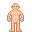
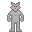
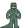
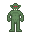
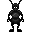
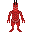
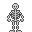

# Guide to Species

This guide introduces playable species and their traits. Available choices depend on the mode. All species must follow the server rules.

<table class="table">

<tr>
<th width="200" tabindex="0" style="color:black;background-color:#cc7000;" scope="col">Species</th>
<th style="color:black;background-color:#cc7000;" scope="col">Description</th>
</tr>

<tr>
<th>Humans</th>

<td>Humans vary in physique and behaviour and support a wide range of character backgrounds.</td>

</tr>

<tr>
<th>Wolfmen</th>

<td>A cross between a man and a wolf, their fur protects them from the cold and they can howl to communicate up to 15 turfs away. (Raw meat can be consumed but they'll get sick from rotten meat).</td>

</tr>

<tr>
<th>Lizardfolk</th>

<td>A stone age race of large reptiles, Alligators will not attack them and they're highly resistant to heat and have a strong bite.</td>

</tr>

<tr><th>Orcs</th>

<td>Green-skinned humanoids with a broad diet and strong radiation resistance. See the Tribes guide for their gameplay traits.</td>

</tr>

<tr>
<th>Antmen</th>

<td>Giant Humanoid Ants that are said to be descendants of the Titanomyrma, they have been said to originate from below the soil after a natural disaster devastated their massive underground dwelling they are now nomads to travel the land above. They can dig with their hands and have limited construction.</td>

</tr>

<tr>
<th>Crabs</th>

<td>Crustaceans, an advanced race that can drink saltwater, they have a strong shell and sharp claws perfect for unarmed combat.</td>

</tr>

<tr>
<th>
Skeletons</th>

<td>"Spooky scary skeletons."</td>
</tr>

</table>
