# Guide to Ranching

## Harvesting dead animals

Use a **held sharp tool** on an adjacent dead animal. **Harm intent** performs quick butchering in **30 ticks** (normally three seconds); **Grab intent** skins and butchers in **100 ticks** (normally ten seconds). Moving, changing your active hand, becoming incapacitated, disconnecting or losing the corpse/tool cancels. Only one harvesting action can claim a corpse at a time. Successful harvesting removes the corpse.

Both routes give the same meat and food byproducts. Grab selects species pelts; quick Harm butchering gives leather for supported mammals. Normal meat yield follows size: minuscule **1**, tiny **2**, small **3**, medium **4**, large **5**, huge **8** separate portions. Existing pig-leg, chicken-carcass, poisonous-frog, crab, zombie and mouse outputs remain distinct.

The mammal products below apply to cattle, pigs/boars, goats, sheep, deer, bison, camels, rabbits, monkeys, cats, bears, wolves, foxes, gorillas, panthers, sabertooths, horses, dogs, mammoths and bats, including their subtypes. Let **Y** be the size yield above.

| Product | Yield |
| --- | --- |
| Heart, liver, kidneys, lungs, brain, intestines | One of each when Y is at least 3; smaller mammals give one mixed giblets portion instead |
| Stomach | Cow/pig/goat/sheep processing stomach; other mammals with Y at least 3 give one food stomach |
| Sinew | One stack of Y minus 2, minimum 1 and maximum 4; only when Y is at least 3 |
| Bone | One stack of Y minus 2, minimum 1 |
| Quick-butchering leather | One stack of Y minus 2, minimum 1 |
| Fat | Up to two portions when the animal's fat rules allow it |

Chicken and rooster also give one giblets portion. Other nonmammals do not gain mammal offal, sinew or generic bone/leather; existing reptile pelts remain available. Pelts depend on species: lions give 3, gladiator lions give none, and non-white sabertooths give 6. White wolves and giant gorillas retain their special pelts.

**Offal is raw, decaying food**, not a surgical transplant organ. Each portion starts with 2 protein and accepts existing meat processing. Cow, pig, goat and sheep stomachs retain their sausage/rennet uses. See [Cooking](Guide_to_Cooking.md) for preparation and preservation.

## Sinew and primitive tools

Activate sinew in hand to consume **1 sinew** and make **1 rope** named **sinew binding cord**. It works in existing rope recipes, including nets, leashes and bindings, with their existing recipe costs and era gates. Sinew stacks hold at most **20**.

Sharpen a branch with an edged tool; this takes **80 ticks** and produces a sharpened stick. Gather flint from rocks with Grab intent, then strike a rock with it until sharpened.

To assemble a flint axe, use a held **sharpened flint** on a **sharpened stick** held by you or on your tile. Keep **1 sinew or rope** in your inventory or on that same tile. The **100-tick** action consumes the stick, head and one binding for one axe; cancellation leaves inputs unspent. Other stone and bone stack recipes remain available.

## Livestock

Well, from the very start of the Neolithic age, Humanity has started
domesticating animals.

<table class="sortable">
<thead>
<tr class="header">
<th>Animal</th>
<th>Image</th>
<th>Description</th>
</tr>
</thead>
<tbody>
<tr>
<td>Chicken</td>
<td>
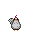
</td>
<td>A bird great for laying eggs.</td>
</tr>
<tr>
<td>Pig</td>
<td>
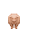
</td>
<td>Good for manure and meat.</td>
</tr>
<tr>
<td>Sheep</td>
<td>
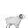
</td>
<td>These animals are quite valuable as they can be sheared to drop wool.</td>
</tr>
<tr>
<td>Cow</td>
<td>
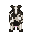
</td>
<td>Highly valuable as they give milk, which doesn't need to be purified or pasteurized at all. They can also breed in a 5x5 cage.</td>
</tr>
<tr>
<td>Horse</td>
<td>
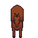
</td>
<td>Extremely valuable. You can ride these animals or kill them (discouraged as these are rare)</td>
</tr>
<tr>
<td>Camel</td>
<td>
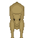
</td>
<td>Just like horses but you can't ride them, Put a bag on their back to carry equipment</td>
</tr>
<tr>
<td>Goat</td>
<td>
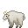
</td>
<td>Much like the cow, goats can be milked if female.</td>
</tr>
<tr>
<td>Turkey</td>
<td>
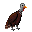
</td>
<td>A bird great for laying eggs!</td>
</tr>
</tbody>
</table>

## Reproduction

To simply get these animals to multiply, you have to have them in a
fairly small area and cramp them. For cows you need a bull and a cow
cramped in a fairly small area and they'll eventually get to it.
Chickens just need at least 2 and one needs to lay an egg and be sitting
on top of it for awhile. Try customizing your chicken coops making it so
they are unable to move off their egg.**(Only the cows, chickens, Deers,
Pigs, Sheep, Goats and turkey's can breed for now)**

## Wildlife

<table class="sortable">
<thead>
<tr class="header">
<th>Animal</th>
<th>Image</th>
<th>Description</th>
</tr>
</thead>
<tbody>
<tr>
<td>Crab</td>
<td>

</td>
<td>Crabby snappy, watch out for its arms.</td>
</tr>
<tr>
<td>Wolf</td>
<td>
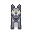
</td>
<td>Seen in temperate and tundra, they go in packs most of the time.</td>
</tr>
<tr>
<td>Goose</td>
<td>
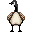
</td>
<td>Geese always mark their territory.</td>
</tr>
<tr>
<td>Panther</td>
<td>

</td>
<td>The assassins of the jungle, hunt with caution.</td>
</tr>
<tr>
<td>Jaguar</td>
<td>
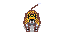
</td>
<td>Fastest hunters in the game.</td>
</tr>
<tr>
<td>Boa</td>
<td>
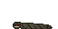
</td>
<td>It can strangle anyone to death.</td>
</tr>
<tr>
<td>Mammoth</td>
<td>
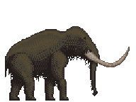
</td>
<td>A colossal behemoth, towering over huts and houses. If one thinks of hunting alone one of these, they'll find themselves stomped, their gibs all over the place.</td>
</tr>
<tr>
<td>Cobra</td>
<td>
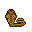
</td>
<td>An aggressive cobra will jump and bite you if you approach it.</td>
</tr>
<tr>
<td>Crow</td>
<td>
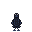
</td>
<td>Flies around towns giving everyone the frights. *caw caw*.</td>
</tr>
<tr>
<td>Buffalo</td>
<td>
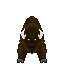
</td>
<td>Hyper-aggressive buffalos, don't try going near them.</td>
</tr>
<tr>
<td>Mouse</td>
<td>
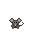
</td>
<td>*Bites you* O-oh I spread you m-my plague, sowwy uwu.</td>
</tr>
<tr>
<td>Penguin</td>
<td>

</td>
<td>Found around the northern hemisphere, mostly at coasts.</td>
</tr>
<tr>
<td>Bear</td>
<td>
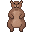
</td>
<td>Bears roam the temperate, run away if you have no weapon.</td>
</tr>
<tr>
<td>Alligator</td>
<td>
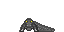
</td>
<td>A fierce beast that roams the swamp. If you have no weapon you should run because you can't kill these with your hand. Faster in the rain.</td>
</tr>
<tr>
<td>Deer</td>
<td>
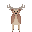
</td>
<td>These animals will run away from you when they see you! Try making them run into a corner to kill them.</td>
</tr>
<tr>
<td>Snake</td>
<td>
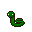
</td>
<td>A slithery serpent that feasts among small mice; Though it is cute, touching it isn't the best idea.</td>
</tr>
<tr>
<td>Frog</td>
<td>
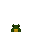
</td>
<td>Drops 1 meat. Watch out though if the frog is poisonous it can kill you! Other than that it just eats flies.</td>
</tr>
<tr>
<td>Poisonous Frog</td>
<td>

</td>
<td>A poisonous creature, it is the cousin of the normal frog, however, eating it will leave the taste of death in your mouth!</td>
</tr>
</tbody>
</table>

## Bugs

<table class="sortable">
<thead>
<tr class="header">
<th>Insect</th>
<th>Image</th>
<th>Description</th>
</tr>
</thead>
<tbody>
<tr>
<td>Flies</td>
<td>

</td>
<td>An annoying pest that will buzz around any food you leave out, so stay clean!</td>
</tr>
<tr>
<td>Mosquitos</td>
<td>

</td>
<td>These fly like creatures give you malaria, stay away from them. If you do get bit by them, don't worry there's Quinine that cures malaria in swamp regions.</td>
</tr>
<tr>
<td>Locusts</td>
<td>

</td>
<td>Ready to eat your crops, ready to molest that corn. Hide your cabbage, hide your wheat, locusts are here to swindle your meat.</td>
</tr>
<tr>
<td>Cockroach</td>
<td>
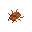
</td>
<td>Penisbeetle for the friends.</td>
</tr>
<tr>
<td>Leech</td>
<td>

</td>
<td>Completely harmless unless they gang up on you, human boy. Can be used in medicine as a method to suck blood out.</td>
</tr>
</tbody>
</table>
