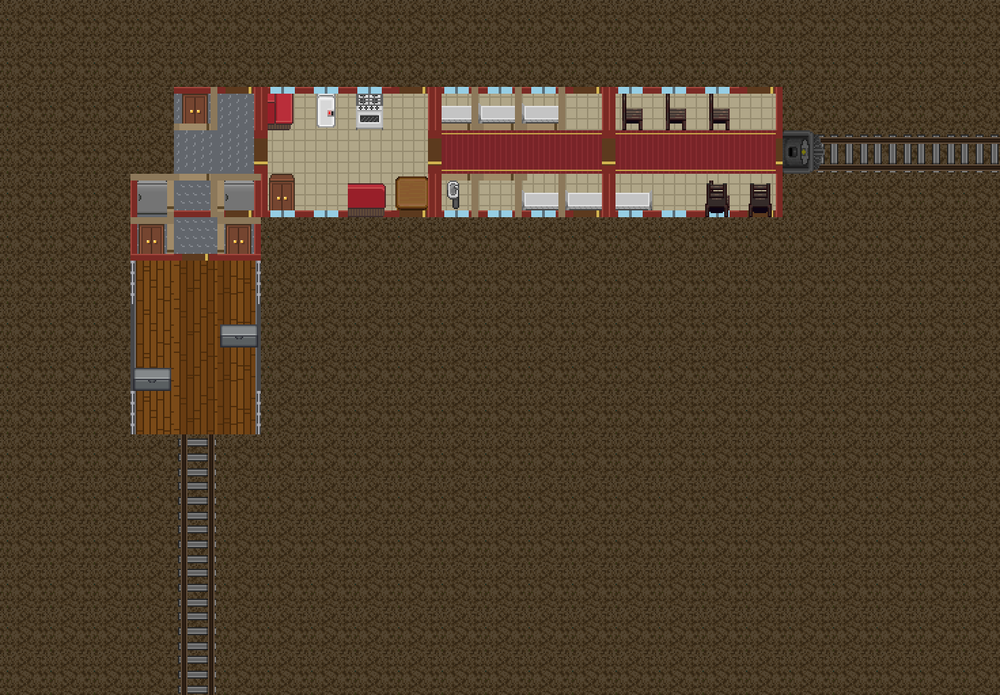
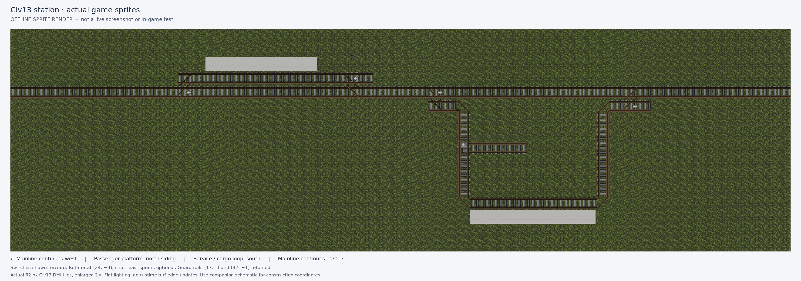
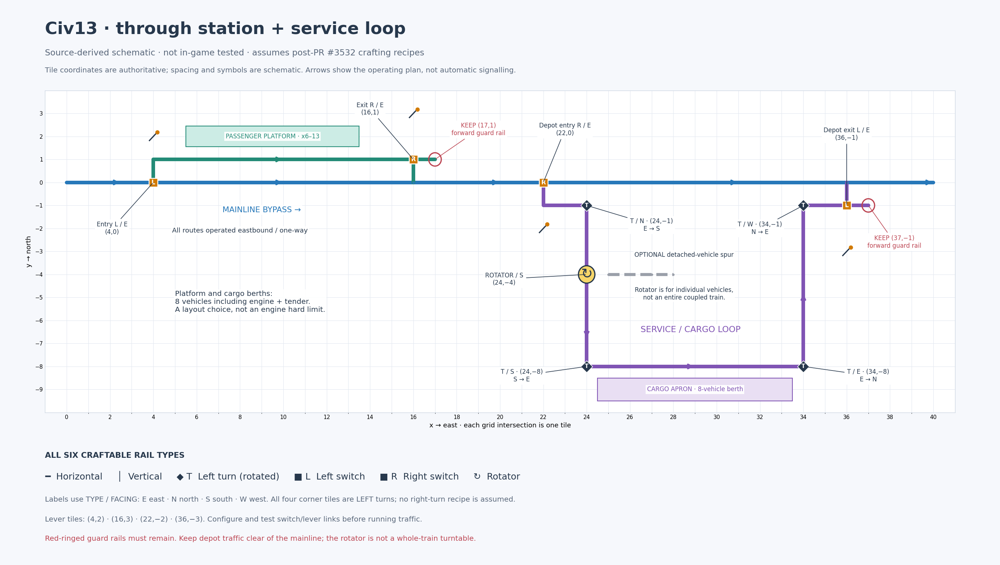

# Trains

Rails and steam trains move people, fuel and cargo along a fixed track. The parts are made from the crafting menu's **trains** section, mostly from iron, once your faction has the research. Track itself is laid by hand, one tile at a time.

## Research

| Mode | Railway sleepers, rails, rail switchers, rotator platform, lever | Steam locomotive, tender, cabin, flatbed and transport wagons |
| --- | --- | --- |
| [Tech tree](Guide_to_Research.md) | **Rail & Steam** node (Vehicles line) | Industrial research **101** |
| [Legacy research](../gamemodes/Civilizations_and_Nomads.md#research) | Industrial research **93** | Industrial research **101** |

The wooden mining cart needs Industrial research **93** in either mode.

Platform car kits (see [Platform cars](#platform-cars)):

| Mode | Platform car, passenger coach | Sleeper, dining and storage cars |
| --- | --- | --- |
| [Tech tree](Guide_to_Research.md) | **Rail & Steam** node | **Assembly Line** node |
| [Legacy research](../gamemodes/Civilizations_and_Nomads.md#research) | Industrial research **101** | Industrial research **140** |

## What you can build

| Piece | Cost | Notes |
| --- | --- | --- |
| Railway sleepers | 1 wood | The wooden ties for one tile of track. |
| Rails | 1 iron | A pair of rails for one tile of track. |
| Rail switcher (to left or right) | 2 iron | A junction that a lever can switch between going straight and turning off. |
| Rail rotator platform | 3 iron | Turns whatever wagon is standing on it. |
| Train lever | 1 iron | Flips every switcher within two tiles. |
| Mining cart | 10 soft wood | Small storage cart (7 slots). |
| Steam locomotive | 18 iron | The engine. Burns coal or wood. |
| Coal tender | 6 iron | Fuel wagon (15 slots) for coal. |
| Cabin wagon | 4 iron | A covered seat for the driver or passengers. |
| Flatbed wagon | 4 iron | Carries people, crates and structures. |
| Transport wagon | 5 iron | A covered storage wagon (8 slots). |

Switchers, rotators, levers and wagons are placed facing the way **you** face, so stand looking along the line before you build them. Plain track shapes itself (see below).

## Laying track

Each tile of track is built in three steps:

1. **Sleepers.** Use the railway sleepers on the tile next to you, or use them in your hand to lay them on the tile in front of you. The ground must be firm, dry and clear.
2. **Rails.** Use the rails on the sleepers.
3. **Spikes.** Hit the rails with a **hammer** to spike them down. Only now is the tile track that trains can run on.

You never choose which way a tile points. It lines up with the track around it:

- A line carries on straight. Keep laying tiles ahead of the last one.
- For a corner, lay the line one tile past where it should turn, then lay the next tile to the side. The end of the line bends into a curve to meet it, even if it was already spiked.
- A tile on its own runs the way you face while laying it.
- Tiles in the middle of a line never change, so a new line can run right alongside an old one. Build the main line first, then sidings and branches beside it.

Use switchers for branches and a lever within two tiles of each switcher you want to control. Put a **rotator platform** at the end of a line or in a yard to turn wagons around. Click it to rotate it a quarter turn, or right-click it for **Rotate Left** and **Rotate Right**.

Keep the track clear. A moving train stops when it hits anything solid, and it smashes what it hits.

### Taking track apart

A **crowbar** takes track apart one step at a time, giving the parts back: first it pulls the spikes (the rails sit loose on their sleepers again), then it lifts the rails off, then it pries up the sleepers. Switchers and rotators come apart in one go and return their iron. Nothing comes apart while a wagon stands on the tile. If a tile turned the wrong way, pry it up and lay it again.

## Bridges over water

Track needs firm ground, so to cross a river, lake or the open sea you first build a bridge and then lay the track on it the same way as on land.

| Span | Cost | Tech tree | Legacy research |
| --- | --- | --- | --- |
| Steel bridge span | 4 steel | **Reinforced Concrete** node | Industrial research **96** |
| Concrete bridge span | 6 clay | **Reinforced Concrete** node | Industrial research **103** |

Each span covers one tile of water, deep sea included:

1. Stand on the shore, in the shallows or at the end of the bridge built so far, facing the water. You can't build while swimming or from a boat.
2. Use the span in your hand to build on the tile in front of you, or use it on the water tile next to you.
3. Keep going tile by tile. The deck doesn't sink or burn, and you can walk, drive and craft on it.

Lay sleepers, rails and spikes on the deck as usual. Track on a bridge joins the rest of the line, so a bridge can carry a line to a station or to the edge of the map. You can also build a road on the deck for cars.

Ships can't pass a bridge. To take a span down again, clear the track, road, vehicles and people off it and hit it with a **hammer**. You get the span back. If a bridge is destroyed by an explosion, any track on that tile falls into the water.

## Fuel

Click the locomotive with fuel to load its combustion chamber, which holds 100 units.

| Fuel | Units per piece |
| --- | --- |
| Coal | 15 |
| Wood | 3 |

If a stack would overfill the chamber, it is refused, so split it into a smaller stack. The locomotive burns **one unit per tile** it moves, and it slows down as the chamber empties. Examine it to see how full it is ("full", "sufficiently fueled", "stable", "emptying", "almost empty"). When the fuel runs out, the engine stalls.

Carry spare coal in a **tender** hitched behind the engine for long routes.

## Building a train

1. Place the locomotive on the rail, facing the way you want to go.
2. Place each wagon on the rail behind it, facing the same way as the engine.
3. Right-click a wagon and choose **Hitch** to couple it to the wagon in front of it. Use **Hitch** again to uncouple it. Hitched wagons follow the one ahead.

## Driving

- **Click the locomotive** to start it and click it again to stop. It drives forward along the track until it is stopped, runs out of fuel, reaches the end of the rail or hits something.
- Set the levers before you leave. A switcher set to split sends the train onto the side track.
- Anyone standing on the track gets hit hard. Look before you start and warn people near the line.

## Carrying passengers and cargo

- **Storage wagons** (mining cart, tender, transport wagon): click to open their storage, or drag items onto them.
- **Flatbed and cabin wagons:** drag a person onto the wagon to bring them aboard, or drag yourself to climb in. Standing on the wagon with someone, you can buckle them in. Drag a loose crate or structure onto a flatbed to secure it for the ride, and right-click the wagon and choose **Unsecure** to release it at the other end.

## Platform cars

Platform cars are full-size railway carriages: **three tiles wide and four tiles long**, with the track down the middle. You can walk around inside them while the train is moving, and everything on the deck rides along with the car: people, furniture, crates and anything you set down. A car bends round curves, and its furniture turns with it.

| Kit | Cost | What you get |
| --- | --- | --- |
| Platform car kit | 12 iron | An open plank deck with railings at each end, for cargo, crates and machines. |
| Passenger coach kit | 16 iron | Six seats either side of a carpeted aisle, windows, side doors and end doors. |
| Sleeper car kit | 20 steel | Three private compartments a side, each with a bed and a sliding door. |
| Dining car kit | 20 steel | A galley with a stove, sink, fridge and counter, and two booths. |
| Storage car kit | 18 steel | Cabinets and large crates, each behind its own compartment door. |

### Putting a car together

1. Carry or drag the kit onto the track. It needs **four tiles of straight track**: the tile under the kit and the three behind it.
2. Leave a **clear tile on both sides** of those four tiles for the deck.
3. Stand facing the way the car should point (towards the locomotive) and hit the kit with a **hammer**.

To couple the car, right-click its front end and choose **Hitch**, the same as an ordinary wagon. The middle of a car can't be unhitched.

### Riding and doors

- Click a door to open or close it. Side doors are at the front end of each enclosed car, and end doors let you walk from one car to the next.
- Walls and windows keep you from walking through them, but they don't stop bullets.
- Track for platform cars needs a clear tile on each side all the way along, including on curves. If a car's deck would hit a wall, a tree or another train, the whole train grinds to a halt before it moves. People standing beside the track aren't hurt. The deck slides under them and they end up on board.

### Taking a car apart

Stop the train, uncouple the car from the cars on both sides and clear everything off its deck, furniture included. Then use a **crowbar** on the car to pack it back into a kit. A kit that was taken apart comes back without furniture, so keep the furniture you removed and put it back aboard.

## Through station and service loop

This example separates an eastbound main line, a passenger platform track and a cargo/service loop. It uses straight track, four corners, two left switchers, two right switchers and a rotator, plus four levers. It is a source-derived layout, **not an in-game-tested station or a guarantee of collision-free operation**.

The platform and cargo stopping positions allow **eight vehicles including the locomotive and tender**. That is a layout choice, not a train-length limit. Extend the straight stopping tracks and clearances for a longer train.

### Layout views

Offline render using actual Civ13 sprites; not a live screenshot or in-game test. Main line continues beyond both station ends; flat lighting and no runtime turf-edge updates. [Open the full-size sprite render](../images/civ13-station-game-sprites.png).

Construction schematic; use the coordinates below when placing track. The arrows indicate a continuing main line, not buffer stops: keep whole-train staging space to the west and exit rail through at least `x=44` to the east. [Open the full-size schematic](../images/civ13-station-plan.png). Sprite assets come from the [Civ13 game source](https://github.com/Civ13/Civ13/tree/ec86e58fa67fdd7baea265d8716a64ae6f9a2d99), under its [game-source license](https://github.com/Civ13/Civ13/blob/ec86e58fa67fdd7baea265d8716a64ae6f9a2d99/LICENSE).

### Coordinates and track plan

Choose a clear area and treat any convenient tile as `(0,0)`. Increasing `x` is east; increasing `y` is north. All ranges below include both endpoints. Lay the main line first, then the passenger track and the depot loop. Facing means the direction to face when building a switcher or the rotator; plain track shapes itself. Use one piece per listed tile; switches and the rotator replace the straight track at their coordinates.

| Section | Tiles and pieces |
| --- | --- |
| Main line | Horizontal rail along `y=0`, except the two entrance switchers below. The drawn `x=0..40` segment is part of a continuing eastbound route, not two buffer stops. Continue west far enough to stage the whole train before the first entrance, and east through **at least `x=44`** for this eight-vehicle layout. Longer trains need longer clear approach and exit tracks. |
| Passenger entrance | **Left switcher, facing east**, at `(4,0)`. Its split route shifts to `(4,1)`. Lever at `(4,2)`. |
| Passenger track | Horizontal rail from `(4,1)` to `(17,1)`, except the exit switcher. |
| Passenger platform | Build alongside the track from `(6,2)` to `(13,2)`; stop the eight-vehicle train beside it on `x=6..13, y=1`. Keep both approaches clear. |
| Passenger exit | **Right switcher, facing east**, at `(16,1)`. Its split route shifts to `(16,0)`. Lever at `(16,3)`. **Keep horizontal rail at `(17,1)`.** |
| Depot entrance | **Right switcher, facing east**, at `(22,0)`. Its split route shifts to `(22,-1)`. Lever at `(22,-2)`. |
| Depot approach | Horizontal rail at `(22,-1)` and `(23,-1)`, leading to the first turn at `(24,-1)`. |
| West leg | Vertical rail at `x=24, y=-2..-7`, except the rotator at `(24,-4)`. |
| Cargo straight | Horizontal rail from `(25,-8)` to `(33,-8)`. An eight-vehicle stopping position is `x=25..32`; leave `x=33` clear. Put the cargo apron alongside at `y=-9`. |
| East leg | Vertical rail at `x=34, y=-7..-2`. |
| Depot exit approach | Horizontal rail from `(35,-1)` to `(37,-1)`, except the exit switcher. |
| Depot exit | **Left switcher, facing east**, at `(36,-1)`. Its split route shifts to `(36,0)`. Lever at `(36,-3)`. **Keep horizontal rail at `(37,-1)`.** |
| Rotator | Replace the west-leg rail at `(24,-4)` with a **rotator facing south** for through traffic. |
| Optional service spur | A separate horizontal track from `(25,-4)` to `(28,-4)`, beside the rotator. Use it only for an unhitched vehicle. |

The four depot corners form by themselves: lay each leg one tile past the corner, then lay the next tile of the following leg, and the corner tile bends to meet it.

| Corner | Incoming travel | Outgoing travel |
| --- | --- | --- |
| `(24,-1)` | East | South |
| `(24,-8)` | South | East |
| `(34,-8)` | East | North |
| `(34,-1)` | North | East |

### Switches and guard rails

A split switcher moves the vehicle **one tile sideways without changing its heading**. It is not a curve. The passenger route therefore enters and leaves its parallel track while continuing to face east; the depot uses actual turns for its loop.

**Keep the forward guard rails at `(17,1)` and `(37,-1)`, even though normal exit traffic leaves sideways.** A switcher currently checks for compatible rail straight ahead before taking its split route. The main line supplies the equivalent forward rail beyond the entrance switchers. Do not remove these forward rails as unused track.

A lever changes **every switcher within two tiles**, rather than linking to one selected switch. The four lever positions above keep the intended controls apart. If you move a lever or add another nearby switcher, check which switches it reaches and inspect their settings before admitting a train.

### Operating the routes

| Route | Passenger entrance at `(4,0)` | Passenger exit at `(16,1)` | Depot entrance at `(22,0)` | Depot exit at `(36,-1)` |
| --- | --- | --- | --- | --- |
| Express bypass | Forward | Not used | Forward | Not used |
| Passenger stop | Split | Split | Forward | Not used |
| Cargo/service loop | Forward | Not used | Split | Split |

1. Keep people, cargo and other trains off the intended route. Confirm the main line and the exit merge are clear.
2. Set the required switches **before** the train enters. Leave the settings alone until the **whole train**, including the last wagon, has cleared the switches.
3. For a passenger stop, use the north platform track and stop the locomotive manually with the train beside the platform.
4. For cargo, follow the depot loop in this order: east into the approach, south down the west leg, east along the cargo straight, north up the east leg, then east to the main-line exit. Stop manually alongside the cargo apron.
5. Before rejoining the main line, wait for a clear merge and have an operator keep other traffic out. For this eight-vehicle train leaving the depot at `(36,0)`, continue until the locomotive reaches at least `(44,0)` and the last wagon has cleared the exit switch. Keep that exit track clear; the drawing ends before the required clearance does. Restore entrance switches to forward after the whole train is clear if through traffic is next.

There is **no automatic station stop, signalling or route reservation** in this plan. A bypass track does not protect a train entering at the exit merge. Use manual dispatch, allow stopping distance and run only traffic the operators can keep separated.

### Using the rotator

The rotator changes the heading of vehicles **on its own tile**. It does not turn an entire coupled train or reverse a whole consist.

Stop and unhitch the individual vehicle before turning it toward the optional east-facing spur. Clear the surrounding tracks, rotate the vehicle into the required direction and use the short spur only for detached-vehicle handling. Restore the rotator to **south** before another train uses the west leg. Do not rotate it beneath a moving or coupled train.
