# Trains

Rails and steam trains move people, fuel and cargo along a fixed track. The parts are made from the crafting menu's **trains** section, mostly from iron, once your faction has the research. Track itself is laid by hand, one tile at a time.

## Research

| Mode | Railway sleepers, rails, rail switchers, rotator platform, lever | Steam locomotive, tender, cabin, flatbed and transport wagons |
| --- | --- | --- |
| [Tech tree](Guide_to_Research.md) | **Rail & Steam** node (Vehicles line) | Industrial research **101** |
| [Legacy research](../gamemodes/Civilizations_and_Nomads.md#research) | Industrial research **93** | Industrial research **101** |

The wooden mining cart needs Industrial research **93** in either mode.

Platform car kits (see [Platform cars](#platform-cars)):

| Mode | Platform car, passenger coach | Sleeper, dining and storage cars |
| --- | --- | --- |
| [Tech tree](Guide_to_Research.md) | **Rail & Steam** node | **Assembly Line** node |
| [Legacy research](../gamemodes/Civilizations_and_Nomads.md#research) | Industrial research **101** | Industrial research **140** |

Wartime cars (see [Wartime cars](#wartime-cars)):

| Mode | Railway gun car, armored locomotive | Armored wagon, flak car |
| --- | --- | --- |
| [Tech tree](Guide_to_Research.md) | **Field Artillery** node | **Automatic Weapons** node |
| [Legacy research](../gamemodes/Civilizations_and_Nomads.md#research) | Industrial **101** and military **109** | Industrial **101** and military **125** |

## What you can build

| Piece | Cost | Notes |
| --- | --- | --- |
| Railway sleepers | 1 wood | The wooden ties for one tile of track. |
| Rails | 1 iron | A pair of rails for one tile of track. A [rolling mill](Guide_to_Metallurgy.md#rolling-mill) makes two pairs from one iron, or three from one steel. |
| Rail switcher (to left or right) | 2 iron | A junction that a lever can switch between going straight and turning off. |
| Rail rotator platform | 3 iron | Turns whatever wagon is standing on it. |
| Train lever | 1 iron | Flips every switcher within two tiles. |
| Mining cart | 10 soft wood | Small storage cart (7 slots). |
| Steam locomotive | 18 iron | The engine. Burns coal or wood. |
| Coal tender | 6 iron | Small fuel wagon (15 slots) for coal, wood planks and branches, with a little water. A fireman shovels from it. |
| Tender kit | 24 iron | Builds a full-size tender with far more coal and water (see [Tenders and water stops](#tenders-and-water-stops)). |
| Water tower | 30 wood | Holds water beside the track and fills engines and tenders. |
| Water crane | 8 iron | A standpipe that fills engines and tenders from a water tower nearby. |
| Fusible plug | 1 lead | Spare safety plug for a steam locomotive's boiler. |
| Train coupling | 4 iron | Spare coupling for a car end. |
| Brake wheel | 6 iron | A handbrake you can work while the train is moving. Bolt it to the deck of a platform car (see [Brakes](#brakes)). |
| Cabin wagon | 4 iron | A covered seat for the driver or passengers. |
| Flatbed wagon | 4 iron | Carries people, crates and structures. |
| Transport wagon | 5 iron | A covered storage wagon (8 slots). |
| Rail warehouse office | 15 iron | Stores cars and whole trains (see [Rail warehouse](#rail-warehouse)). |

Switchers, rotators, levers and wagons are placed facing the way **you** face, so stand looking along the line before you build them. Plain track shapes itself (see below).

## Laying track

Each tile of track is built in three steps:

1. **Sleepers.** Use the railway sleepers on the tile next to you, or use them in your hand to lay them on the tile in front of you. The ground must be firm, dry and clear.
2. **Rails.** Use the rails on the sleepers.
3. **Spikes.** Hit the rails with a **hammer** to spike them down. Only now is the tile track that trains can run on.

You never choose which way a tile points. It lines up with the track around it:

- A line carries on straight. Keep laying tiles ahead of the last one.
- For a corner, lay the line one tile past where it should turn, then lay the next tile to the side. The end of the line bends into a curve to meet it, even if it was already spiked.
- A tile on its own runs the way you face while laying it.
- Tiles in the middle of a line never change, so a new line can run right alongside an old one. Build the main line first, then sidings and branches beside it.

Use switchers for branches and a lever within two tiles of each switcher you want to control. Put a **rotator platform** at the end of a line or in a yard to turn wagons around. Click it to rotate it a quarter turn, or right-click it for **Rotate Left** and **Rotate Right**.

Keep the track clear. A moving train stops when it hits anything solid, and it smashes what it hits.

### Taking track apart

A **crowbar** takes track apart one step at a time, giving the parts back: first it pulls the spikes (the rails sit loose on their sleepers again), then it lifts the rails off, then it pries up the sleepers. Switchers and rotators come apart in one go and return their iron. Nothing comes apart while a wagon stands on the tile. If a tile turned the wrong way, pry it up and lay it again.

## Bridges over water

Track needs firm ground, so to cross a river, lake or the open sea you first build a bridge and then lay the track on it the same way as on land.

| Span | Cost | Tech tree | Legacy research |
| --- | --- | --- | --- |
| Timber pier span | 8 wood | **Imperial Architecture** node | Industrial research **70** |
| Steel bridge span | 4 steel | **Reinforced Concrete** node | Industrial research **96** |
| Concrete bridge span | 6 concrete blocks | **Reinforced Concrete** node | Industrial research **103** |

Each span covers one tile of water. Steel and concrete spans cross the deep sea too; a timber pier span only stands in shallow water:

1. Stand on the shore, in the shallows or at the end of the bridge built so far, facing the water. You can't build while swimming or from a boat.
2. Use the span in your hand to build on the tile in front of you, or use it on the water tile next to you.
3. Keep going tile by tile. You can walk, drive and craft on the deck. Steel and concrete decks don't sink or burn; a timber deck doesn't sink either, but it is much weaker.

#### Timber piers and the pile driver

A timber pier span needs its log piles driven into the bed, so it only goes down on **shallow water** within **two tiles of a pile driver**. Deep water takes a steel or concrete span.

| | Station | Cost | Tech tree |
| --- | --- | --- | --- |
| 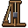 | **Pile driver** | 14 wood | **Imperial Architecture** node |

1. Build the pile driver at the water's edge and make sure it is fastened (use a wrench).
2. Lay timber pier spans on shallow water within two tiles of it, the same way as any other span.
3. To go further out, unfasten the driver with a wrench, pull it onto the new deck and fasten it again.

The pile driver can stand on the shore, in the shallows or on a deck. Hit it with a hammer on **Harm intent** to take it apart.

Lay sleepers, rails and spikes on the deck as usual. Track on a bridge joins the rest of the line, so a bridge can carry a line to a station or to the edge of the map. You can also build a road on the deck for cars.

Ships can't pass a bridge. To take a span down again, clear the track, road, vehicles and people off it and hit it with a **hammer**. You get the span back. If a bridge is destroyed by an explosion, any track on that tile falls into the water.

## Fuel

Click the locomotive with fuel to load its combustion chamber, which holds 100 units. The big steam engines are fired from the firebox door in the cab (see [Cab crew](#cab-crew)).

| Fuel | Units per piece |
| --- | --- |
| Coal | 15 |
| Wood planks | 3 |
| Branch | 3 |

If a stack would overfill the chamber, it is refused, so split it into a smaller stack. Examine the locomotive to see how full it is ("full", "sufficiently fueled", "stable", "emptying", "almost empty"). When the fuel runs out, the engine stalls and the train rolls on until it slows to a stop.

How much fuel a tile takes depends on the throttle and the load. Idling along costs a quarter of a unit, and full throttle with a fully loaded train costs one unit. An overloaded train costs more. That is about a hundred tiles of hard running per full chamber.

For long routes couple a **tender** next to the engine and shovel from it as you go (see [Tenders and water stops](#tenders-and-water-stops)).

## Steam, water and the boiler

A steam locomotive runs on **steam pressure**, made by boiling water over the fire. Click the engine to see its gauges: the fire, the **pressure**, the **water in the glass** (the boiler itself) and the **tank**. Diesel engines have none of this.

- **Raising steam.** A new engine comes filled and in steam. One that has stood with its fire out goes cold in about twenty minutes. Light the fire and wait: from cold it takes about two minutes to reach full pressure, four on a heavy locomotive. A firebox less than half full makes steam more slowly.
- **Pressure is power.** From 60% up the engine gives everything it has. Below that it gets slower, and under 15% the throttle won't open at all.
- **Don't wind the engine.** A train at the engine's rated load holds its pressure at full throttle. A heavier train uses steam faster than the fire makes it, so the pressure sinks and the train slows. Ease the throttle down a notch and let it recover.
- **Keep the fire up.** With the firebox under half full the pressure falls as you run. A lit fire also burns a little fuel while the engine stands, so drop the fire if you park it for long.
- **Water.** Working boils the water away. The **injector**, one of the engine's controls, feeds the boiler from the tank as you go and is on to start with. It costs a little steam, so a fireman can turn it off on a hard pull and back on when the driver eases off. Fill the tank by clicking the engine with a bucket or any open vessel of water. A tank lasts about 240 tiles of hard running, a heavy locomotive's about 600.
- **Never let the boiler run dry.** Everyone nearby is warned when the water is low in the glass. If it runs out with the fire lit, the **fusible plug** melts: steam puts the fire out and the engine is dead where it stands. Nothing explodes. Make a new **fusible plug** (1 lead; **Rail & Steam** node, or industrial research **101**), click the engine with it, then pour in water before you light the fire again. With the engine cold, water goes into the boiler first and then the tank.

## Tenders and water stops

A tender carries the coal and water an engine can't. It must be coupled **directly to the engine**, in front of it or behind it.

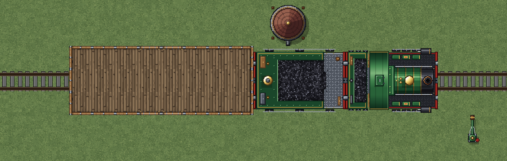

- **Coal tender**: the small one-tile wagon. Its fuel is whatever coal and wood is in its storage, and it carries a little water.
- **Tender**: built from a **tender kit** on four tiles of straight track, like a platform car. It has a plate at the front to stand on, a coal bunker and a water tank, and holds as much as fifteen fireboxes of fuel and ten engine tanks of water. Click any part of it with coal, wood or a bucket of water to load it. Examine it to see how full it is.

**Nothing feeds the fire for you.** Click the engine with a **shovel** in your hand, standing at the firebox door on the big engines, to throw a load of fuel from the tender into the firebox. Each stroke is about two pieces of coal and you can shovel about once a second, on a moving train too. That is the fireman's job. You can still put fuel in by hand.

The tender's **water** runs to the engine by itself.

To fill up at the trackside:

1. Build a **water tower** next to the line, close enough that the track is within three tiles of it.
2. Fill the tower. Pour buckets of water into it, or build it within two tiles of fresh water and click it with an empty hand to work its pump. It holds a great deal.
3. Stop the engine or tender beside the tower and click the tower with an empty hand. Everything within reach is filled.
4. A **water crane** does the same anywhere within twelve tiles of a tower. Stand it within two tiles of the track. A wrench turns it.

## Building a train

1. Place the locomotive on the rail, facing the way you want to go.
2. Place each wagon on the rail behind it. Wagons, cars and engines can face either way along the track: a car coupled in back to front keeps facing the way it does and simply runs tail first.
3. Right-click a wagon and choose **Hitch** to couple it to the wagon in front of it, or to the wagon behind it if there is nothing in front. Use **Hitch** again to uncouple it. Hitched wagons follow the one ahead.

The locomotive doesn't have to be at the front. Hitched in behind wagons it **pushes** them, and in the middle of a train it drives the wagons on both sides of it.

## Couplings

Every wagon, car and engine has a **coupling** at each end. You can see it on the end of the car: a hook with its link hanging free, or a brass screw drawn tight between two hitched cars.

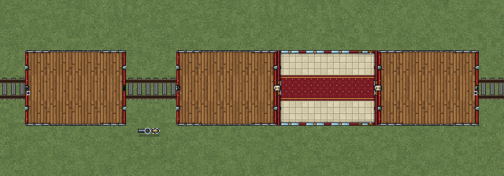

| You want to | Do this, standing next to the coupling |
| --- | --- |
| Couple two cars | Click the coupling with an empty hand. The cars must stand end to end. |
| Uncouple | Click it with an empty hand and wait a moment. It won't come undone while an engine is pulling: shut the throttle first. |
| Check it | Shift-click it. |
| Break it | Hit it with a weapon on harm intent. Each blow wears it down. |
| Mend it | Use a welding tool on it. |
| Take it off | Uncouple it, then use a wrench on it. You get the coupling as an item. |
| Fit one | Click the empty end with a **train coupling** in your hand. Spares cost 4 iron (**Rail & Steam** node, or industrial research **101**). |

Right-click, **Hitch** still works too.

- A **broken coupling parts the train**. The engine runs on with whatever is still hitched to it, and the rest is left standing on the line.
- Two cars couple only if **both** couplings that meet are whole. A car with a broken or missing coupling can still be hitched by its other end.
- Explosions damage the couplings of the cars they catch.

### Shunting

Making up a train is called shunting, and a yard does it all day.

- **Come up slowly and you buffer up.** A train that creeps up to standing cars at a crawl stops against them, and nothing is damaged. Open the throttle one notch, then close it and let the train roll the last few tiles. Faster than a crawl it is a bump, and faster still the cars are knocked rolling (see [Runaway cars](#runaway-cars)).
- **Then couple by hand**, or let automatic couplers do it.

#### Automatic couplers

An **automatic coupler** is a steel knuckle that takes the place of the hook and screw link. It costs 6 steel (**Assembly Line** node, or industrial research **140**).

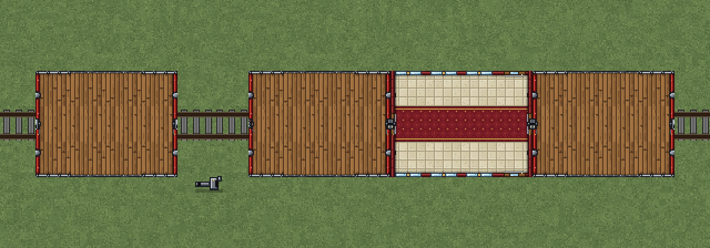

- **Fitting one**: click the free end of a car with the coupler in your hand. It changes places with the coupling that was there, which drops at your feet. It wears, breaks, mends and comes off like any coupling.
- **They lock by themselves.** Push two automatic couplers together slowly and they couple, and the train stops there. Nobody has to stand between the cars. Too fast and they do not catch: the cars are knocked away instead.
- **Rolling cars couple too.** A car let go down a siding locks onto the cars it rolls up against.
- **The lever lets go at once.** Click a locked automatic coupler and the cars part straight away, with no wait. It still won't let go while an engine is pulling. On a coasting train the cars you let go roll on by themselves, which is how a shunter sends cars into a siding without stopping.
- Both ends that meet must be automatic. An automatic coupler and a hook and screw link still couple, but only by hand.

## Driving

**Click the locomotive** to open its controls. On the big steam engines the controls are shared between three places in the cab (see [Cab crew](#cab-crew)).

- **Start the engine** or **Stop the engine**. On a steam locomotive these are **Light the fire** and **Drop the fire**. It needs fuel to start, and a steam locomotive needs water in its boiler.
- **Injector on** or **Injector off**, on steam locomotives. See [Steam, water and the boiler](#steam-water-and-the-boiler).
- **Throttle up** and **Throttle down** move between notches 0 and 3. Each notch is a third of the engine's top speed. The train gathers speed over a few tiles rather than jumping to it.
- **Brake** closes the throttle and puts the engine's own brake on. It holds the engine only, so a long train also needs its handbrakes (see [Brakes](#brakes)). Closing the throttle without braking lets the train coast.
- **Sand the rails** drops sand under the wheels for the next few tiles so they grip (see [Wheel slip and sand](#wheel-slip-and-sand)).
- **Reverser** sets forward or backward, and only works while the train is standing. Forward is always the way **that engine** faces, wherever it is in the train. Backing up moves the train with the far end leading. Set the levers for the way that end of the train will go.

Examine the locomotive to see its notch, reverser, speed, a steam locomotive's pressure and water, and whether the train is too heavy for it.

### Speed, load and stopping

- A steam locomotive at full throttle is faster than a carriage or any tank, about as fast as a running person. The armored locomotive is a little slower.
- Every wagon and car adds weight, and so does what it carries: people, cargo, stored items and furniture. A locomotive pulls its own rated load at full speed. Over that, the train is slower, and a train far too heavy for its engine won't start at all: the wheels just spin.
- **Two engines** make a heavier train fast again. Hitch a second running locomotive anywhere in the train, at the front, in the middle or pushing at the back. It adds its pull and burns its own fuel. The engine whose throttle was opened first drives the train; the other's controls take over once it has stopped.
- **What leads the train sets its top speed.** A locomotive running forward at the head gets full speed. A locomotive running backward gets three quarters. Wagons pushed ahead of the engine, forward or backing up, get half, unless a running locomotive is at their head.
- **An engine at each end**, each facing out, lets a train run at full speed both ways without turning anything round. Drive from the engine that faces the way you want to go.
- **Trains don't stop on the spot.** Braking takes a couple of tiles for an engine on its own, and many more with a long, heavy train behind it. Coasting takes longer still. Start braking well before a station or a junction.

### Wheel slip and sand

An engine can only pull as hard as its wheels grip the rails. Open the throttle too far on a heavy train that is standing or crawling and the wheels spin: you are told they are slipping, the train gains no speed, and the engine burns fuel for nothing.

- **Start a heavy train gently.** A train near its engine's full load starts on notch 2 and takes notch 3 once it is rolling. A train much too heavy for its engine has to start on notch 1. A light engine or a short train never slips.
- **Rain and snow make the rails slippery.** In wet weather use a notch lower than you would in the dry.
- **Sand the rails** when you need the grip: the wheels hold for the next eight tiles, which is enough to get a heavy train moving. Once the train is rolling at a fair speed it no longer slips.
- **The sandbox holds 20 uses.** The engine's controls show how many are left. Use **sand** on the locomotive to fill it up again.

### Snow on the line

Snow that falls and settles on the track slows a train. The car at the front pushes into it, and the train keeps to **three quarters** of its speed in light snow and **half** in deep snow until it is back on clear track.

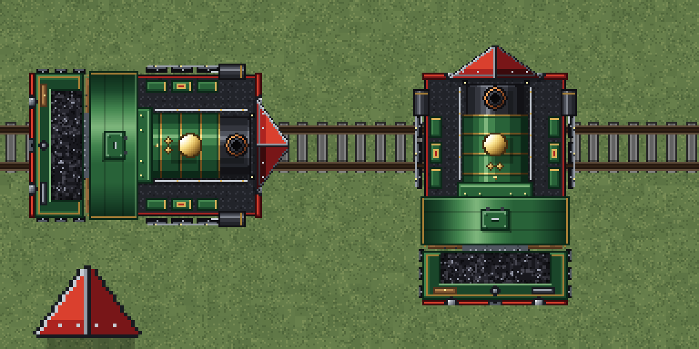

A **snowplough** (10 iron, on the **Rail & Steam** node or industrial research **101**) clears the snow off each tile as the train passes, so the train keeps its speed and the line behind it is open for the next one.

- **To fit it**, stop the train and click the **coupling** at a free end of an engine or car with the snowplough.
- **It only works at the end that leads the train.** Fit it to the front of the engine for running forward. A train that backs up a long way wants one on its last car as well.
- **To take it off**, click that coupling with a **wrench**.

### Runaway cars

Cars keep rolling. Nothing stops a wagon just because it is no longer coupled to an engine.

- **A train that parts on the move leaves cars rolling.** If a coupling breaks while the train is running, or someone uncouples a car while the train coasts, the part without the engine rolls on by itself the way it was going. It slows down over many tiles, sooner if it is light.
- **Hit standing cars and they roll away.** Run into cars at more than a crawl and they are knocked rolling down the line, unless a handbrake holds them. To couple up, pin down a handbrake on the cars first, or come up to them very slowly.
- **A runaway hits whatever is in its way** like any other train, and at speed that is a crash.
- **Stopping one takes a brake wheel.** A handbrake cannot be pinned down from the ground on a moving car. Someone riding a runaway can wind a brake wheel on, which is one more reason to keep a brake van on the back of the train.

### Brakes

A train stops by how much of its weight is braked. The driver's **Brake** grips the engine and nothing else. That stops a lone engine quickly, but with a dozen cars pushing from behind, the engine's brake is a small part of the train and the stop is long. The rest of the braking is on the cars.

- **Every wagon and car has a handbrake.** Right-click the car and choose **Handbrake** to pin it down or let it off. It takes a couple of seconds, you must be next to the car, and it only works while the train is **standing**. Examining a car tells you when its handbrake is on.
- **A brake wheel works on the move.** Click a brake wheel to wind the brake of the car it stands on hard on, and click again to wind it off. Its tell-tale shows red when the brake is on and green when it is off.
- **The more weight is braked, the shorter the stop.** With every car braked, a train stops about as fast as an engine on its own.
- **Let the brakes off before you leave.** A handbrake left on drags like several extra cars: the train is slow, and with enough of them on it won't start at all. The engine's controls list how many handbrakes are on in the train.
- **Park with a handbrake on.** A train with any handbrake on cannot be pushed along the line by hand.

#### Brake van

The **brake van** is the guard's car. It has an open veranda at the front and a cabin behind it with a **brake wheel** and a seat. It is built heavy, about twice the weight of an ordinary car, so its brake holds twice as much. Couple one at the back of a train and put a guard in it: when the driver brakes, the guard winds the wheel on, and winds it off again before the train starts.

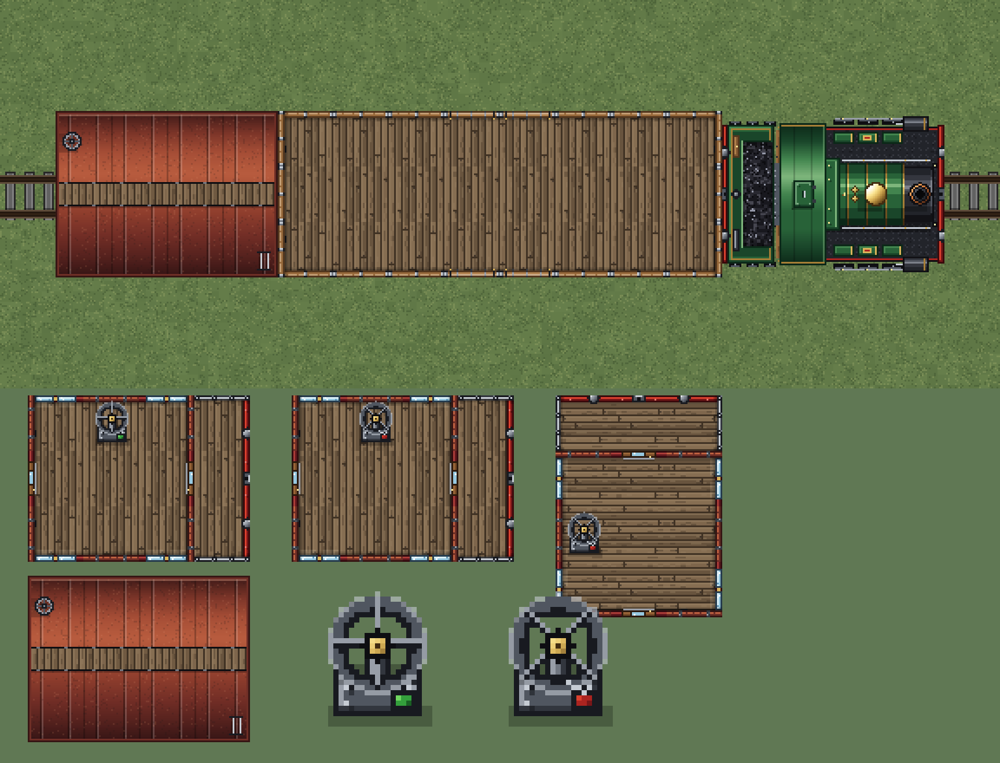

| Piece | Cost | What you get |
| --- | --- | --- |
| Brake van kit | 24 iron | A four-tile guard's van with a veranda, a cabin, a brake wheel and a seat. Built like any other car kit (see [Putting a car together](#putting-a-car-together)). |
| Brake wheel | 6 iron | A brake wheel on its own. Build it on the deck of any platform car to give that car a brake a rider can work on the move. A **wrench** unbolts it, once its brake is off, so it can be dragged away. |

A long train can carry more than one: a van at the back, and a brake wheel on a car or two further up for extra hands.

### Hitting things

- The faster and heavier the train, the harder it hits. A train creeping along shoves a person off the rails with a bruise and stops in front of crates and furniture without breaking them.
- At speed it throws people clear of the track, badly hurt or worse, and keeps going. It smashes anything solid in its way and stops there. A wall, pillar, door or barricade on the line takes the blow like a ram: a fast train breaks through a weak wall and keeps going, while a strong one stops it. A broken wall can bring down the roof it held.
- Set the levers before you leave. A switcher set to split sends the train onto the side track. Look before you start, and warn people near the line.

### Crashes

A train that is stopped dead at speed is wrecked. It happens when a running train hits another train, a strong wall or anything else it cannot push through. A light train crashes from a little over half its top speed, and a long, heavy one from much less. Slower than that it only bumps and stops.

- **The front of the train takes the worst of it.** The car that hits takes the full blow, the one behind it half, the third a third, and so on down the train.
- **Cars come off the rails.** A hard crash derails the leading car, a harder one the first two or three. The train that was hit can lose a car the same way. A derailed car or engine stops its whole train until it is welded: one pass with a **welding tool** on each wrecked section of a car, or one on a heavy locomotive, puts it back. A small one-tile locomotive stays on the rails but its fire goes out.
- **Couplings break.** The couplings between the leading cars are strained and can snap, which parts the train there. Mend or replace them as usual (see [Couplings](#couplings)).
- **Riders are thrown.** Everyone aboard is hurt, knocked off their feet and thrown towards the front of the train, hardest in the leading cars. Walls, doors and furniture stop them. Someone buckled into a seat is hurt half as much and stays put, so the back of the train, sitting down, is the safest place to be.
- **Cargo shifts.** Loose crates and other cargo slide forward and can go over the end of an open car. In a hard crash, cargo secured to a transport wagon breaks loose as well.
- **The train stops.** Every engine is left standing with its throttle shut.

Watch the line ahead, keep your speed down where you cannot see far, and start braking early: a heavy train needs a long way to stop.

## Servicing

A train wears as it runs. None of it is urgent on a short trip, but a train that is never looked after gets slower and at last stops.

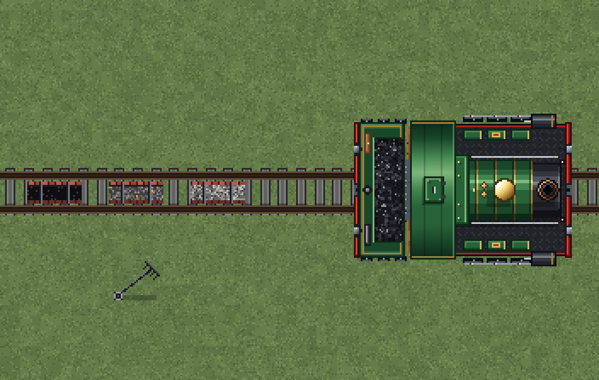

### Oiling

Every wagon, car and engine runs on the oil in its **axle boxes**. One oiling lasts about **600 tiles**.

- **To oil a car**, stand next to it while the train is standing and click it with an open vessel holding at least 5 units of **fat oil, olive oil, corn oil, lard or petroleum**. One go oils the whole car, however long it is.
- **Examine a car** to check it. It says so when its axle boxes are running dry, which is the time to oil it.
- **A hot box.** A car that runs out of oil runs hot. Smoke curls from the axle box every so often, and the car drags like two. Anyone riding at the back of the train should watch for the smoke. Stop and oil it.
- **A seized axle.** Keep running a hot box for about 150 tiles and the axle seizes. The car is then held as if its handbrake were on, and oil alone won't free it. Use a **wrench** on the car to change the bearing, which takes a while, then oil it.

### Cleaning the fire

A steam engine's fire slowly fills with **clinker**. After a few fireboxes of fuel the engine's controls say the fire is **dirty**, and it makes steam more slowly. Left alone it ends up **choked**, making half the steam it should.

1. Build an **ash pit** on a track tile (6 iron) and make a **fire rake** (2 iron). Both are on the **Rail & Steam** node, or industrial research **101**.
2. Stop the engine over the ash pit.
3. Stand at the firebox door and click the engine with the fire rake.

The clinker drops into the pit and a little of the fire goes with it, so put some fuel on afterwards. An ash pit holds ten cleanings. When it is full, move the engine off it and dig it out with a **shovel**.

### Brake shoes

A brake wears its **shoes** whenever the train moves with it on: a handbrake left pinned down, a brake van's brake wound on down a hill, or the driver's brake on the engine. A set lasts about **300 tiles** of braking.

- **Examine a car or engine** to check. It says when the shoes are worn thin.
- **Worn out**, the brake grinds metal on metal and holds less than a third of what it should, so the train takes much longer to stop.
- **To change them**, make a **set of brake shoes** (3 iron), let the handbrake off, and click the standing car with the set.

### Washing out the boiler

The water a steam engine boils leaves **scale** in its boiler. After about a dozen tanks of water the controls say the boiler is **scaling up**, and the fire makes less steam than it should. Left alone the boiler ends up **thick with scale**.

1. Stop the engine beside a **water crane** or **water tower** that holds at least 300 units of water.
2. Drop the fire and let the boiler cool until the pressure is 25% or lower. From full pressure that takes about a quarter of an hour.
3. On the fireman's side of the cab, choose **Wash out the boiler**. It takes about half a minute.

The scale is hosed out and the boiler is left clean and full of cold water, ready for the fire to be lit.

### Overhaul

An engine that has worked about **5,000 tiles** starts to knock and blow, and pulls a little less with every trip after that, down to seven tenths of its strength. Examining it says when it is due for an overhaul.

1. Stand the engine in the bay of a [rail warehouse](#rail-warehouse), the stretch of track beside the office post, and stop it.
2. Hold a **wrench**, with **10 iron or steel** in your other hand for the new parts.
3. Click the engine with the wrench. The work takes about a minute.

An engine can be overhauled early, from half that distance on.

### Coaling stage and sand bin

Two structures beside the track save carrying fuel and sand to every engine by hand. Both serve whatever stands within two tiles of them. Like the brake shoes, they are on the **Rail & Steam** node, or industrial research **101**.

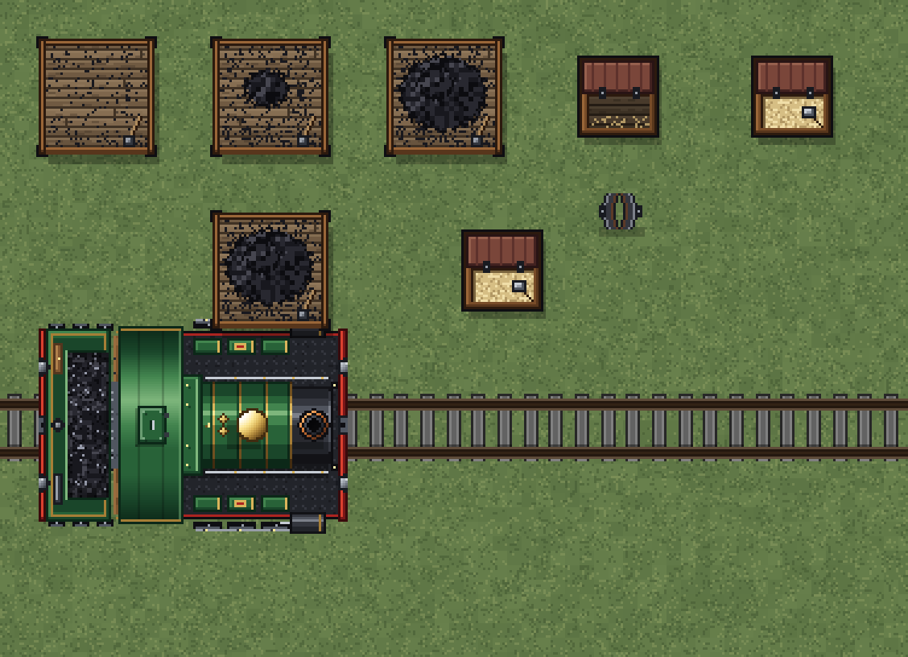

- **Coaling stage** (20 wood): click it with **coal or wood** to tip the fuel onto its heap. Stop a steam engine or a walk-on tender beside it and click the stage with an empty hand to fill the tender's bunker and the engine's firebox.
- **Sand bin** (8 wood): click it with **sand** to fill it. Stop an engine beside it and click the bin with an empty hand to fill the engine's sandbox.

## Carrying passengers and cargo

- **Storage wagons** (mining cart, tender, transport wagon): click to open their storage, or drag items onto them.
- **Flatbed and cabin wagons:** drag a person onto the wagon to bring them aboard, or drag yourself to climb in. Standing on the wagon with someone, you can buckle them in. Drag a loose crate or structure onto a flatbed to secure it for the ride, and right-click the wagon and choose **Unsecure** to release it at the other end.

## Platform cars

Platform cars are full-size railway carriages: **three tiles wide and four tiles long**, with the track down the middle. You can walk around inside them while the train is moving, and everything on the deck rides along with the car: people, furniture, crates and anything you set down. A car bends round curves, and its furniture turns with it.

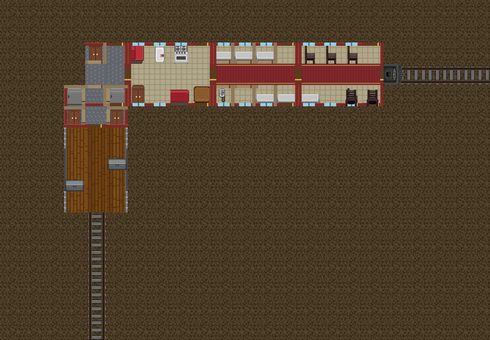

| Kit | Cost | What you get |
| --- | --- | --- |
| Platform car kit | 12 iron | An open plank deck with railings at each end, for cargo, crates and machines. |
| Passenger coach kit | 16 iron | Six seats either side of a carpeted aisle, windows, side doors and end doors. |
| Sleeper car kit | 20 steel | Three private compartments a side, each with a bed and a sliding door. |
| Dining car kit | 20 steel | A galley with a stove, sink, fridge and counter, and two booths. |
| Storage car kit | 18 steel | Cabinets and large crates, each behind its own compartment door. |

### Long cars

Long cars are **eight tiles long**, twice the length of the others, and weigh twice as much. They are built, coupled and ridden the same way.

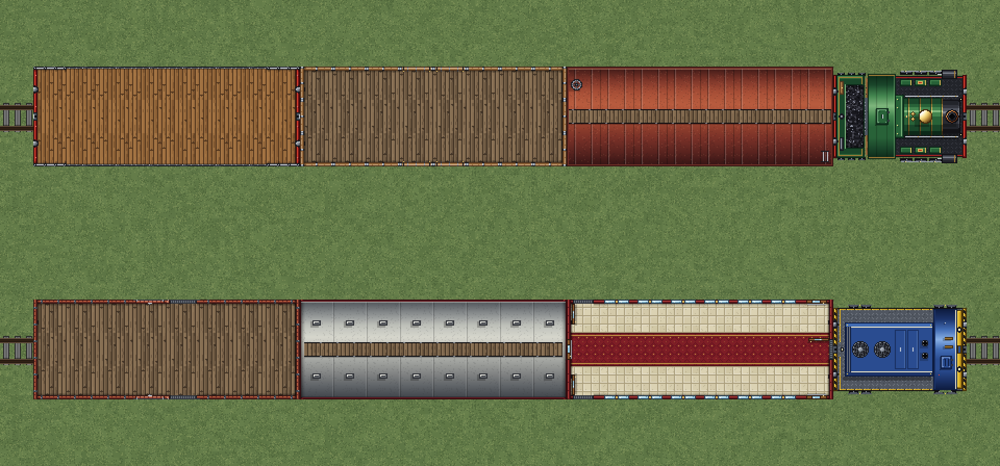

| Kit | Cost | What you get |
| --- | --- | --- |
| Bogie flatcar kit | 22 iron | A long open plank deck with railings at each end, for machines, vehicles and long loads. |
| Open wagon kit | 26 iron | Plank sides all round to keep loose cargo aboard. The drop doors in the middle of each side open for loading. Carries ore, coal or sand in bulk (see [Bulk freight](#bulk-freight)). |
| Boxcar kit | 30 iron | A roofed goods van with closed ends. The sliding doors in the middle of each side open for loading. |
| Bogie coach kit | 26 steel | Twelve seats either side of a carpeted aisle, with a vestibule and doors at each end. |

### Bulk freight

Ore, coal and sand don't have to ride as loose piles. An **open wagon** or a **hopper wagon** takes them in bulk: the load becomes one heap in the car, shown from above, and a full wagon carries far more than you could stack on a deck.

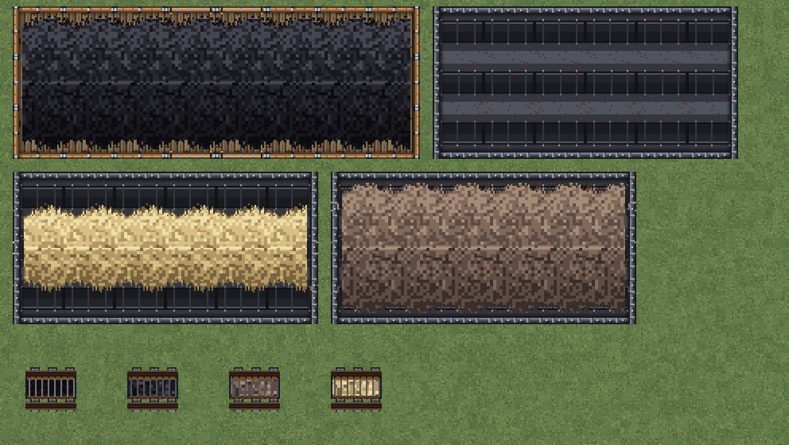

| Car | Holds | How it unloads |
| --- | --- | --- |
| Open wagon | 600 | Dug out with a shovel. |
| Hopper wagon (kit: 28 iron, six tiles long) | 800 | Drops its whole load through the floor, or is dug out with a shovel. |

- **To load**, click the car with a stack of ore, coal, charcoal, sand or another mined mineral. The whole stack is tipped in.
- **One kind at a time.** A car loaded with coal takes only coal until it is empty.
- **To dig a load out**, click the car with a **shovel**. Each go puts up to 50 on the ground beside you.
- **A loaded car is heavy.** A full open wagon weighs nearly twice what it does empty, so count it when you plan the train.
- **Examine the car** to see what it carries and how much.

**Dropping a hopper's load.** A hopper is built with a **door lever** at its front left corner. Stop the train and pull the lever: the load rumbles out through the floor and lies on the track under the wagon.

To catch it, build a **drop pit** (8 iron) on a track tile and stop the hopper over it. The load then falls into the pit, which holds **3,000** of one kind. Dig the pit out with a shovel from beside the track. If the pit is full or holds something else, the lever tells you and the load stays in the wagon.

The hopper wagon kit, a spare door lever (4 iron) and the drop pit are on the **Rail & Steam** node, or industrial research **101**.

### Putting a car together

1. Carry or drag the kit onto the track. A car needs **four tiles of straight track**, and a long car **eight**: the tile under the kit and the rest behind it. Examine a kit to see how long its car is.
2. Leave a **clear tile on both sides** of those tiles for the deck.
3. Stand facing the way the car should point and hit the kit with a **hammer**. A car can face either way in a train.

To couple the car, right-click its front end and choose **Hitch** to join the car ahead, or its rear end to join the car behind. The middle of a car can't be unhitched.

### Riding and doors

- Click a door to open or close it. Side doors are at the front end of each enclosed car, and end doors let you walk from one car to the next.
- Walls and windows keep you from walking through them, but they don't stop bullets. Armor plate on wartime cars does.
- Track for platform cars needs a clear tile on each side all the way along, including on curves. If a car's deck would hit a wall, a tree or another train, the whole train grinds to a halt before it moves. People standing beside the track aren't hurt. The deck slides under them and they end up on board.

### Wartime cars

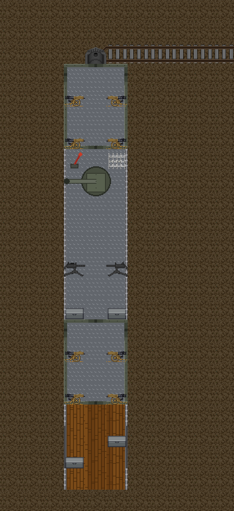

| Kit | Cost | What you get |
| --- | --- | --- |
| Railway gun car kit | 60 steel | A long-range gun on a turntable, an outrigger lever and a shell rack. |
| Armored wagon kit | 40 steel | Armor plate with firing doors. Bring your own machine guns. |
| Flak car kit | 45 steel | A low armored wall and ammunition crates. Bring your own autocannons. |
| Armored locomotive | 30 steel | A steam locomotive cased in steel plate. |

- **Bracing the railway gun.** The gun only fires while its car is braced. Stop the train, wait a moment for it to settle, then pull the **outrigger lever** on the car. While the outriggers are down the whole train stays where it is; pull the lever again to raise them before you set off.
- **Guns.** The kits come unarmed. Forge [emplaced machine guns](Guide_to_Weapons.md#emplaced-machine-guns) and 30mm autocannons at an anvil and push them aboard. A **wrench** unbolts a gun nobody is manning so it can be moved, and bolts it down again. Autocannons come off the anvil bolted down.
- **Armor.** Armor plate stops bullets coming from outside the car, but the crew inside can shoot out through it. Open an armor door to get on or off.
- **Explosions.** Shells and bombs damage platform cars; armored cars take much less. A car blown off the rails stops its whole train. Weld it with a **welding tool** until it is back on the rails.
- **Armored locomotive.** Bullets do nothing to it. Heavy explosions wear its plating down, and once its boiler is holed the engine dies and won't start again until it has been welded.

### Taking a car apart

Stop the train, uncouple the car from the cars on both sides and clear everything off its deck, furniture included. Then use a **crowbar** on the car to pack it back into a kit. A kit that was taken apart comes back without furniture, so keep the furniture you removed and put it back aboard.

## Heavy locomotives

Heavy locomotives are full-size engines, three tiles wide and four long. They are driven with the same controls as the small locomotive and are no faster, but each pulls about twice the train, carries more fuel and survives explosions.

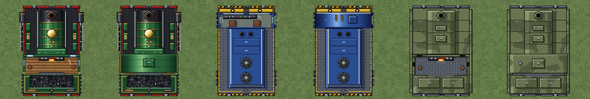

| Kit | Cost | Research | Fuel | Notes |
| --- | --- | --- | --- | --- |
| Heavy steam locomotive kit | 45 steel | **Rail & Steam** node, or industrial research **101** | Coal, wood planks, branches (holds 250) | Boiler in front, cab third, coal bunker at the back. |
| Heavy diesel locomotive kit | 50 steel | **Combustion Engine** node, or industrial research **115** | Diesel or biodiesel (holds 300 units) | The fastest engine. Cab at the front, with a walkway down each side of the hood. |
| Heavy armored locomotive kit | 80 steel | **Field Artillery** node, or industrial **101** and military **109** | Coal, wood planks, branches (holds 300) | The strongest puller and the slowest. Bullets do nothing to it, and its cab doors stop bullets from outside. |

- **Assemble** the kit like a platform car: put it on straight track with three more straight tiles behind it and a clear tile either side, face the way the engine should point and hit it with a **hammer**.
- **Drive from the cab.** The rest of the body is solid, apart from the diesel's walkways. Step into the diesel's cab, or stand beside it, and click the locomotive to open the controls. The steam engines have a [cab crew](#cab-crew).
- **Fuel.** Click the diesel with a container of diesel from anywhere beside it. The steam engines are fired from the firebox door in the cab. Water goes into a steam engine from anywhere beside it.
- **Couple** wagons and cars to it with **Hitch**, as with any locomotive. It can pull from the front, push from the back or help another engine.
- **Keep clear of the line.** A heavy locomotive is as wide as a platform car, and it hits anyone standing beside the rails as well as on them.
- **Damage.** Explosions wear the engine and its body down. A wrecked engine dies and a wrecked body section stops the train until it is welded. A **welding tool** repairs both.

A heavy locomotive can't be packed back into a kit, and it is too long for a rail warehouse.

### Cab crew

The cab of a heavy steam, heavy armored or main-line locomotive is three tiles wide, and each tile is a place of work. Click the locomotive from the tile you stand on to work what is there.

| Where you stand | Looking forward | What you work |
| --- | --- | --- |
| **Driver's stand** | Right side of the cab | Throttle, brake and reverser. |
| **Firebox door** | Middle of the cab | **Light the fire** and **Drop the fire**. Coal and wood go in here by hand, the shovel fires from the tender here, and a new fusible plug is fitted here. |
| **Fireman's side** | Left side of the cab | The injector. |

A driver and a fireman run the engine properly: one keeps a hand on the regulator and the brake while the other feeds the fire and watches the water. One person can do it all, but has to step away from the brake to shovel. The small steam locomotive and the diesel are still worked from one place.

### Main-line steam locomotive

The main-line steam locomotive is the big express engine: six tiles long, faster than any other steam engine and able to pull twice the train of the heavy steam locomotive.

| Kit | Cost | Research | Fuel |
| --- | --- | --- | --- |
| Main-line steam locomotive kit | 90 steel | **Rail & Steam** node, or industrial research **101** | Coal, wood planks, branches (firebox holds 400) |

- **Assemble** it like the heavy locomotives, on **six** tiles of straight track. The cab is the last section.
- **It needs a tender.** It has no coal bunker and almost no water of its own. Build a [tender](#tenders-and-water-stops) behind it and couple the two, so the tender's plate meets the back of the cab. The tender's water runs to the engine, and the fireman at the firebox door shovels from the tender.
- **Raising steam** from cold takes about six minutes on a good fire, so keep the fire in between runs.
- It has the same [cab crew](#cab-crew) as the heavy steam engines, takes damage and is repaired the same way, and can't be packed back into a kit or stored in a rail warehouse.

## Rail warehouse

A rail warehouse stores cars and locomotives off the line, together with everything on board, so a yard doesn't need long sidings. Trains drive straight through it: unload cars from the back of a train, or couple stored cars back on to make up a new one.

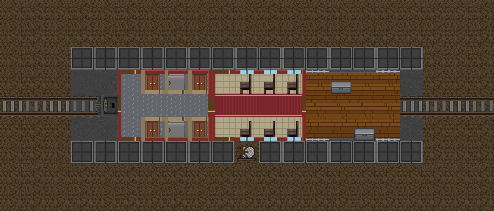

1. **Build the office** (15 iron; **Rail & Steam** node, or industrial research **101**) facing the track, with **one tile between the office and the rails**. The track running past it, **six tiles each way**, is the warehouse bay (13 tiles, room for three platform cars and a locomotive, or one long car and one platform car). Use a wrench on an empty office to turn it. Build walls and a roof around the bay if you like, but leave the track open at both ends and keep a clear tile either side of the rails.
2. **Drive the train in** and stop it with the cars you want to put away inside the bay. Get everyone off them.
3. **Use the office.** Choose a car to put away, or **Put away the whole train**. Cars always come off the **back** of the train: whatever is standing on a car goes with it, crates and their contents included.
4. **Couple a car back on** from the same menu. It rolls onto the track behind the train in the bay, facing the way the train heads, and is hitched to it. If the bay is empty, it rolls to the far end.

The office holds 8 cars or locomotives. It won't take a moving train, a car that sticks out of the bay, a car with people aboard, or a railway gun car with its outriggers down.

## Through station and service loop

This example separates an eastbound main line, a passenger platform track and a cargo/service loop. It uses straight track, four corners, two left switchers, two right switchers and a rotator, plus four levers.

The platform and cargo stopping positions allow **eight vehicles including the locomotive and tender**. Extend the straight stopping tracks for a longer train.

### Layout views

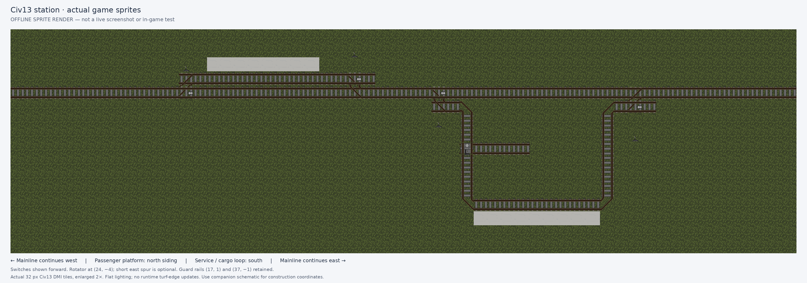

The main line continues beyond both station ends. [Open the full-size sprite render](../images/civ13-station-game-sprites.png).

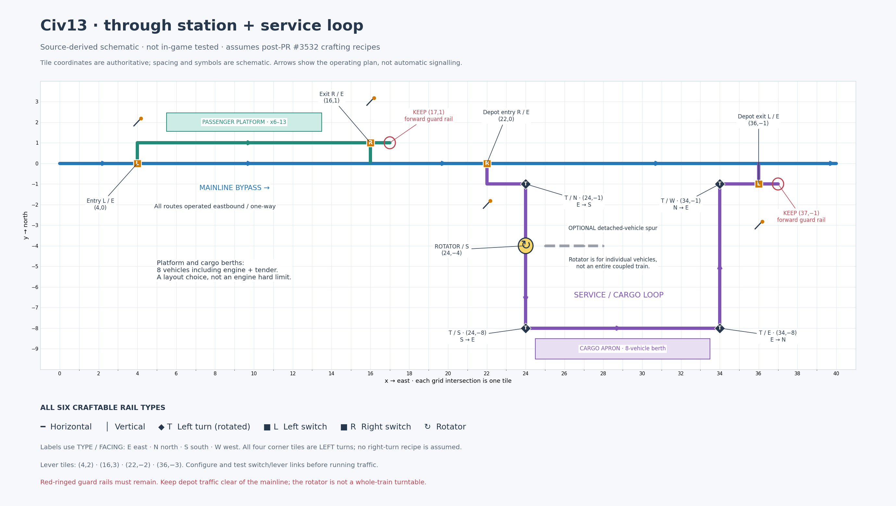

Construction schematic; use the coordinates below when placing track. The arrows indicate a continuing main line, not buffer stops: keep whole-train staging space to the west and exit rail through at least `x=44` to the east. [Open the full-size schematic](../images/civ13-station-plan.png). Sprite assets come from the [Civ13 game source](https://github.com/Civ13/Civ13/tree/ec86e58fa67fdd7baea265d8716a64ae6f9a2d99), under its [game-source license](https://github.com/Civ13/Civ13/blob/ec86e58fa67fdd7baea265d8716a64ae6f9a2d99/LICENSE).

### Coordinates and track plan

Choose a clear area and treat any convenient tile as `(0,0)`. Increasing `x` is east; increasing `y` is north. All ranges below include both endpoints. Lay the main line first, then the passenger track and the depot loop. Facing means the direction to face when building a switcher or the rotator; plain track shapes itself. Use one piece per listed tile; switches and the rotator replace the straight track at their coordinates.

| Section | Tiles and pieces |
| --- | --- |
| Main line | Horizontal rail along `y=0`, except the two entrance switchers below. The drawn `x=0..40` segment is part of a continuing eastbound route, not two buffer stops. Continue west far enough to stage the whole train before the first entrance, and east through **at least `x=44`** for this eight-vehicle layout. Longer trains need longer clear approach and exit tracks. |
| Passenger entrance | **Left switcher, facing east**, at `(4,0)`. Its split route shifts to `(4,1)`. Lever at `(4,2)`. |
| Passenger track | Horizontal rail from `(4,1)` to `(17,1)`, except the exit switcher. |
| Passenger platform | Build alongside the track from `(6,2)` to `(13,2)`; stop the eight-vehicle train beside it on `x=6..13, y=1`. Keep both approaches clear. |
| Passenger exit | **Right switcher, facing east**, at `(16,1)`. Its split route shifts to `(16,0)`. Lever at `(16,3)`. **Keep horizontal rail at `(17,1)`.** |
| Depot entrance | **Right switcher, facing east**, at `(22,0)`. Its split route shifts to `(22,-1)`. Lever at `(22,-2)`. |
| Depot approach | Horizontal rail at `(22,-1)` and `(23,-1)`, leading to the first turn at `(24,-1)`. |
| West leg | Vertical rail at `x=24, y=-2..-7`, except the rotator at `(24,-4)`. |
| Cargo straight | Horizontal rail from `(25,-8)` to `(33,-8)`. An eight-vehicle stopping position is `x=25..32`; leave `x=33` clear. Put the cargo apron alongside at `y=-9`. |
| East leg | Vertical rail at `x=34, y=-7..-2`. |
| Depot exit approach | Horizontal rail from `(35,-1)` to `(37,-1)`, except the exit switcher. |
| Depot exit | **Left switcher, facing east**, at `(36,-1)`. Its split route shifts to `(36,0)`. Lever at `(36,-3)`. **Keep horizontal rail at `(37,-1)`.** |
| Rotator | Replace the west-leg rail at `(24,-4)` with a **rotator facing south** for through traffic. |
| Optional service spur | A separate horizontal track from `(25,-4)` to `(28,-4)`, beside the rotator. Use it only for an unhitched vehicle. |

The four depot corners form by themselves: lay each leg one tile past the corner, then lay the next tile of the following leg, and the corner tile bends to meet it.

| Corner | Incoming travel | Outgoing travel |
| --- | --- | --- |
| `(24,-1)` | East | South |
| `(24,-8)` | South | East |
| `(34,-8)` | East | North |
| `(34,-1)` | North | East |

### Switches and guard rails

A split switcher moves the vehicle **one tile sideways without changing its heading**. The passenger route enters and leaves its parallel track while continuing to face east; the depot uses actual turns for its loop.

**Keep the forward guard rails at `(17,1)` and `(37,-1)`, even though normal exit traffic leaves sideways.** A switcher needs rail straight ahead before it will take its split route.

A lever changes **every switcher within two tiles**, rather than linking to one selected switch. The four lever positions above keep the intended controls apart. If you move a lever or add another nearby switcher, check which switches it reaches and inspect their settings before admitting a train.

### Operating the routes

| Route | Passenger entrance at `(4,0)` | Passenger exit at `(16,1)` | Depot entrance at `(22,0)` | Depot exit at `(36,-1)` |
| --- | --- | --- | --- | --- |
| Express bypass | Forward | Not used | Forward | Not used |
| Passenger stop | Split | Split | Forward | Not used |
| Cargo/service loop | Forward | Not used | Split | Split |

1. Keep people, cargo and other trains off the intended route. Confirm the main line and the exit merge are clear.
2. Set the required switches **before** the train enters. Leave the settings alone until the **whole train**, including the last wagon, has cleared the switches.
3. For a passenger stop, use the north platform track and stop the locomotive manually with the train beside the platform.
4. For cargo, follow the depot loop in this order: east into the approach, south down the west leg, east along the cargo straight, north up the east leg, then east to the main-line exit. Stop manually alongside the cargo apron.
5. Before rejoining the main line, wait for a clear merge and have an operator keep other traffic out. For this eight-vehicle train leaving the depot at `(36,0)`, continue until the locomotive reaches at least `(44,0)` and the last wagon has cleared the exit switch. Keep that exit track clear; the drawing ends before the required clearance does. Restore entrance switches to forward after the whole train is clear if through traffic is next.

There is **no automatic station stop, signalling or route reservation** in this plan. A bypass track does not protect a train entering at the exit merge. Use manual dispatch, allow stopping distance and run only traffic the operators can keep separated.

### Using the rotator

The rotator changes the heading of vehicles **on its own tile**. It does not turn an entire coupled train or reverse a whole consist.

Stop and unhitch the individual vehicle before turning it toward the optional east-facing spur. Clear the surrounding tracks, rotate the vehicle into the required direction and use the short spur only for detached-vehicle handling. Restore the rotator to **south** before another train uses the west leg. Do not rotate it beneath a moving or coupled train.
