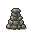
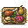
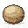
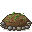

# Tribal Life

A tribe is more than a camp. Remember the great deeds of its people, honour its dead, feast together, make music and trade fairly. Everything here can be made from the first age on.

| Item | Made from | Research |
| --- | --- | --- |
|  Cairn | 5 stone | Ritual Worship |
|  Feasting mat | 3 leather | Ritual Worship |
|  Bone flute | 1 bone | Ritual Worship |
|  Frame drum | 2 leather | Ritual Worship |
|  Barter mat | 2 leather | Basic Toolmaking |
|  Stone beads | 1 stone | Regalia & Heraldry |
|  Bone beads | 1 bone | Regalia & Heraldry |

## Deeds on the totem pole

When you do something great, you remember it as a deed and are told so in chat. Carve your deeds into one of your tribe's wooden totem poles: use a **knife** on the pole and every deed you are carrying is carved into it after a few seconds.

* You need to belong to a tribe to have deeds.
* The first tribe to carve a pole owns it. Other tribes can't carve on it.
* Examine a pole to read its deeds, each with the name of whoever did it and the date.
* A pole holds 40 deeds. When it is full, raise another.
* Each kind of deed is remembered once per person.

Deeds include bringing down a big or dangerous beast, hollowing out a dugout canoe, taming a wild animal, finishing a rock painting, raising a burial mound and holding a feast.

## Burial mounds and cairns

 Bury someone in a grave and fill it in as usual. Then heap **3 piles of dirt** onto the filled grave to raise a **burial mound**. With the last pile you are asked who rests there, and the mound takes their name.

A shovel levels the mound again; a second go digs up the grave as before.

 A **cairn** is a heap of stones raised as a marker. When you build one you can give it a name and say what it marks.

## Feasts

 Lay food on a **feasting mat** by using it on the mat. To take a dish back, use the mat with an empty hand on grab intent.

When **at least four people** are gathered within 2 tiles of the mat and there is a dish for each of them, use the mat with an empty hand to call the feast. Everyone eats their fill, cheers up, and stays full for **three hours**, getting hungry at half the usual rate.

## Music

Hold a **bone flute** or **frame drum** and use it in hand to play. Everyone nearby who hears it cheers up a little. The same listener is only cheered once every couple of minutes.

## Barter

 A **barter mat** lets two people trade without either of them having to trust the other.

1. Stand next to the mat and use an item on it to offer it. The first two people to offer are the traders.
2. Each trader lays out everything they want to give.
3. Use the mat with an empty hand and choose **Agree**. When both traders have agreed, each offer is set down at the other trader's feet.

If either offer changes, both agreements are cleared, so nobody can swap something out at the last moment. If a trader walks away, they drop out of the trade and their goods are left on the mat's tile. You can also choose **Take back my offer** or **Leave the trade**.

Strings of **stone beads** and **bone beads** stack and make handy trade goods, along with salt, pelts and flint tools.
