# Guide to Weapons
## 5000 B.C. Weapons

<table>
<tr>
<th>Weapon</th>
<th>Image</th>
<th>Description</th>
<th>Available</th>
<th>Craftable?</th>
<th>Ammo type</th>
</tr>
<tr>
<td>Club</td>
<td>
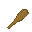
</td>
<td>A club used by cavemen during the stone age, reports say that during the Dunga wars, cavemen could be heard saying "UNGA BUNGA!" while waving their clubs around.</td>
<td>5000 B.C.- 2020 A.D.</td>
<td>Yes</td>
<td></td>
</tr>
<tr>
<td>Quarterstaff</td>
<td>

</td>
<td>A long stick to thwack thou enemies..</td>
<td>5000 B.C.- 2020 A.D.</td>
<td>Yes</td>
<td></td>
</tr>
<tr>
<td>Wood buckler</td>
<td>
  
</td>
<td>A small shield made out of wood.</td>
<td>5000 B.C.- 1600 A.D.</td>
<td>Yes</td>
<td></td>
</tr>
<tr>
<td>Battleaxe</td>
<td>
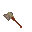
</td>
<td>A battleaxe with a head the size of an infant, perfect to cut people in half because of inertia only. It can be made from multiple materials.</td>
<td>5000 B.C. - 1850 A.D.</td>
<td>Yes</td>
<td></td>
</tr>
<tr>
<td>Tomahawk</td>
<td>

</td>
<td>Light and cheap, perfect for any indian wishing to end a soldier's life. Or a nomad to end a city's... It can be made from multiple materials.</td>
<td>5000 B.C. - 1850 A.D.</td>
<td>Yes</td>
<td></td>
</tr>
<tr>
<td>Spear</td>
<td>
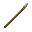
</td>
<td>A pointy stick used by many societies and civilizations; It can be made with a variety of different materials.</td>
<td>5000 B.C. - 2020 A.D.</td>
<td>Yes</td>
<td></td>
</tr>
<tr>
<td>Sling</td>
<td>

</td>
<td>A piece of leather which you can fling stones at the head of your foes with.</td>
<td>5000 B.C. - 2020 A.D.</td>
<td>Yes</td>
<td>Rocks</td>
</tr>
<tr>
<td>Whip</td>
<td>

</td>
<td>A string of leather made to remind your slaves when NOT to stop farming your plantations.</td>
<td>5000 B.C. - 2020 A.D.</td>
<td>Yes</td>
<td></td>
</tr>
<tr>
<td>Primitive bow</td>
<td>
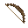 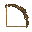
</td>
<td>A bow used by hunters to hunt gazelles and mammoths</td>
<td>5000 B.C.- 1013 A.D.</td>
<td>Yes</td>
<td>Arrows</td>
</tr>
<tr>
<td>Stone-headed club</td>
<td>
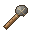
</td>
<td>A wooden handle with a heavy stone lashed to the end. Made from <b>3 stone</b>. It hits harder than a wood club and sometimes knocks people down, but it swings slowly.</td>
<td>5000 B.C. - 313 B.C.</td>
<td>Yes</td>
<td></td>
</tr>
<tr>
<td>Javelin</td>
<td>
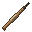
</td>
<td>A light wooden throwing spear with a fire-hardened point, made from <b>2 wood</b>. Throw it, or jab with it up close. It is weaker than a pilum.</td>
<td>5000 B.C. - 313 B.C.</td>
<td>Yes</td>
<td></td>
</tr>
<tr>
<td>Bone harpoon</td>
<td>
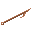
</td>
<td>A barbed bone point on a shaft, made from <b>4 bone</b>. Throw it, or use it on a fishing spot to <a href="Guide_to_Fishing.md#equipment">spear fish</a>.</td>
<td>5000 B.C. - 313 B.C.</td>
<td>Yes</td>
<td></td>
</tr>
<tr>
<td>Bola</td>
<td>

</td>
<td>Three stones on cords, made from <b>2 leather</b> or <b>2 rope</b>. Throw it at someone and it tangles their legs: they cannot run until they <b>Resist</b> free (about 6 seconds), and they may trip. Animals hit by it stumble and fall for a moment. You can pick the bola up again afterwards.</td>
<td>5000 B.C. - 313 B.C.</td>
<td>Yes</td>
<td></td>
</tr>
<tr>
<td>Atlatl</td>
<td>
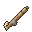
</td>
<td>A grooved wooden spear-thrower, made from <b>2 wood</b>. It needs only one hand. Lay an atlatl dart in it and fire. A dart hits harder than a flint arrow, but the atlatl reloads more slowly and reaches less far than a bow.</td>
<td>5000 B.C. - 313 B.C.</td>
<td>Yes</td>
<td>Atlatl darts</td>
</tr>
<tr>
<td>Slingstaff</td>
<td>

</td>
<td>A sling lashed to a staff, made from <b>4 leather</b>. It needs both hands and fires more slowly than a hand sling, but its stones hit noticeably harder.</td>
<td>5000 B.C. - 313 B.C.</td>
<td>Yes</td>
<td>Rocks</td>
</tr>
</table>

### Atlatl darts

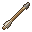

Craft an **atlatl dart shaft** from **1 wood** in the **Weapons** menu. Then use a **sharpened flint**, a **flint arrowhead** or a **stone arrowhead** on the shaft to make a flint or stone atlatl dart. Darts fit in a quiver. Use a dart on an atlatl to load it.

## 313 B.C. Weapons

<table>
<tr>
<th>Weapon</th>
<th>Image</th>
<th>Description</th>
<th>Available</th>
<th>Craftable?</th>
<th>Ammo type</th>
</tr>
<tr>
<td>Xiphos</td>
<td>
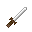
</td>
<td>An ancient sword used by those in the Greek armies during the Greco-Persian wars, often times they were secondary weapons after the javelin or dory.</td>
<td>313 B.C. - 313 B.C.</td>
<td>Yes</td>
<td></td>
</tr>
<tr>
<td>Dory</td>
<td>
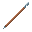
</td>
<td>The dory is a spear that was the main spear of hoplites (heavy infantry) in Ancient times.</td>
<td>313 B.C. - 1013 A.D.</td>
<td>Yes</td>
<td></td>
</tr>
<tr>
<td>Sarissa</td>
<td>

</td>
<td>The sarissa was a spear used in Ancient times by multiple greek states in phalanx formations, its length is around 4 to 6 metres.</td>
<td>313 B.C. - 1013 A.D.</td>
<td>Yes</td>
<td></td>
</tr>
<tr>
<td>Greek Shield</td>
<td>
   
</td>
<td>An ancient shield used by those in the Greek armies, each shield represents a Greek city-state.</td>
<td>313 B.C. - 2020 A.D.</td>
<td>Yes</td>
<td></td>
</tr>
<tr>
<td>Pilum</td>
<td>

</td>
<td>A javelin commonly used by the Roman army in ancient times. It's head was an iron shank.</td>
<td>313 B.C. - 1013 A.D.</td>
<td>Yes</td>
<td></td>
</tr>
<tr>
<td>Gladius</td>
<td>
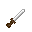
</td>
<td>An ancient sword used by those in the Roman army, it was the primary weapon used by foot soldiers.</td>
<td>313 B.C. - 313 B.C.</td>
<td>Yes</td>
<td></td>
</tr>
<tr>
<td>Roman buckler</td>
<td>

</td>
<td>A small shield used by the Roman Army not to protect the body, but to stop parry blows.</td>
<td>313 B.C. - 313 B.C.</td>
<td>No</td>
<td></td>
</tr>
<tr>
<td>Roman shield</td>
<td>

</td>
<td>The standard Roman shield also referred to as the "Scutum", used by the Roman Army. This shield is known for being used to perform the [Testudo Formation](https://en.wikipedia.org/wiki/Testudo_formation)</td>
<td>313 B.C. - 2020 A.D.</td>
<td>Yes</td>
<td></td>
</tr>
<tr>
<td>Roman standard</td>
<td>

</td>
<td>A Roman weapon for close-range fighting.</td>
<td>313 B.C. - 313 B.C.</td>
<td>No</td>
<td></td>
</tr>
<tr>
<td>Bronze shield</td>
<td>

</td>
<td>A shield made from bronze.</td>
<td>313 B.C. - 2020 A.D.</td>
<td>Yes</td>
<td></td>
</tr>
<tr>
<td>Iron shield</td>
<td>

</td>
<td>A shield made from iron.</td>
<td>313 B.C. - 2020 A.D.</td>
<td>Yes</td>
<td></td>
</tr>
<tr>
<td>Small sword</td>
<td>

</td>
<td>A small sword that can be made from various materials, such as; copper, iron and steel. Made for combat that's quick and close.</td>
<td>450 A.D. - 2020 A.D.</td>
<td>Yes</td>
<td></td>
</tr>
<tr>
<td>Arming sword</td>
<td>
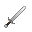
</td>
<td>A longer version of the short sword, can be made from bronze, iron or steel.</td>
<td>700 A.D. - 2020 A.D.</td>
<td>Yes</td>
<td></td>
</tr>
</table>

## 1013 A.D. Weapons

<table>
<tr>
<th>Weapon</th>
<th>Image</th>
<th>Description</th>
<th>Available</th>
<th>Craftable?</th>
<th>Ammo type</th>
</tr>
<tr>
<td>Garrote</td>
<td>
 
</td>
<td>Just like a necklace of pearls it is made to suit a neck, just not a lady's, and not for much time.</td>
<td>650 B.C. - 2020 A.D.</td>
<td>Yes</td>
<td></td>
</tr>
<tr>
<td>Throwing knife</td>
<td>
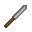
</td>
<td>A light knife made from iron, suited for throwing at dummies and unexpecting rivals.</td>
<td>900 A.D. - 2020 A.D.</td>
<td>Yes</td>
<td></td>
</tr>
<tr>
<td>Shuriken</td>
<td>

</td>
<td>A shuriken is a Japanese concealed weapon that is commonly used by the samurai and police as a hidden dagger or quick dagger to throw.</td>
<td>1013 A.D. - 2020 A.D.</td>
<td>Yes</td>
<td></td>
</tr>
<tr>
<td>Kunai</td>
<td>

</td>
<td>A weapon to stab with and throw, but also a tool to spy... yoooOOOOOoo.</td>
<td>1013 A.D. - 2020 A.D.</td>
<td>Yes</td>
<td></td>
</tr>
<tr>
<td>Naginata</td>
<td>

</td>
<td>A pole weapon used by the samurai class and the infantry of feudal Japan.</td>
<td>1013 A.D. - 1650 A.D.</td>
<td>Yes</td>
<td></td>
</tr>
<tr>
<td>Katana</td>
<td>
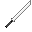
</td>
<td>A sword used by the samurai class in feudal Japan.</td>
<td>1013 A.D.- 2020 A.D.</td>
<td>Yes</td>
<td></td>
</tr>
<tr>
<td>Wakazashi</td>
<td>
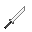
</td>
<td>The wakizashi is one of the traditionally made Japanese swords worn by the samurai in feudal Japan.</td>
<td>1013 A.D.- 2020 A.D.</td>
<td>Yes</td>
<td></td>
</tr>
<tr>
<td>Tanto</td>
<td>

</td>
<td>A short japanese knife.</td>
<td>1013 A.D.- 2020 A.D.</td>
<td>Yes</td>
<td></td>
</tr>
<tr>
<td>Halberd</td>
<td>
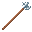
</td>
<td>The halberd consists of an axe blade topped with a spike mounted on a long shaft and a hook or thorn on the back side of the axe blade for grappling mounted combatants.</td>
<td>1013 A.D. - 2020 A.D.</td>
<td>Yes</td>
<td></td>
</tr>
<tr>
<td>Pike</td>
<td>
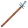
</td>
<td>A pike is a pole weapon, a very long thrusting spear used extensively by infantry.</td>
<td>1013 A.D. - 2020 A.D.</td>
<td>Yes</td>
<td></td>
</tr>
<tr>
<td>Steel shield</td>
<td>
  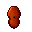 
</td>
<td>A shield made from hard steel, the most durable and resilient of its kind.</td>
<td>700 A.D. - 2020 A.D.</td>
<td>Yes</td>
<td></td>
</tr>
<tr>
<td>Steel shield</td>
<td>

</td>
<td>A shield used by saracens.</td>
<td>700 A.D. - 2020 A.D.</td>
<td>No</td>
<td></td>
</tr>
<tr>
<td>Templar Shield</td>
<td>
 
</td>
<td>A shield made from the best iron to fight for the Holy Throne. Deus lo vult!.</td>
<td>1100 A.D. - 1300 A.D.</td>
<td>No</td>
<td></td>
</tr>
<tr>
<td>Maul</td>
<td>

</td>
<td>A weapon made only for giants and mad men, this can reduce anyone to a meatsteak.</td>
<td>650 B.C. - 2020 A.D.</td>
<td>No</td>
<td></td>
</tr>
<tr>
<td>A large two-handed sword</td>
<td>
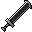
</td>
<td>"But for now... I'll fight with my sword for him! (voices sing)" *Clang!*</td>
<td>650 B.C. - 2020 A.D.</td>
<td>No</td>
<td></td>
</tr>
<tr>
<td>Cannon</td>
<td>
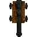 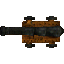 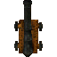 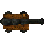
</td>
<td>A cannon capable of taking down castle walls by firing cannonballs.</td>
<td>1500 A.D. - 1850 A.D.</td>
<td>Yes</td>
<td>Stoneballs</td>
</tr>
<tr>
<td>Short bow</td>
<td>
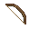 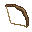
</td>
<td>A standard bow.</td>
<td>1013 A.D. - 1958 A.D.</td>
<td>Yes</td>
<td>Arrows</td>
</tr>
<tr>
<td>Long bow</td>
<td>
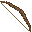 
</td>
<td>A bow capable of shooting further than a standard bow thanks to its longer string and bigger frame.</td>
<td>1013 A.D. - 1958 A.D.</td>
<td>Yes</td>
<td>Arrows</td>
</tr>
<tr>
<td>Crossbow</td>
<td>
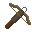 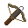
</td>
<td>A different kind of bow, with its string capable of storing energy until the lever of the frame is pulled, firing a bolt at high speeds.</td>
<td>1013 A.D. - 2020 A.D.</td>
<td>Yes</td>
<td>Bolts</td>
</tr>
<tr>
<td>Firelance</td>
<td>
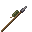 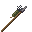
</td>
<td>The true predecesor of all firearms; inefficent, one-shot and with a reach of 3 metres. Used in the first days of gunpowder.</td>
<td>1013 A.D. - 1850 A.D.</td>
<td>Yes</td>
<td>Stonebullet</td>
</tr>
</table>

## 1713 A.D. Weapons

<table>
<tr>
<th>Weapon</th>
<th>Image</th>
<th>Description</th>
<th>Available</th>
<th>Craftable?</th>
<th>Ammo type</th>
</tr>
<tr>
<td>Police baton</td>
<td>

</td>
<td>A wooden baton to catch burglars.</td>
<td>1713 A.D. - 2020 A.D.</td>
<td>Yes</td>
<td></td>
</tr>
<tr>
<td>Rapier</td>
<td>
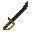
</td>
<td>A Rapier is type of sword with a slender and sharply-pointed two-edged blade. Common for duelling and self-defence but also as a military side arm.</td>
<td>1713 A.D.- 2020 A.D.</td>
<td>Yes</td>
<td></td>
</tr>
<tr>
<td>Cutlass</td>
<td>
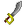
</td>
<td>A cutlass is a short, broad sabre or slashing sword, with a straight or slightly curved blade sharpened on the cutting edge, and a hilt often featuring a solid cupped or basket-shaped guard. Dominant during the Age of Sail.</td>
<td>1713 A.D.- 1713 A.D.</td>
<td>Yes</td>
<td></td>
</tr>
<tr>
<td>Spadroon</td>
<td>
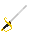
</td>
<td>A spadroon is a light sword with a straight edged blade, enabling both cut and thrust attacks. Used primarily in the army and the navy.</td>
<td>1713 A.D.- 1713 A.D.</td>
<td>Yes</td>
<td></td>
</tr>
<tr>
<td>Longsword</td>
<td>

</td>
<td>The largest sword most of people will be able to see, even if not the largest sword that can be made. Only for true knights.</td>
<td>1713 A.D.- 1713 A.D.</td>
<td>Yes</td>
<td></td>
</tr>
<tr>
<td>Sabre</td>
<td>
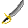
</td>
<td>A sabre is a type of backsword with a curved blade associated with the light cavalry.</td>
<td>1713 A.D.- 1873 A.D.</td>
<td>Yes</td>
<td></td>
</tr>
<tr>
<td>Handcannon</td>
<td>
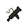
</td>
<td>The true successor to the firelance.</td>
<td>1713 A.D. - 1850 A.D.</td>
<td>Yes</td>
<td>Stonebullet</td>
</tr>
<tr>
<td>Musket</td>
<td>
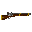
</td>
<td>A muzzled-loaded long gun, the musket is a heavier version of the arquebus that became popular all around the world due to it's ability to penetrate heavy armour.</td>
<td>1713 A.D. - 1713 A.D.</td>
<td>Yes</td>
<td>Musket cartridge</td>
</tr>
<tr>
<td>Musketoon</td>
<td>
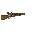
</td>
<td>A shorter version of the musket, the musketoon mainly was popular among pirates and acted as a service shotgun or carbine.</td>
<td>1713 A.D. - 1713 A.D.</td>
<td>Yes</td>
<td>Musket cartridge</td>
</tr>
<tr>
<td>Arquebus</td>
<td>
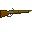
</td>
<td>The earliest version of a rifle in the 15th century, it is fired from its support stick.</td>
<td>1713 A.D. - 1850 A.D.</td>
<td>Yes</td>
<td>Musket cartridge</td>
</tr>
<tr>
<td>Flintlock pistol</td>
<td>
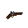
</td>
<td>A flintlock rifle modified to be as small as a pistol. Famous around duellists, has a short range.</td>
<td>1713 A.D. - 1850 A.D.</td>
<td>Yes</td>
<td>Musketball (pistol)</td>
</tr>
</table>

## 1873 A.D. Weapons

<table>
<tr>
<th>Weapon</th>
<th>Image</th>
<th>Description</th>
<th>Available</th>
<th>Craftable?</th>
<th>Ammo type</th>
</tr>
<tr>
<td>Colt Peacemaker</td>
<td>
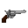 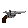
</td>
<td>The Colt Single Action Army, also known as the Single Action Army and Peacemaker, is a single-action revolver with a revolving cylinder holding six metallic cartridges.</td>
<td>1873 A.D.- 1973 A.D.</td>
<td>Yes</td>
<td>.45 Colt</td>
</tr>
<tr>
<td>Derringer</td>
<td>
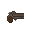 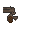
</td>
<td>A single-shot muzzleloading percussion cap pistol, for the wealthy and for those who want a quick, stealthy draw.</td>
<td>1873 A.D.- 1973 A.D.</td>
<td>Yes</td>
<td>.41 Short</td>
</tr>
<tr>
<td>Winchester 1873</td>
<td>
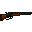
</td>
<td>A lever-action repeating rifle. The gun that won the West.</td>
<td>1873 A.D.- 1973 A.D.</td>
<td>Yes</td>
<td>.44-40</td>
</tr>
<tr>
<td>Sharps rifle</td>
<td>
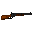 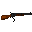
</td>
<td>A large-bore single-shot rifle.</td>
<td>1873 A.D.- 1973 A.D.</td>
<td>Yes</td>
<td>.45-70</td>
</tr>
<tr>
<td>Martini-Henry</td>
<td>
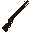 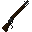
</td>
<td>The Martini–Henry is a breech-loading single-shot lever-actuated rifle</td>
<td>1873 A.D.- 1973 A.D.</td>
<td>Yes</td>
<td>.577/540</td>
</tr>
<tr>
<td>Gewehr71</td>
<td>

</td>
<td>A german service rifle.</td>
<td>1873 A.D.- 1973 A.D.</td>
<td>Yes</td>
<td>7.65x53mm</td>
</tr>
<tr>
<td>Artillery</td>
<td>
   
</td>
<td>A heavy set of equipment made to continuously fire artillery shells upon great distances by flying in an arc.</td>
<td>1850 A.D.- 2020 A.D.</td>
<td>Yes</td>
<td>Artillery shell</td>
</tr>
</table>

## 1903-2020 A.D. Weapons

<table>
<tr>
<th>Weapon</th>
<th>Image</th>
<th>Description</th>
<th>Available</th>
<th>Craftable?</th>
<th>Ammo type</th>
</tr>
<tr>
<td>Karabiner 98k</td>
<td>

</td>
<td>A bolt-action rifle, the Kar98k was the standard service rifle used by the German Wehrmacht in World War II.</td>
<td>1943 A.D. - 1943 A.D.</td>
<td>No</td>
<td>7.92x57mm Mauser</td>
</tr>
<tr>
<td>Ak47</td>
<td>
 
</td>
<td>Ak47</td>
<td>1943 A.D. - 2020 A.D.</td>
<td>No</td>
<td>7.62×39mm</td>
</tr>
<tr>
<td>MP40</td>
<td>

</td>
<td>A submachine gun, the MP40 was mainly used by infantrymen, platoon officers, and paratroopers in the Wehrmacht.</td>
<td>1943 A.D. - 1943 A.D.</td>
<td>No</td>
<td></td>
</tr>
<tr>
<td>Compound bow</td>
<td>
 
</td>
<td>A bow that uses a levering system, cables and pulleys to bend the limbs to store more power inside the frame than the longbow.</td>
<td>1958 A.D.- 2020 A.D.</td>
<td>Yes</td>
<td>Arrows</td>
</tr>
<tr>
<td>G3</td>
<td>
 
</td>
<td>A german select-fire battlerifle developed by Heckler &amp; Koch.</td>
<td>1943 A.D. - 1943 A.D.</td>
<td>No</td>
<td>7.92x57mm Mauser</td>
</tr>
<tr>
<td>Flammenwerfer</td>
<td>

</td>
<td>A German flamethrower used in World War II to burn Russians and Americans to a crisp; Just watch your back!. "Hans! Get ze flammenwerfer"</td>
<td>1943 A.D. - 1943 A.D.</td>
<td>No</td>
<td>Flammen</td>
</tr>
<tr>
<td>RPG-7</td>
<td>
 
</td>
<td>A russian-developed unguided rocket-launcher.</td>
<td>1943 A.D. - 2020 A.D.</td>
<td>No</td>
<td>40 mm</td>
</tr>
<tr>
<td>M16</td>
<td>
 
</td>
<td>An American rifle.</td>
<td>1943 A.D. - 1943 A.D.</td>
<td>No</td>
<td>5.56×45mm NATO</td>
</tr>
<tr>
<td>Shank</td>
<td>

</td>
<td>For when the guards don't give you enough food...</td>
<td>1973 A.D.- 2020 A.D.</td>
<td>Yes</td>
<td></td>
</tr>
<tr>
<td>FN P90</td>
<td>
 
</td>
<td>FN P90</td>
<td>1973 A.D.- 2020 A.D.</td>
<td>No</td>
<td>FN 5.7×28mm</td>
</tr>
<tr>
<td>FN SCAR-L</td>
<td>
 
</td>
<td>A light version of the FN SCAR</td>
<td>1973 A.D.- 2020 A.D.</td>
<td>No</td>
<td>5.56×45mm NATO</td>
</tr>
<tr>
<td>FN SCAR-H</td>
<td>
 
</td>
<td>A heavy version of the FN SCAR</td>
<td>1973 A.D.- 2020 A.D.</td>
<td>No</td>
<td>7.62×51mmmm NATO</td>
</tr>
<tr>
<td>Makeshift AK</td>
<td>
 
</td>
<td>A barely functional imitation of the gas-operated, 7.62×39mm assault rifle, developed in the Soviet Union by Mikhail Kalashnikov</td>
<td>2013 A.D.- 2020 A.D.</td>
<td>Yes</td>
<td>7.62x39mm</td>
</tr>
</table>

***

## Firearm maintenance and configuration

Before working, **unload the chamber and internal ammunition, remove the inserted magazine even if empty, and unload any attached grenade launcher**. Hold the gun and keep the part in your active hand. Installation or removal takes **15 ticks** and cancels if access, compatibility, tools or ammunition change. A gun under work cannot fire or reload.

| Part | Required tool or station |
| --- | --- |
| Optic or optic rail | Screwdriver in your inventory |
| Underbarrel grip, bipod, weapon light or launcher | Adjacent, anchored firearm maintenance bench |
| Compatible bayonet or suppressor | Hand installation |

Use **Field Strip** to select a part to remove; the same tool rules apply. Integrated iron sights remain installed, and removed parts drop at your feet. **Remove an optic before removing its adapter.**

### Dovetail-to-Picatinny rail

Craft the adapter from **2 steel** in the **Tools** menu with **Gunsmithing**, in **eras 6 through 8**. Crafting takes **120 ticks**.

The adapter fits one empty native dovetail optic slot on a gun without a native Picatinny mount. It physically hosts **one Picatinny optic**. It does not add a second optic slot, accept another adapter, change caliber or ammunition, or alter magazine, suppressor or underbarrel compatibility.

The rail adds **0.15 weight**. Attachments retain their ergonomics factors, while added rail and part weight reduces handling through effective ergonomics. The existing firing-dispersion calculation uses that value, so more hardware is a handling tradeoff.

### Bipod

Craft a bipod from **2 steel** in the **Weapons** menu after **Gunsmithing**. It fits the underbarrel rail of rifles and machine guns that have a Picatinny underbarrel mount, and you fit it at a firearm maintenance bench.

The bipod is **braced** when you have kept still for a second and are either lying prone or facing something solid right in front of you, such as a wall, sandbags, a table or a barricade. A braced gun has much less recoil and spread. On the move the bipod does nothing and makes the gun slightly harder to handle. Examine the gun to see whether it is braced.

### Weapon light

Craft a weapon light from **1 electronics** in the **Weapons** menu after **Consumer Electronics**. It takes the underbarrel rail, so a gun can carry a bipod or a weapon light but not both. Right-click the gun and choose **Toggle Weapon Light**. The light shines only while the gun is in your hands.

### Gun sling

Craft a gun sling from **2 leather** in the **Weapons** menu after **Gunsmithing**. Hold the gun in one hand and use the sling in the other to fit it. Only guns you can wear on your shoulder or back take one. If you are knocked down, stunned or knocked out and drop a slung gun, it stays on your shoulder or back as long as that slot is free.

### Modular gun parts

These gun families are built from four parts:

- **AK:** AKM and AK-74 rifles (including the folding-stock, short and tactical versions) and the AK-101 to AK-105.
- **AR:** the M16A1, AR-15, M16A2 and M16A4, the XM177E2, M4 and MK-18 carbines, the C7 and C8, and the semi-automatic Bushmaster XM-15.
- **Mauser:** the Gewehr 98, Karabiner 98a and 98k, the Mauser M1890, M1893 and M1903, the Gewehr 71 and the Madsen M47 bolt-action rifles (see below).
- **Mosin:** the Mosin M1891 and 91/30 bolt-action rifles. The sawn-off Obrez cannot be taken apart.
- **Arisaka:** the Arisaka Type 30, 35, 38, 97 and 99 bolt-action rifles.
- **Lee-Enfield:** the Lee-Enfield Mk. III and the Pattern 1914 Enfield.
- **Springfield:** the M1903 Springfield, including the scoped version.
- **Lebel:** the Lebel 1886/M93, including the scoped version.
- **Berthier:** the Berthier M1907/15 and M1907/16, including the scoped version.
- **Carcano:** the Carcano 1891.
- **Murata, Berdan, Volkssturmgewehr and M24:** the Type-22 Murata, Berdan M1870, Volkssturmgewehr and M24 SWS bolt-action rifles, each a family of its own.
- **Sharps, Rolling-block and Martini-Henry:** the single-shot Sharps, Rolling-Block (both the .45-70 and the Spanish .43 versions) and Martini-Henry rifles.
- **PTRD, PzB and Barrett:** the PTRD-41 and PzB 39 anti-tank rifles and the Barrett M99, including the scoped versions.

- **Semi-automatic rifles:** the SKS (including the Chinese and SKS-M versions), Gewehr 41 and 43 (one family), SVT-40, M1 Garand, M1 Carbine, Fedorov Avtomat, Volkssturmkarabiner 98, PTRS-41, SVD, VSS Vintorez, Barrett M82 and BAMR, each a family of its own.
- **Lever-action:** every lever-action rifle, including the Winchesters, the Henry and Evans repeaters and the Cowboy Repeater, shares one family.

- **Pistols:** the Nambu (Type A and Type 14), Bergmann, Luger, Walther P38, Browning Hi-Power, Mauser C96, Borchardt, Colt Pocket Hammerless (M1903 and M1908), M1911 (including the Colt Mark IV and STI 2011), Tokarev TT-33, Makarov, Stechkin APS, Glock (including the IOQ B-72 and Tarus G3, which take Glock magazines), Beretta M9, Jericho 941, SIG 250, SIG P220, PL-14, MP-443 and Desert Eagle.
- **Revolvers:** the Nagant M1895, Modele 1892, Colt Single Action (Peacemaker, Storekeeper and Frontier), Colt M1892, Colt Police Positive, Smith & Wesson (Model 30, Orbea Hermanos and M.10), Enfield No. 2, Webley Mk IV, Type 26, Derringer, Magnum 44, Mckellen M12, Taurus Judge and the Colt Revolving Rifle.

- **Shotguns:** pump-action shotguns share one family; the KS-23, coach gun, MTS-225, Remington 11, SPAS-12, Saiga-12, USAS-12 and AR-12 are each a family of their own.
- **Submachine guns:** the MP40, Erma EMP, MAB 38, Sten, Thompson (including the Tommy gun), M3 Grease Gun, PPSh, PPD, PPS, Type 100, MP5, Uzi, Skorpion, TEC-9, Kriss Vector, MAC-10, P90 and SR-3.
- **Automatic rifles:** the StG-44, FG42, M14, FAL, G3, AR-10, HK417, SCAR (L and H), AUG, L85, QBZ-95 and VZ-58.
- **Machine guns:** the BAR, Breda 30, Browning M1919, DP, Madsen, MG 13, MG 34, Type 96 and 99, MG 3, M60, C6, M249, Negev, RPD, RPK (47 and 74), PKM and NSV.

The makeshift bolt rifle, the training Arisaka, the makeshift revolver, the Panther revolver and the makeshift AK cannot be taken apart. Emplaced and vehicle-mounted guns, such as the Maxim, Vickers, DShK and autocannons, are serviced in place and have no removable parts.

Hold the gun, then right-click it and choose **Gun Parts** to open its parts panel. The panel shows whether the gun can fire and what is stopping it, its cartridge, handling and the magazines or clips it takes, and each installed part with its condition and a **Remove** button. Unload the gun before working on it. Every gun part you carry is listed too, with a preview of what fitting it would change: handling before and after, the cartridge, and whether the gun would still fire. Hold a part in your active hand to get a **Fit** button, or use it on the gun. Examining the gun up close also lists its parts. Each family's parts only fit guns of that family.

**Salvaging parts:** next to a firearm maintenance bench, a part you carry can be scrapped from the parts panel's **Salvage** button, or by using the part on the bench. You are first shown what is destroyed and what comes back, and nothing happens until you confirm. Salvage returns about half the part's factory materials, less for worn parts: a new AK barrel (3 steel) gives back 2 steel, while a worn-out barrel gives back nothing.

| Part | AK options | AR options | Where you can swap it |
| --- | --- | --- | --- |
| Magazine well | 7.62x39mm, 5.45x39mm or 5.56x45mm | 5.56x45mm (M16 and AR-15 magazines) | By hand |
| Stock | Fixed or folding | Fixed or collapsible | By hand |
| Barrel | 7.62x39mm, 5.45x39mm or 5.56x45mm | 5.56x45mm | Next to a firearm maintenance bench |
| Bolt carrier group | AK | AR | Next to a firearm maintenance bench |

- **Changing caliber:** fit an AK barrel and magazine well of the same cartridge. The rifle then takes that ammunition and its magazines, so an AK-74 with 7.62x39mm parts loads AKM magazines and one with 5.56x45mm parts loads AK-101 magazines. Mismatched parts, or a missing bolt carrier, barrel or magazine well, stop the rifle from firing.
- **Stocks:** a rifle with no stock still fires but is harder to handle. Folding and collapsible stocks are slightly less steady than fixed ones.
- **Barrel wear:** every shot wears the barrel, and a worn-out barrel stops the rifle firing until you replace it. Parts keep their condition when you remove them, so swapping parts never repairs anything.

**Bolt-action rifles** (Mauser, Mosin, Arisaka, Lee-Enfield, Springfield, Lebel, Berthier and Carcano) have a bolt, a barrel, a fixed magazine and a wooden stock, swapped the same way as above. The magazine decides which stripper clips and rounds the rifle takes, so fit a barrel and magazine of the same cartridge to rebarrel a rifle. Mausers come in 7.92x57mm, 7.65x53mm or 7x57mm, so a Kar98k can become a 7.65x53mm rifle. Arisakas come in 6.5x50mm or 7.7x58mm, so a Type 38 can take Type 99 clips. Mosins only come in 7.62x54mmR, and the other bolt-action families in their own single cartridge. A Berthier takes either the three-round magazine or the longer five-round M16 magazine, which changes the clips it takes and how many rounds it holds.

**Single-shot rifles** (Sharps, Rolling-block, Martini-Henry, PTRD, PzB and Barrett) have a breechblock or bolt, a barrel, an extractor or breech that takes one round at a time, and a stock. A Rolling-Block rifle can be converted between .45-70 and .43 Spanish by fitting a barrel and extractor of the other cartridge.

**Semi-automatic and lever-action rifles** work the same way, with a bolt carrier (or lever) instead of a bolt:

- An SKS can be fitted with the SKS-M magazine well to take SKS-M and AK-47 magazines, and an SKS-M can go back to the fixed ten-round magazine loaded from clips.
- A Gewehr 41 and a Gewehr 43 swap between the fixed clip-loaded magazine and the detachable Gewehr 43 magazine the same way.
- Lever-action barrels and tube magazines come in .44-40, .357 Magnum and .45-70. The tube keeps the rifle's own length, so a Winchester M1873 rebarrelled to .45-70 still holds 14 rounds.

**Pistols** have a slide, a barrel, a magazine well and a grip; **revolvers** have lockwork, a barrel, a cylinder and a grip. The bare core is called a frame. Some convert between cartridges by swapping the barrel and the magazine well or cylinder:

- Colt Pocket Hammerless: .32 ACP or .380 ACP.
- Desert Eagle: .50 or .44 Magnum.
- M1911: the 2011 grip module takes STI 2011 magazines.
- Colt Single Action: .45 Colt or .44-40.
- Smith & Wesson: .32 or .38.

**Shotguns, submachine guns, automatic rifles and machine guns** have a receiver, an action or bolt, a barrel, a magazine well (or tube magazine, breech, cylinder or feed tray) and a stock. Some convert between cartridges:

- SCAR: 5.56x45mm (STANAG magazines) or 7.62x51mm (SCAR-H magazines).
- RPK: 7.62x39mm (RPK-47 and AK-47 magazines) or 5.45x39mm (RPK-74 and AK-74 magazines).
- Type 96/99: 6.5x50mm or 7.7x58mm.

**Making rifle parts in a factory:** once your faction has researched **Automatic Weapons**, fabricators can make every AK and AR part and a bare **AK receiver** or **AR receiver**. Fit a bolt carrier and a barrel to the receiver at a firearm maintenance bench, then a magazine well and a stock, and you have a working rifle named after its family and caliber.

| Fabricator recipe | Inputs | Minimum fabricator |
| --- | --- | --- |
| AK receiver | 6 steel | Automated (tier 2) |
| AR receiver | 5 steel | Automated (tier 2) |
| AK or AR bolt carrier group | 3 steel | Automated (tier 2) |
| AK barrel (7.62x39mm, 5.45x39mm or 5.56x45mm) or AR barrel | 3 steel | Automated (tier 2) |
| AK or AR magazine well | 2 steel | Assembly (tier 1) |
| AK fixed stock | 2 wood | Assembly (tier 1) |
| AK folding stock | 2 steel | Assembly (tier 1) |
| AR fixed or collapsible stock | 2 plastic | Assembly (tier 1) |

Fabricators also make every bolt-action and single-shot part and a bare receiver for each family. The research a family needs depends on its era:

- **Cartridge Firearms**, at Assembly (tier 1): Mauser, Mosin, Arisaka, Lee-Enfield, Springfield, Lebel, Berthier, Carcano, Murata, Berdan, Sharps, Rolling-block and Martini-Henry.
- **Cartridge Firearms**, at Assembly (tier 1): lever-action.
- **Self-Loading Firearms**, at Assembly (tier 1): Volkssturmgewehr, PTRD, PzB, SKS, Gewehr 41/43, SVT, M1 Garand, M1 Carbine, Fedorov, Volkssturmkarabiner and PTRS.
- **Automatic Weapons**, at Automated (tier 2): M24, Barrett M99, SVD, VSS, Barrett M82 and BAMR.

| Fabricator recipe | Rifles | Anti-tank and anti-materiel rifles (PTRD, PTRS, PzB, Barretts, BAMR) |
| --- | --- | --- |
| Receiver | 4 steel | 6 steel |
| Bolt, bolt carrier, lever or breechblock | 2 steel | 3 steel |
| Barrel (any caliber of that family) | 3 steel | 5 steel |
| Magazine, magazine well, extractor or breech (any caliber of that family) | 1 steel | 2 steel |
| Stock | 3 wood (M24: 2 steel) | 2 steel |

Pistol and revolver parts are made at Assembly (tier 1): pre-war designs need **Cartridge Firearms**, and the Makarov, Stechkin, Glock, Beretta, Jericho, SIG, PL-14, MP-443, Desert Eagle, Magnum 44, Mckellen and Taurus Judge need **Automatic Weapons**.

| Fabricator recipe | Pistols and revolvers |
| --- | --- |
| Frame | 2 steel |
| Slide or lockwork | 1 steel |
| Barrel | 1 steel |
| Magazine well or cylinder | 1 steel |
| Grip | 1 wood (Automatic Weapons designs: 1 plastic) |

Shotgun, submachine gun, automatic rifle and machine gun parts need:

- **Cartridge Firearms**, at Assembly (tier 1): pump-action, coach gun and Remington 11.
- **Self-Loading Firearms**, at Assembly (tier 1): the wartime submachine guns (MP40 to Type 100), StG-44, FG42 and the BAR, Breda 30, Browning M1919, DP, Madsen, MG 13, MG 34 and Type 96/99.
- **Automatic Weapons**, at Assembly (tier 1): the KS-23, MTS-225, SPAS-12, Saiga-12, USAS-12, AR-12 and the post-war submachine guns (MP5 to SR-3).
- **Automatic Weapons**, at Automated (tier 2): the post-war automatic rifles (M14 to VZ-58) and machine guns (MG 3 to NSV).

| Fabricator recipe | Shotguns | Submachine guns | Automatic rifles | Machine guns (NSV) |
| --- | --- | --- | --- | --- |
| Receiver | 3 steel | 3 steel | 4 steel | 5 steel (7) |
| Action, bolt or bolt carrier | 2 steel | 1 steel | 2 steel | 2 steel (3) |
| Barrel | 3 steel | 2 steel | 3 steel | 4 steel (6) |
| Magazine well, tube, breech, cylinder or feed tray | 1 steel | 1 steel | 1 steel | 2 steel (3) |
| Stock | 3 wood, 2 steel or 2 plastic | 1 steel or 1 plastic | 3 wood, 2 steel or 2 plastic | 3 wood, 2 steel or 2 plastic |

With this many recipes, a fabricator first asks which group to choose from: **General**, or one family's parts such as **Glock parts**.

### Cleaning and repairs

In the default catalog, craft a **firearm cleaning kit from 5 iron** in Tools or a **firearm maintenance bench from 18 iron** in Production. Tech-tree mode gates both through **Gunsmithing**; map catalogs, skills and other research modes still apply.

A cleaning kit works on projectile firearms other than bows at **50% condition up to, but excluding, 80%**. After **100 ticks**, it restores **80% condition**. More severe damage needs the firearm maintenance bench.

The bench repairs **25 condition** at a cost of **1 maximum condition**, taking **180 ticks**. The firearm must still have positive condition; a broken gun cannot be restored by this repair. Damage during work cancels the repair. Existing shot wear, jams and condition checks still apply.

## Reloading Mechanism

### Arquebus ( Late Medieval )

1. Add **Gunpowder**

   Either from barrel full of **Gunpowder** or **Gunpowder pouch.**
   
2. Add **Projectiles** 

   Musket balls; **Can be made from any materials.**
   
3. Cock the flintlock/musket and **Fire**

   **Press Z to cock the musket.**
   
> Tip: Keep powder in a gunpowder pouch and musket balls within reach. These weapons fire one shot before reloading; have a plan for the reload.

A flintlock's flint wears down after a few dozen shots and then misfires about half the time. Use a sharpened flint on the gun to fit a new one; see [Gunflint in flintlocks](Guide_to_Flint.md#gunflint-in-flintlocks).

### Flintlock parts assembly

At **ages 3 and 4**, with **Gunsmithing** unlocked, you can assemble a flintlock pistol or musket from parts. The original weapon crafting routes remain available; this is an optional route with additional wood, steel and flint costs.

| Part | Production route | Cost |
| --- | --- | --- |
| Pistol butt | Plank Tools menu | 1 softwood, 120 ticks |
| Musket stock | Plank Tools menu | 3 softwood, 240 ticks |
| Pistol barrel | Iron on an anvil, choose flintlock parts | 20 iron |
| Musket barrel | Iron on an anvil, choose flintlock parts | 30 iron |
| Flintlock mechanism | Steel on a steel anvil | 2 steel |

Existing blacksmith skill and job restrictions apply. Gather flint from rocks with **Grab intent**, then strike a rock with it until sharpened.

1. Use sharpened flint on the mechanism: **20 ticks**.
2. Use the matching barrel on the pistol butt or musket stock.
3. Use the loaded mechanism on that barreled stock.

The last two actions take **20 ticks each for a pistol**, or **30 each for a musket**. Hold the input in your active hand; hold the target or leave it on adjacent ground. Movement, losing an input, incapacitation or losing the research/era requirement cancels consumption. Traded parts still require Gunsmithing and age 3 or 4 to assemble. Partial assemblies survive saves.

Finished guns use their existing ammunition, firing behavior and stats. See the loading instructions below. Original feature coding: **Isaku4904**; parts sprites: **mohamed/mm2hn**.

### Muskets/Flintlocks ( Early Gunpowder Age )

Some muskets use prepared ammunition instead of separate powder and balls:

1. Insert the appropriate **musket ammunition**.
2. Cock the musket and fire.

Carry a useful supply in your webbing, but leave ammunition for teammates and late joiners. A compatible bayonet provides a melee option.

### Lever-Action/Cowboy Revolvers ( The Frontier Age )

1. Examine your gun to check its caliber and find compatible ammunition.
2. Right-click the ammunition pouch and select **toggle drawing method** to access its contents.
3. Load the rounds and press **Z** to chamber a round when required.

Some guns require you to remove spent casings before reloading. Check the gun's controls if fresh rounds will not load.

### WW1/WW2/Modern Guns

Insert a compatible magazine and chamber a round as required by the gun. Check the firing mode before engaging. Examine a gun while you hold it to count the rounds left, and a reload shows the new count above the gun.

**Ammunition handling:**

- Toggle the drawing method on ammunition boxes and pouches to take ammunition from them while held.
- Refill compatible magazines or clips by combining them, or stand over ammunition piles and press **C**. The caliber must match. Ammunition boxes and pouches can also be refilled this way.
- Fired brass can be loaded again with gunpowder and iron bullets. See [cartridges](Guide_to_Crafting.md#iron-projectiles) in the crafting guide.
- Caliber alone does not tell you how an engagement will go. Accuracy, cover, ammunition and positioning matter too.

**Armor and ammunition types:**

- Helmets and body armor reduce bullet damage. The closer the armor is to a round's penetrating power, the more of the hit it absorbs, and armor strong enough stops the round entirely. Armor never makes a hit worse.
- Examine armor to see its bullet protection tier:

  | Tier | What it does against ordinary rounds |
  | --- | --- |
  | Light | Softens pistol and rifle rounds |
  | Medium | Stops pistol rounds, softens rifle rounds |
  | Heavy | Stops pistol and intermediate rifle rounds such as 7.62x39mm and 5.56x45mm |
  | Very heavy | Stops full rifle rounds such as 7.62x51mm; armor-piercing and heavy machine gun rounds still get through |

- Absorbing hits wears armor down, so damaged armor protects for less time. Repair or replace it.
- Rounds marked **(AP)**, armor piercing, deal less damage but beat about one more armor tier and pass through one more layer of cover. Use them against armored targets.
- Rounds marked **(HP)**, hollow point, deal more damage to unprotected targets but are easily stopped by armor and do not pass through bodies or cover.
- Examine a round to see its tradeoff, and a magazine to count the AP and HP rounds in it.
- A round your armor stops does not wound, stun or leave shrapnel in you, but the impact can still knock you down, so armor is not a reason to stand in the open.
- Shrapnel from a hit lodges in the body part that was hit.

For reagent handling and gunpowder production, consult the [chemistry guide](Guide_to_Chemistry.md). A barrel is a container, not a substitute for checking the recipe.

## Weapon types and how to use them.

### Pistols

Pistols are compact weapons for close-range defence. Their limited ammunition and range make them a poor substitute for a rifle in an open-field engagement. Carry spare ammunition and avoid relying on a guaranteed hit.

### Submachine Gun

Submachine guns suit short-range fighting in rooms and alleys. Automatic fire increases spread, so use controlled bursts and avoid prolonged engagements across open ground.

### Semi-Auto/Automatic Rifles

Rifles offer flexibility across different engagement distances. Use semi-automatic fire for controlled shots and automatic fire for close engagements or suppression. Firing more bullets does not make every bullet more accurate.

### Bolt-Action Rifles:

Bolt-action rifles reward careful positioning and deliberate shots. Keep distance where possible and account for the time between shots. Cover still matters, and an empty rifle is a strong argument for bringing spare ammunition.

### Machine Guns

Machine guns help defend positions and suppress enemy movement. Coordinate with teammates and manage ammunition.

Long bursts heat the barrel. You are warned when it gets hot, and once it is red hot the gun will not fire until it has cooled for a few seconds. Mounted machine guns heat up more slowly than light ones. Examine the gun to check its barrel. Fire in short bursts to keep it working. Firing can restrict movement, leaving an exposed gunner vulnerable; choose cover before starting a sustained burst.

**Cover and positioning:**

- Entrenchment and sandbags reduce the chance of being hit; they do not make you invulnerable.
- Resting is not a guarantee of protection from gunfire.
- An enemy you can see may also be able to see you. Avoid staying exposed while repeatedly exchanging shots.
- Bullets can penetrate some obstacles. Do not assume a wall always stops incoming fire.

## Grenades and What to do with them:

| Type | Use and cautions |
| --- | --- |
| Shrapnel | Fragments threaten nearby players. Move away from a thrown grenade and seek cover. |
| High explosive / anti-tank | Explosions threaten infantry and can damage vehicles. Avoid approaching a tank's front to throw one. |
| Chemical | Gas threatens players in affected areas, especially enclosed spaces. Use appropriate protective equipment and keep teammates clear. |
| Smoke | Blocks visibility and helps screen movement or casualty recovery. Smoke provides concealment; it does not make the area immune to bullets. |

## Drones

Digital Age factions with **Drones** research can build flying drones from electronics: a **drone controller** (10), a **quadcopter drone** (15) and a **payload drone** (20).

1. Place the drone, then hit it with the controller to pair them. Each controller flies one drone.
2. Use the controller in hand to take control. Your movement keys now steer the drone, and **Space** takes off or lands. Use the controller in hand again to let go.
3. A payload drone carries one grenade. Hit the landed drone with a grenade to attach it (it takes a few seconds), fly it over the target and press **C** (secondary activation) with the controller in hand to release it. The grenade arms as it drops.

A broken drone stops responding until it is repaired with a welding tool or tape.

## How to use artillery

This is the artillery menu. From the top to the bottom:

1.  The shell you have loaded
2.  How far you are aiming to hit
3.  The deviation to the right/left of the shell (from your character's point of view)

To have a higher chance of success at firing artillery shells on your
enemies' territory, it's best if you have a telescope in hand. Or even
better yet, a "spotter" to have their telescope always on the target,
telling you where to aim while you control the artillery.

Each tile further means you'll have to add the value of "1" to the distance. If you want to hit 45 tiles away, you must aim for "45" distance.*

The sway is the "deviation" or just sway, that the shell will be
affected by. If you fire from coordinates that aren't exactly
aligned with your enemy, you can use these to move your shell
left-to-right instead of moving the artillery.

You will need to load a shell before firing, you can clearly see if
there's one by checking the panel.

There are many kinds of shells, like chlorine shells, zyklon B
shells, white phosphorus shells, makeshift nuclear shells and many
more, but let's see these more simple examples.

This is a <b>H</b>igh-<b>E</b>xplosive shell, it will create a big explosion where
it lands, spreading fire along. Great if your enemy has houses made out
of wood or if there's grass around.

This is an <b>A</b>rmor-<b>P</b>iercing shell, it will pierce through the armour of
tanks.

**All the other shells are:**

<table>
<tr>
<td style="text-align: center;">

Chlorine

</td>
<td style="text-align: center">

Designed to cause overexposure to the chlorine element, it causes
respiratory system failure and severe nose and throat irritation

</td>
</tr>
<tr>
<td style="text-align: center;">

Mustard

</td>
<td style="text-align: center">

A man-made agent which causes chemical burning of the skin, eyes, and
throat, very nasty stuff.

</td>
</tr>
<tr>
<td style="text-align: center;">

Phosgene

</td>
<td style="text-align: center">

A far more potent and well disguised cousin of chlorine gas, it has a
slightly delayed but otherwise identical effect.

</td>
</tr>
<tr>
<td style="text-align: center;">

White Phosphorus

</td>
<td style="text-align: center">

A type of pyrophoric incendiary munition, it ignites air creating a
large smoke cloud. Temperatures high enough to cause fourth degree burns
to anyone unfortunate enough to be in direct contact.

</td>
</tr>
<tr>
<td style="text-align: center;">

Xylyl Bromide

</td>
<td style="text-align: center">

Primarily used as a "tear gas" type agent. Stereotypical respiratory
pain and eye, skin, and throat irritations. Not heavily lethal, however.

</td>
</tr>
<tr>
<td style="text-align: center;">

Zyklon B

</td>
<td style="text-align: center">

Cyanide-based pesticide, it impedes upon cellular respiration. In
simpler words it 'deactivates' the entire human body within minutes
post-inhalation.

</td>
</tr>
<tr>
<td style="text-align: center;">

APCR

</td>
<td style="text-align: center">

A shell designed with a hard metal penetrating core, it has extreme
penetrative force made to wound tank crews and disable vehicle
components.

</td>
</tr>
<tr>
<td style="text-align: center;">

AP

</td>
<td style="text-align: center">

A steel alloy shell designed to survive the shock of direct hits against
metal armor and continue going. Not exactly fancy but it works.

</td>
</tr>
<tr>
<td style="text-align: center;">

HE

</td>
<td style="text-align: center">

A shell designed to inflict as much concussive explosive force as
possible, applications include destruction of fortifications or direct
anti-personnel usages.

</td>
</tr>
<tr>
<td style="text-align: center;">

Makeshift Nuclear

</td>
<td style="text-align: center">

A shell designed to irradiate a large area for long periods of time.

</td>
</tr>
