

Civilization 13 wiki

# Build a civilization from the Stone Age to the modern era

Civilization 13 (formerly 1713) is a free multiplayer game based on Space Station 13 code, played through BYOND, that spans several epochs of human history. It features both roleplay and team-deathmatch modes, with the main one being [Nomads](gamemodes/Civilizations_and_Nomads.md), in which you bring your civilization from the Stone Age to the Modern Age. Visit the [Civ13 website](https://civ13.github.io/) for an overview of the game.

<a class="wiki-button" href="New_Player_Guide.md">How to play</a> <a class="wiki-button wiki-button-secondary" href="guides_overview.md">Browse the guides</a> <a class="wiki-button wiki-button-secondary" href="https://civ13.github.io/Civ13/crafting/">Crafting Atlas</a>

## Start playing

<ol class="wiki-steps">
<li><strong>Install BYOND</strong>
<a href="https://www.byond.com/download/">Download BYOND</a> and install the Windows client. BYOND lists Linux as a hosting platform rather than a game client; macOS is not listed as a supported player platform.
</li>
<li><strong>Learn the basics</strong>
<a href="rules/Rules.md">Read the server rules</a> and <a href="New_Player_Guide.md">learn how to play</a>. The <a href="Starter_Guide.md">Starter Guide</a> covers your first hour as a nomad.
</li>
<li><strong>Choose a server</strong>
These links open BYOND when the client is installed: <a href="byond://civ13.com:1715">Join RP / Nomads</a> or <a href="byond://civ13.com:1714">Join TDM</a>.
</li>
</ol>

For questions or community help, join the [Civ13 Discord](https://discord.gg/hBEtg4x). To contribute, use the edit links on a page or follow the [wiki contribution guide](Contributing_to_the_Wiki.md). The game source is on [GitHub](https://github.com/Civ13/Civ13).

## Guides

The guides cover every stage of a civilization. See the [guides overview](guides_overview.md) for the full list grouped by topic, including [research](guides/Guide_to_Research.md), [power and batteries](guides/Guide_to_Power.md), [factory automation](guides/Guide_to_Factory_Automation.md), [boats](guides/Guide_to_Boats.md), [trains](guides/Guide_to_Trains.md) and [travel between lands](guides/Guide_to_Travel.md).

<ul class="wiki-icon-grid">
<li><a href="New_Player_Guide.md">How to Play</a></li>
<li><a href="rules/Rules.md">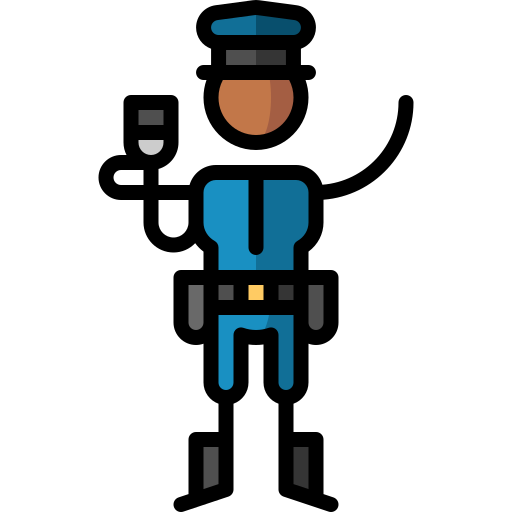Rules</a></li>
<li><a href="Starter_Guide.md">Starter Guide</a></li>
<li><a href="gamemodes/Civilizations_and_Nomads.md">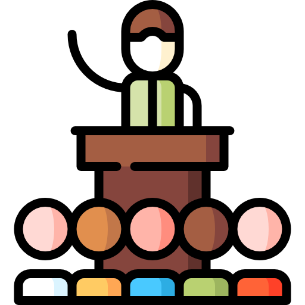Nomads</a></li>
<li><a href="guides/Guide_to_Character.md">Character</a></li>
<li><a href="guides/Guide_to_Crafting.md">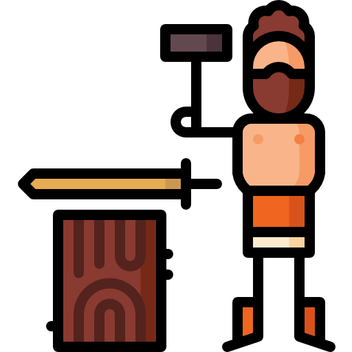Crafting</a></li>
<li><a href="Full_Crafting_List.md">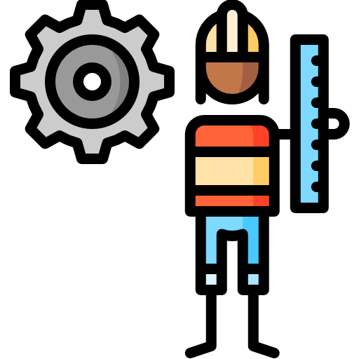Crafting List</a></li>
<li><a href="guides/Guide_to_Metallurgy.md">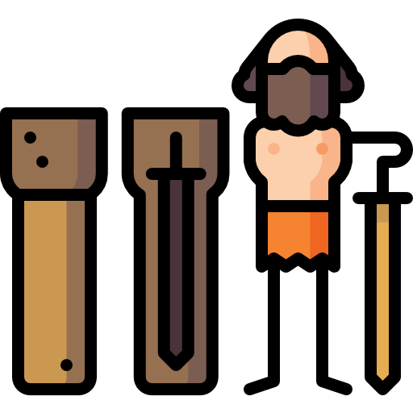Metallurgy</a></li>
<li><a href="guides/Guide_to_Construction.md">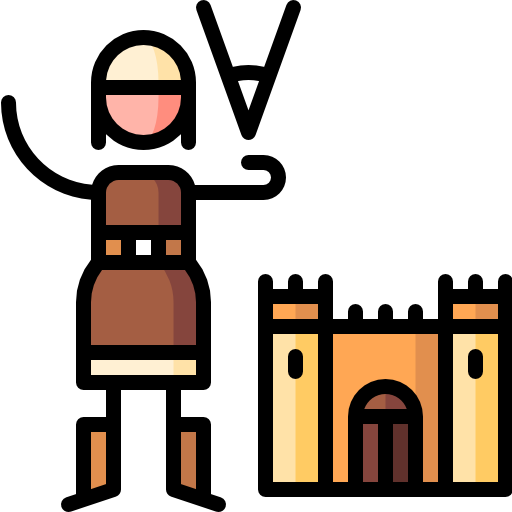Construction</a></li>
<li><a href="guides/Guide_to_Farming.md">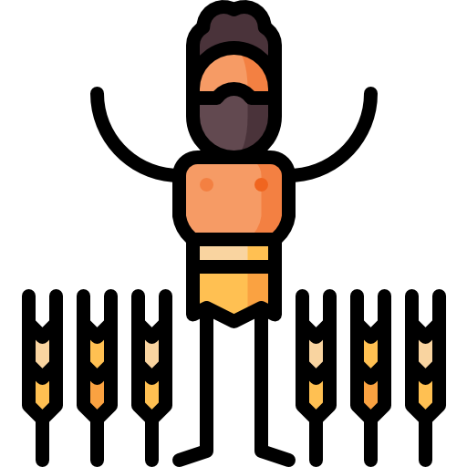Farming</a></li>
<li><a href="guides/Guide_to_Ranching.md">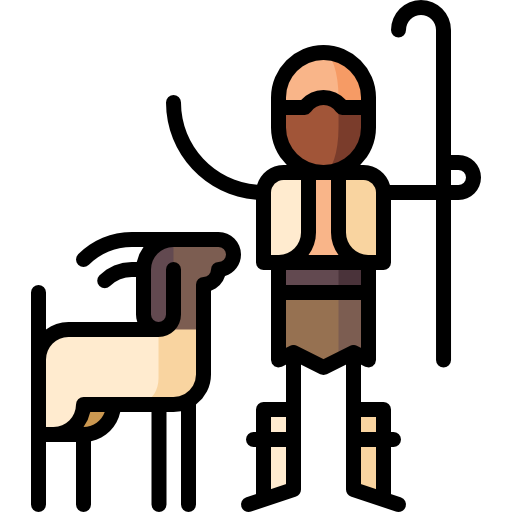Ranching</a></li>
<li><a href="guides/Guide_to_Fishing.md">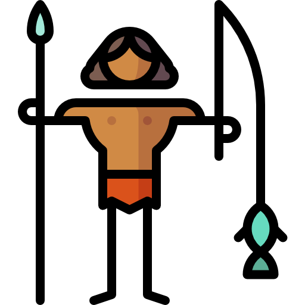Fishing</a></li>
<li><a href="guides/Guide_to_Cooking.md">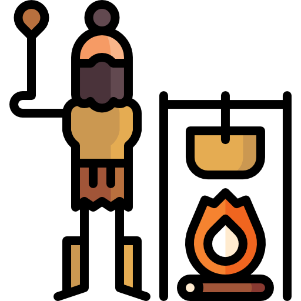Cooking</a></li>
<li><a href="guides/Guide_to_Medical.md">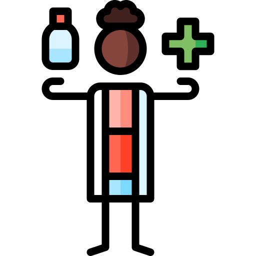Medical</a></li>
<li><a href="guides/Guide_to_Chemistry.md">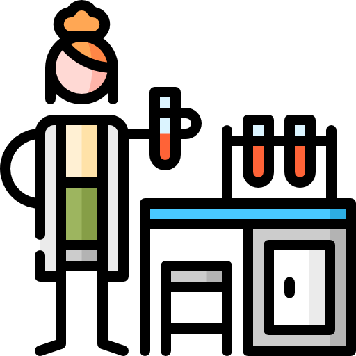Chemistry</a></li>
<li><a href="guides/Guide_to_Radiation.md">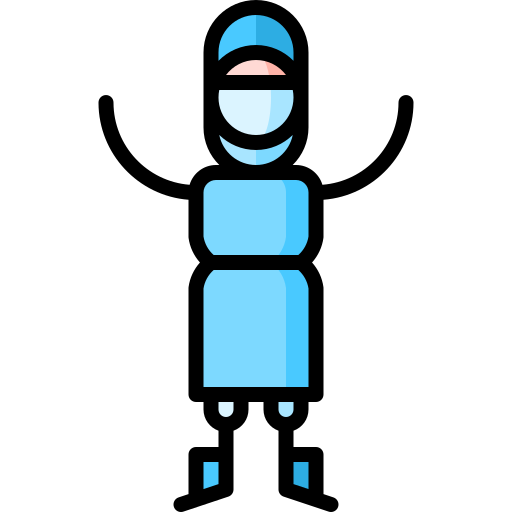Radiation</a></li>
<li><a href="guides/Guide_to_Hygiene.md">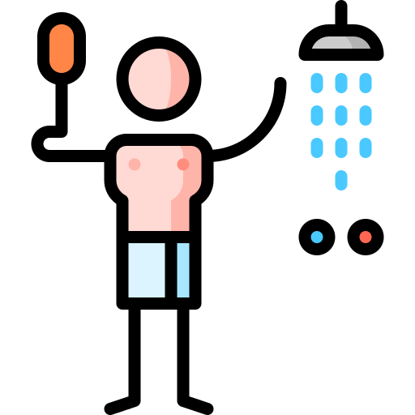Hygiene</a></li>
<li><a href="guides/Guide_to_Communications.md">Communication</a></li>
<li><a href="guides/Guide_to_Paperwork.md">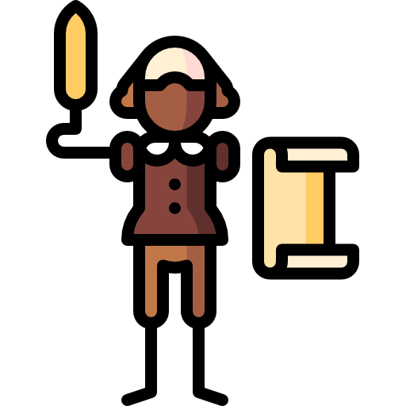Paperwork</a></li>
<li><a href="guides/Guide_to_Religion.md">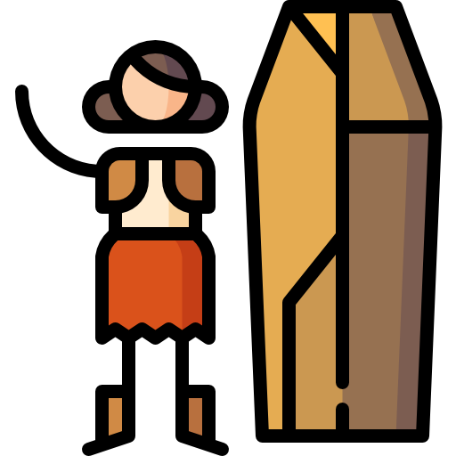Religion</a></li>
<li><a href="guides/Guide_to_Races.md">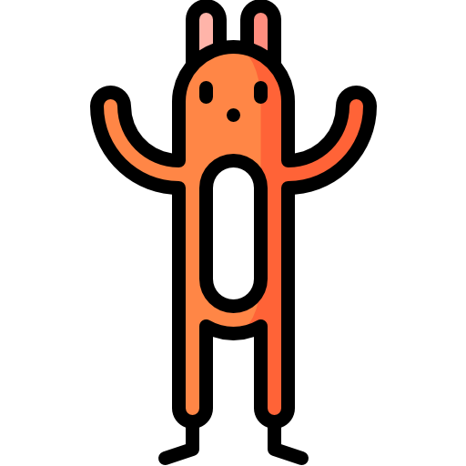Races</a></li>
<li><a href="guides/Guide_to_Weapons.md">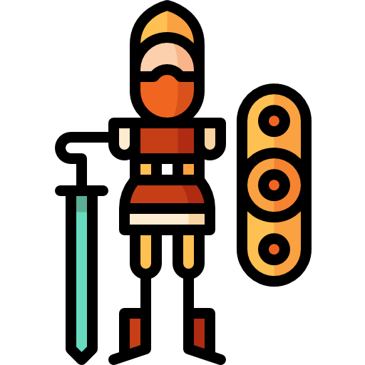Weapons</a></li>
<li><a href="guides/Guide_to_Tanks.md">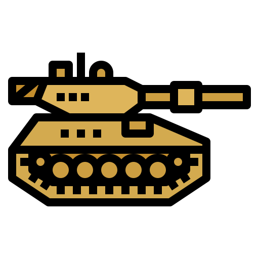Tanks</a></li>
</ul>

## Maps and scenarios

Maps are grouped the way the in-game vote groups them. Each heading opens the matching section of the [maps overview](maps_overview.md), which also lists maps that are not in rotation. For objectives and first-round guidance, start with the [game modes overview](gamemodes/Game_Modes.md).

<section class="wiki-map-group"><h3><a href="maps_overview.md#nomads--persistent-worlds">Nomads & Persistent Worlds</a></h3><ul>
<li data-type="RP"><a href="maps/Nomads_Maps.md">Nomads Maps</a></li>
<li data-type="RP"><a href="maps/Gaia.md">Gaia</a></li>
<li data-type="RP"><a href="maps/Wasteland.md">Wasteland</a></li>
</ul></section>
<section class="wiki-map-group"><h3>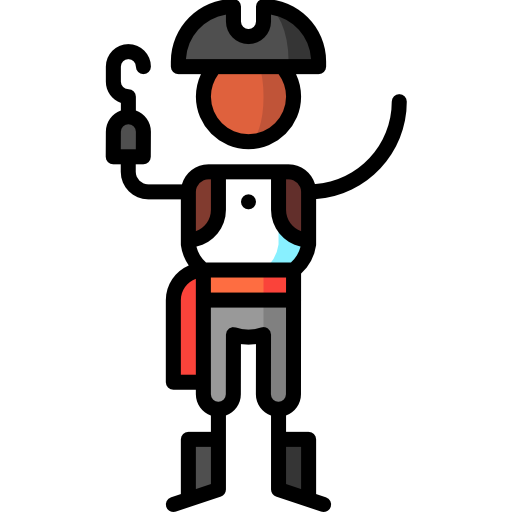<a href="maps_overview.md#colony--pioneers">Colony & Pioneers</a></h3><ul>
<li data-type="RP"><a href="maps/Colony.md">Colony</a></li>
<li data-type="RP"><a href="maps/Jungle_Colony.md">Jungle Colony</a></li>
<li data-type="RP"><a href="maps/Pioneers.md">Pioneers</a></li>
<li data-type="RP"><a href="maps/Bohemia.md">Bohemia</a></li>
<li data-type="RP"><a href="maps/Four_Colonies.md">Four Colonies</a></li>
</ul></section>
<section class="wiki-map-group"><h3>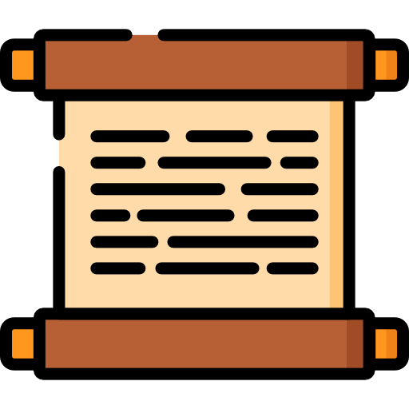<a href="maps_overview.md#roleplay-scenarios">Roleplay Scenarios</a></h3><ul>
<li data-type="RP"><a href="maps/Tribes.md">Tribes</a></li>
<li data-type="RP"><a href="maps/Hunt.md">Hunt</a></li>
<li data-type="RP"><a href="maps/Little_Creek_RP.md">Little Creek RP</a></li>
<li data-type="RP"><a href="maps/Gulag_13.md">Gulag 13</a></li>
</ul></section>
<section class="wiki-map-group"><h3>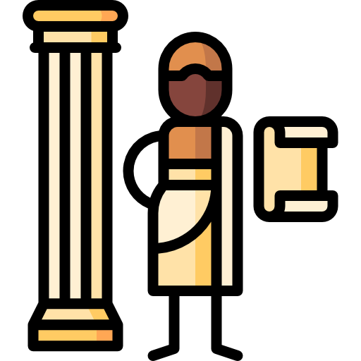<a href="maps_overview.md#pre-firearms-3000-bc-to-1650">Pre-Firearms (3000 BC to 1650)</a></h3><ul>
<li data-type="TDM"><a href="maps/Karak.md">Karak</a></li>
<li data-type="TDM"><a href="maps/Camp.md">Camp</a></li>
<li data-type="TDM"><a href="maps/Oasis.md">Trouble at the Oasis</a></li>
<li data-type="TDM"><a href="maps/Heraclea.md">Heraclea</a></li>
<li data-type="TDM"><a href="maps/Siege.md">Siege</a></li>
<li data-type="TDM"><a href="maps/Gladiators.md">Gladiators</a></li>
<li data-type="TDM"><a href="maps/Teutoburg.md">Teutoburg</a></li>
<li data-type="TDM"><a href="maps/Sammirhayeed.md">Sammir Hayeed</a></li>
<li data-type="TDM"><a href="maps/Two_Tribes.md">Two Tribes</a></li>
</ul></section>
<section class="wiki-map-group"><h3>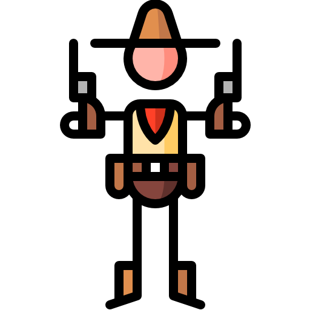<a href="maps_overview.md#early-firearms-1650-to-1930">Early Firearms (1650 to 1930)</a></h3><ul>
<li data-type="TDM"><a href="maps/Hill_203.md">Hill 203</a></li>
<li data-type="TDM"><a href="maps/Ypres.md">Ypres</a></li>
<li data-type="TDM"><a href="maps/Tsaritsyn.md">Tsaritsyn</a></li>
<li data-type="TDM"><a href="maps/Port_Arthur.md">Port Arthur</a></li>
<li data-type="TDM"><a href="maps/Santo_Tomas.md">Santo Tomas</a></li>
<li data-type="TDM"><a href="maps/Coloocan.md">Coloocan</a></li>
<li data-type="TDM"><a href="maps/Little_Creek_TDM.md">Little Creek TDM</a></li>
<li data-type="TDM"><a href="maps/Missionary_Ridge.md">Missionary Ridge</a></li>
<li data-type="TDM"><a href="maps/Naval.md">Naval</a></li>
<li data-type="TDM"><a href="maps/Supply_Raid.md">Supply Raid</a></li>
<li data-type="TDM"><a href="maps/Bridge.md">Bridge</a></li>
<li data-type="TDM"><a href="maps/Recife.md">Recife</a></li>
<li data-type="TDM"><a href="maps/Fields.md">Fields</a></li>
<li data-type="TDM"><a href="maps/Isla_Robusta.md">Isla Robusta</a></li>
<li data-type="TDM"><a href="maps/Sekigahara.md">Sekigahara</a></li>
</ul></section>
<section class="wiki-map-group"><h3>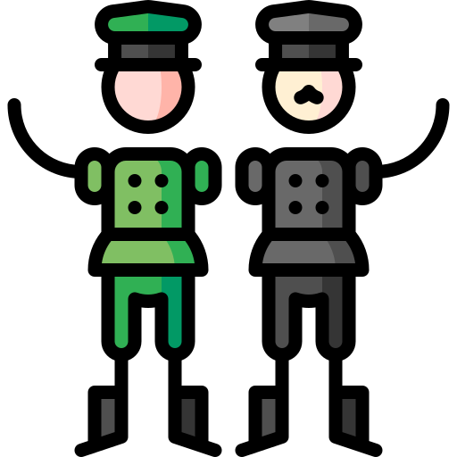<a href="maps_overview.md#world-war-ii-1931-to-1948">World War II (1931 to 1948)</a></h3><ul>
<li data-type="TDM"><a href="maps/Reichstag.md">Reichstag</a></li>
<li data-type="TDM"><a href="maps/Stalingrad.md">Stalingrad</a></li>
<li data-type="TDM"><a href="maps/Khalkyn_Gol.md">Khalkyn Gol</a></li>
<li data-type="TDM"><a href="maps/Kursk.md">Kursk</a></li>
<li data-type="TDM"><a href="maps/Intramuros.md">Intramuros</a></li>
<li data-type="TDM"><a href="maps/Rizal_Stadium.md">Rizal Stadium</a></li>
<li data-type="TDM"><a href="maps/Wake_Island.md">Wake Island</a></li>
<li data-type="TDM"><a href="maps/Nanjing.md">Nanjing</a></li>
<li data-type="TDM"><a href="maps/Omaha.md">Omaha</a></li>
</ul></section>
<section class="wiki-map-group"><h3>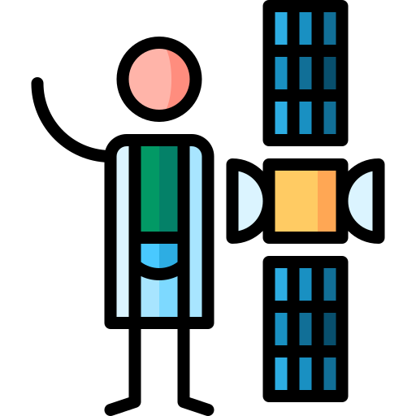<a href="maps_overview.md#modern-firearms-1949-to-2021">Modern Firearms (1949 to 2021)</a></h3><ul>
<li data-type="TDM"><a href="maps/Retreat.md">Retreat</a></li>
<li data-type="TDM"><a href="maps/Road_to_Dak_To.md">Road to Dak To</a></li>
<li data-type="TDM"><a href="maps/Compound.md">Compound</a></li>
<li data-type="TDM"><a href="maps/Alleyway.md">Alleyway</a></li>
<li data-type="TDM"><a href="maps/Arab_Town.md">Arab Town</a></li>
<li data-type="TDM"><a href="maps/Hostages.md">Hostages</a></li>
</ul></section>
<section class="wiki-map-group"><h3>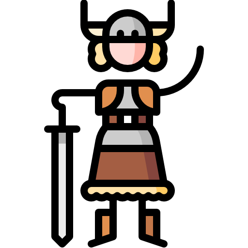<a href="maps_overview.md#pve">PvE</a></h3><ul>
<li data-type="RP"><a href="maps/Antarctica.md">Antarctica</a></li>
<li data-type="RP"><a href="maps/Lights_Out.md">Lights Out</a></li>
<li data-type="RP"><a href="maps/Cursed_Island.md">Cursed Island</a></li>
</ul></section>
<section class="wiki-map-group"><h3>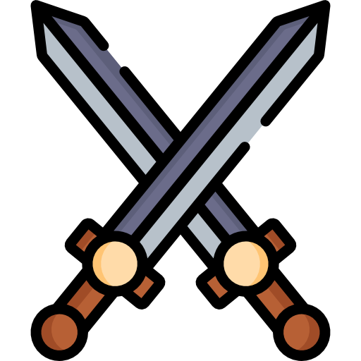<a href="maps_overview.md#battle-royale">Battle Royale</a></h3><ul>
<li data-type="TDM"><a href="maps/Battleroyale.md">Battleroyale</a></li>
</ul></section>

## Our mission

Civ13 brings people together to build civilizations, explore historical settings, and create stories through crafting, cooperation, diplomacy, and conflict.

Our mission is to make that experience deep, creative, and welcoming. New players should be able to ask questions, experienced players should have reasons to share what they know, and contributors should be able to improve the project without accepting personal abuse.

Read our [Mission and Community Standards](Mission_and_Community_Standards.md) for the principles we expect players, contributors, and staff to uphold.

## More

<section class="wiki-link-card"><h3><a href="Hotkeys.md">Hotkeys</a></h3>
Keyboard shortcuts for movement, intents and the crafting menu.
</section>
<section class="wiki-link-card"><h3><a href="Crafting_Skill_Level_Requirements.md">Skill requirements</a></h3>
Which crafting skill level each recipe and workbench needs.
</section>
<section class="wiki-link-card"><h3><a href="Food_Decay_Times.md">Food decay times</a></h3>
How long food keeps before it rots.
</section>
<section class="wiki-link-card"><h3><a href="developers/Civ13_MCP.md">Developers</a></h3>
Civ13 MCP setup for local source inspection, the <a href="developers/Mapping.md">mapping guide</a> and the <a href="https://civ13.github.io/Civ13/">developer API reference</a>.
</section>
<section class="wiki-link-card"><h3><a href="Contributing_to_the_Wiki.md">Contributing</a></h3>
How to fix a page or write a new guide.
</section>
<section class="wiki-link-card"><h3><a href="Games.md">Games and inspirations</a></h3>
Similar games and the projects Civ13 draws on.
</section>

