

Civilization 13 wiki

# Build a civilization from the Stone Age to the Digital Age

Civilization 13 (formerly 1713) is a free multiplayer game based on Space Station 13 code, played through BYOND, that spans several epochs of human history. It features both roleplay and team-deathmatch modes, with the main one being [Nomads](gamemodes/Civilizations_and_Nomads.md), in which you bring your civilization from the Stone Age to the Digital Age. See the [full list of epochs](guides/Guide_to_Epochs.md). Visit the [Civ13 website](https://civ13.github.io/) for an overview of the game.

<a class="wiki-button" href="topics/Start_Here.md">Start here</a> <a class="wiki-button wiki-button-secondary" href="guides_overview.md">Find a guide</a> <a class="wiki-button wiki-button-secondary" href="https://civ13.github.io/Civ13/crafting/">Crafting Atlas</a>

## Start playing

<ol class="wiki-steps">
<li><strong>Install BYOND</strong>
<a href="https://www.byond.com/download/">Download BYOND</a> and install the Windows client. BYOND lists Linux as a hosting platform rather than a game client; macOS is not listed as a supported player platform.
</li>
<li><strong>Learn the basics</strong>
<a href="rules/Rules.md">Read the server rules</a> and <a href="New_Player_Guide.md">learn how to play</a>. The <a href="Starter_Guide.md">Starter Guide</a> covers your first hour as a nomad, and <a href="guides/Guide_to_Your_First_Day.md">Your First Day</a> walks you through getting a research book, food, water and shelter on persistent worlds such as North and South America.
</li>
<li><strong>Choose a server</strong>
These links open BYOND when the client is installed: <a href="byond://civ13.com:1715">Join RP / Nomads</a> or <a href="byond://civ13.com:1714">Join TDM</a>.
</li>
</ol>

For questions or community help, join the [Civ13 Discord](https://discord.gg/hBEtg4x). To contribute, use the edit links on a page or follow the [wiki contribution guide](Contributing_to_the_Wiki.md). The game source is on [GitHub](https://github.com/Civ13/Civ13).

## Find what you need

<form class="wiki-search" role="search" action="index.html" method="get"><label for="wiki-search-input">Search the wiki</label><input id="wiki-search-input" type="search" name="search" placeholder="Try: campfire, iron, horse, boat..." autocomplete="off"><button type="submit">Search</button></form>

The guides are grouped by what you are trying to do. Pick a section for a description of each guide in it, or go straight to a guide. The same sections are in the sidebar on every page, and [Find a Guide](guides_overview.md) lists everything on one page.

<!-- nav-cards:#Guides -->

<section class="wiki-topic"><h3><a href="topics/Start_Here.md">Start Here</a></h3>
Install, join, survive the first night and learn the controls.
<ul><li><a href="New_Player_Guide.md">How to Play</a></li><li><a href="FAQ.md">Frequently Asked Questions</a></li><li><a href="rules/Rules.md">Rules</a></li><li><a href="Starter_Guide.md">Starter Guide</a></li><li><a href="guides/Guide_to_Your_First_Day.md">Your First Day</a></li><li><a href="Hotkeys.md">Hotkeys</a></li><li><a href="guides/Guide_to_HUD.md">Customizing Your HUD</a></li><li><a href="guides/Guide_to_Chat.md">Chat Window &amp; Tabs</a></li><li><a href="guides/Guide_to_Character.md">Character &amp; Skills</a></li><li><a href="guides/Guide_to_Accolades_and_Characters.md">Accolades &amp; Characters</a></li><li><a href="guides/Guide_to_Slang.md">Slang</a></li></ul></section>
<section class="wiki-topic"><h3>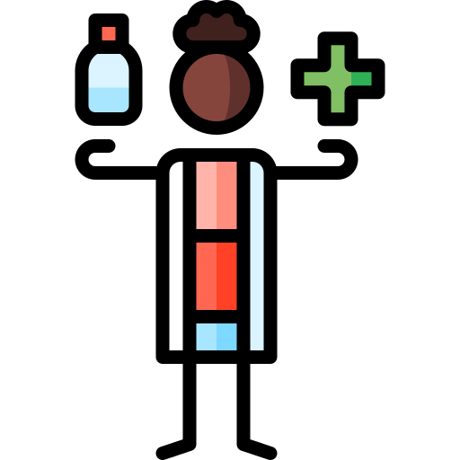<a href="topics/Health_and_Survival.md">Health &amp; Survival</a></h3>
Wounds, illness, cold, floods and everything else that can kill you.
<ul><li><a href="guides/Guide_to_Medical.md">Medical</a></li><li><a href="guides/Guide_to_Hygiene.md">Hygiene</a></li><li><a href="guides/Guide_to_Survival.md">Winter &amp; Long Rounds</a></li><li><a href="guides/Guide_to_Weather.md">Weather &amp; Climate</a></li><li><a href="guides/Guide_to_Floods.md">Rivers &amp; Floods</a></li><li><a href="guides/Guide_to_Exercise.md">Exercise &amp; Training</a></li><li><a href="guides/Guide_to_Drugs.md">Drugs and Stimulants</a></li><li><a href="guides/Guide_to_Radiation.md">Radiation</a></li><li><a href="guides/Guide_to_Pollution.md">Pollution</a></li></ul></section>
<section class="wiki-topic"><h3>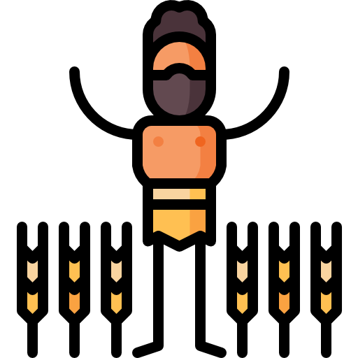<a href="topics/Food_and_Farming.md">Food &amp; Farming</a></h3>
Grow it, catch it, raise it, cook it and keep it from rotting.
<ul><li><a href="guides/Guide_to_Cooking.md">Cooking</a></li><li><a href="Food_Decay_Times.md">Food Decay Times</a></li><li><a href="guides/Guide_to_Farming.md">Farming</a></li><li><a href="guides/Guide_to_Fishing.md">Fishing</a></li><li><a href="guides/Guide_to_Trapping.md">Trapping</a></li><li><a href="guides/Guide_to_Ranching.md">Ranching</a></li><li><a href="guides/Guide_to_Animals.md">Animals, Dogs &amp; Mounts</a></li><li><a href="guides/Guide_to_Beekeeping.md">Beekeeping</a></li><li><a href="guides/Guide_to_Mice.md">Mice &amp; Pests</a></li></ul></section>
<section class="wiki-topic"><h3>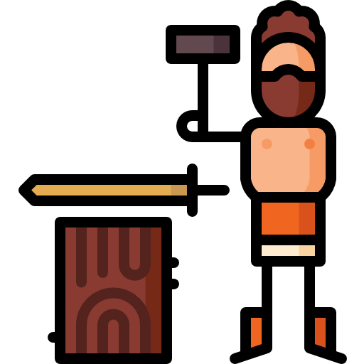<a href="topics/Crafting_and_Materials.md">Crafting &amp; Materials</a></h3>
The crafting window, recipes, skills and everyday materials.
<ul><li><a href="guides/Guide_to_Crafting.md">Crafting</a></li><li><a href="Full_Crafting_List.md">Full Crafting List</a></li><li><a href="Crafting_Skill_Level_Requirements.md">Crafting Skill Requirements</a></li><li><a href="Miscellaneous_Crafting.md">Miscellaneous Crafting</a></li><li><a href="guides/Guide_to_Tool_Materials.md">Tool Materials</a></li><li><a href="guides/Guide_to_Pottery_and_Lime.md">Pottery, Bricks &amp; Lime</a></li><li><a href="guides/Guide_to_Resins_and_Fabrics.md">Resins, Silk &amp; Fabrics</a></li><li><a href="guides/Guide_to_Pouches_and_Gemstones.md">Pouches, Belts &amp; Gemstones</a></li><li><a href="guides/Guide_to_Painting.md">Painting</a></li></ul></section>
<section class="wiki-topic"><h3>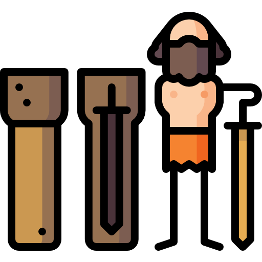<a href="topics/Mining_and_Metalwork.md">Mining &amp; Metalwork</a></h3>
Stone, ore and metal, from flint to plated steel.
<ul><li><a href="guides/Guide_to_Resource_Extraction.md">Resource Extraction</a></li><li><a href="guides/Guide_to_Flint.md">Flint</a></li><li><a href="guides/Guide_to_Obsidian.md">Obsidian</a></li><li><a href="guides/Guide_to_Metallurgy.md">Metallurgy</a></li><li><a href="guides/Guide_to_Placer_Mining.md">Placer Mining</a></li><li><a href="guides/Guide_to_Ore_Dressing.md">Ore Dressing</a></li><li><a href="guides/Guide_to_Mercury.md">Mercury</a></li><li><a href="guides/Guide_to_Amalgamation.md">Amalgamation</a></li><li><a href="guides/Guide_to_Industrial_Milling.md">Industrial Milling</a></li><li><a href="guides/Guide_to_Quicksilver_Crafts.md">Quicksilver Crafts</a></li><li><a href="guides/Guide_to_Electroplating.md">Electroplating</a></li></ul></section>
<section class="wiki-topic"><h3>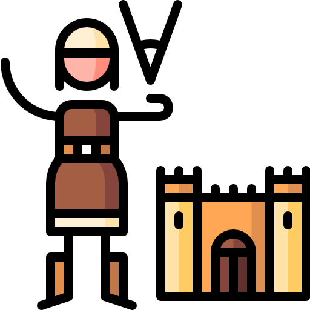<a href="topics/Building_and_Homes.md">Building &amp; Homes</a></h3>
Walls, roofs, homes, mechanisms and fortifications.
<ul><li><a href="guides/Guide_to_Construction.md">Construction</a></li><li><a href="guides/Guide_to_Homes.md">Making a Home</a></li><li><a href="guides/Guide_to_Levers_and_Mechanisms.md">Levers &amp; Mechanisms</a></li><li><a href="guides/Guide_to_Trenches.md">Trenches &amp; Fortifications</a></li><li><a href="guides/Guide_to_Castles.md">Defending a Castle</a></li></ul></section>
<section class="wiki-topic"><h3>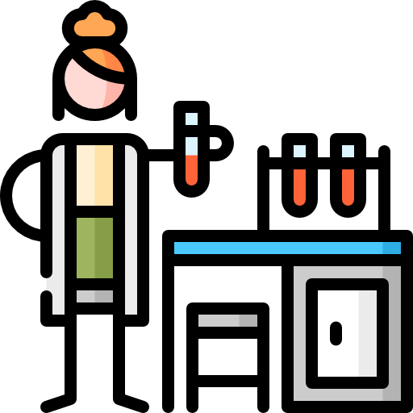<a href="topics/Research_and_Technology.md">Research &amp; Technology</a></h3>
Advance through the ages, then add power, machines and computers.
<ul><li><a href="guides/Guide_to_Epochs.md">Epochs</a></li><li><a href="guides/Guide_to_Research.md">Research</a></li><li><a href="guides/Guide_to_Books_and_Scholars.md">Books and Scholars</a></li><li><a href="guides/Guide_to_Chemistry.md">Chemistry</a></li><li><a href="guides/Guide_to_Power.md">Power &amp; Batteries</a></li><li><a href="guides/Guide_to_Factory_Automation.md">Factory Automation</a></li><li><a href="guides/Guide_to_Computers.md">Computers</a></li><li><a href="guides/Guide_to_Integrated_Circuits.md">Integrated Circuits</a></li></ul></section>
<section class="wiki-topic"><h3>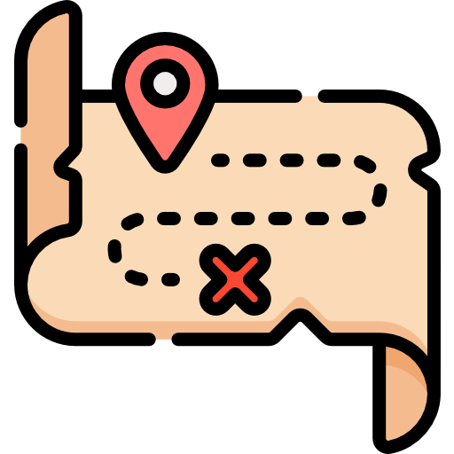<a href="topics/Travel_and_Regions.md">Travel &amp; Regions</a></h3>
The lands of the world and how to move between them.
<ul><li><a href="guides/Guide_to_Travel.md">Travel Between Lands</a></li><li><a href="guides/Guide_to_Map_Making.md">Map Making</a></li><li><a href="regions/Regions.md">Regions Overview</a></li><li><a href="maps/Gaia.md">Gaia</a></li><li><a href="maps/The_Americas.md">North and South America</a></li><li><a href="regions/Europe.md">Europe</a></li><li><a href="regions/Africa.md">Africa</a></li><li><a href="regions/Asia.md">Asia</a></li><li><a href="regions/Oceania.md">Oceania</a></li><li><a href="regions/Greenland.md">Greenland</a></li><li><a href="regions/Antarctica.md">Antarctica</a></li><li><a href="guides/Guide_to_the_Moon.md">The Moon &amp; Mars</a></li></ul></section>
<section class="wiki-topic"><h3>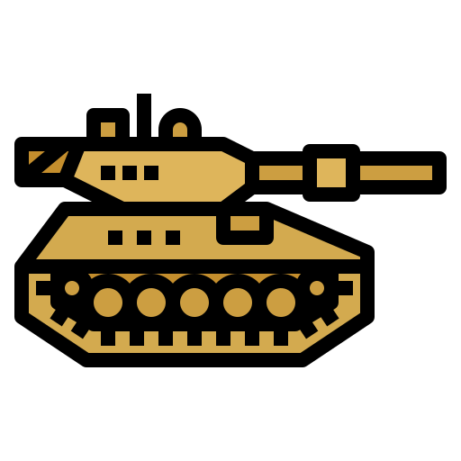<a href="topics/Vehicles.md">Vehicles</a></h3>
Boats, trains, tanks, aircraft and space stations.
<ul><li><a href="guides/Guide_to_Boats.md">Boats &amp; Ships</a></li><li><a href="guides/Guide_to_Ship_Damage_Control.md">Ship Damage Control</a></li><li><a href="guides/Guide_to_Trains.md">Trains</a></li><li><a href="guides/Guide_to_Tanks.md">Tanks</a></li><li><a href="guides/Guide_to_Aircraft.md">Aircraft</a></li><li><a href="guides/Guide_to_Aircraft_Carriers.md">Aircraft Carriers</a></li><li><a href="guides/Guide_to_Space_Stations.md">Space Stations</a></li></ul></section>
<section class="wiki-topic"><h3>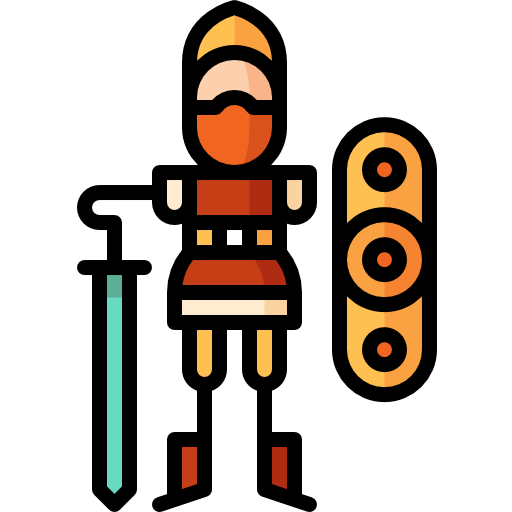<a href="topics/Combat.md">Combat</a></h3>
Fighting, weapons, armor and leading others in battle.
<ul><li><a href="guides/Guide_to_Combat.md">Combat Basics</a></li><li><a href="guides/Guide_to_Weapons.md">Weapons</a></li><li><a href="guides/Guide_to_Armor.md">Armor</a></li><li><a href="guides/Guide_to_Gunsmithing.md">Making Guns</a></li><li><a href="guides/Guide_to_Leadership.md">Leading a Squad</a></li><li><a href="guides/Guide_to_Nomad_Visitors.md">Nomad Raiders &amp; Caravans</a></li><li><a href="entities.md">Entity Lists</a></li></ul></section>
<section class="wiki-topic"><h3>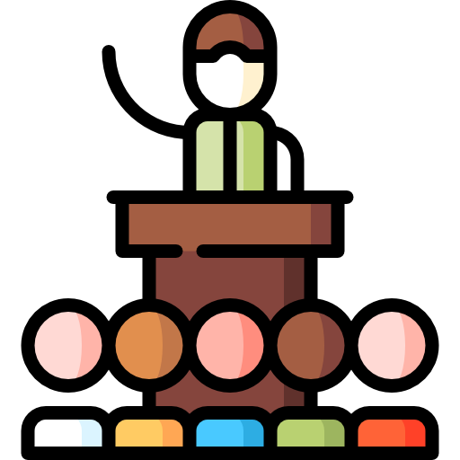<a href="topics/Society_and_Trade.md">Society &amp; Trade</a></h3>
Talking, languages, faith, money, companies and colony roles.
<ul><li><a href="guides/Guide_to_Factions.md">Factions, Provinces &amp; Nations</a></li><li><a href="guides/Guide_to_Communications.md">Communications</a></li><li><a href="guides/Guide_to_Peoples_and_Languages.md">Peoples and Languages</a></li><li><a href="guides/Guide_to_Races.md">Races</a></li><li><a href="guides/Guide_to_Tribal_Life.md">Tribal Life</a></li><li><a href="guides/Guide_to_Religion.md">Religion</a></li><li><a href="Music.md">Music</a></li><li><a href="guides/Guide_to_Money.md">Money &amp; Coins</a></li><li><a href="guides/Guide_to_Companies.md">Companies &amp; Stock Market</a></li><li><a href="guides/Guide_to_Paperwork.md">Paperwork</a></li><li><a href="Paper_Templates.md">Paper Templates</a></li><li><a href="role_guides.md">Role Guides</a></li></ul></section>

<!-- /nav -->

## I want to...

| I want to... | Go to |
| --- | --- |
| Install the game and join a server | [How to Play](New_Player_Guide.md) |
| Survive my first night | [Starter Guide](Starter_Guide.md#your-first-night), or [Your First Day](guides/Guide_to_Your_First_Day.md#your-first-night) on a persistent world |
| Find water and food | [Your First Day: Water](guides/Guide_to_Your_First_Day.md#water) and [Food](guides/Guide_to_Your_First_Day.md#food) |
| Learn the keys | [Hotkeys](Hotkeys.md) |
| Look up a recipe | [Crafting Atlas](https://civ13.github.io/Civ13/crafting/) |
| Know why I can't craft something | [Crafting Skill Requirements](Crafting_Skill_Level_Requirements.md) and [Research](guides/Guide_to_Research.md) |
| Treat a wound or an illness | [Medical](guides/Guide_to_Medical.md) |
| Stay warm in winter | [Winter & Long Rounds](guides/Guide_to_Survival.md#staying-warm) |
| Grow crops | [Farming](guides/Guide_to_Farming.md) |
| Keep food from rotting | [Cooking: Food storage](guides/Guide_to_Cooking.md#food-storage) and [Food Decay Times](Food_Decay_Times.md) |
| Tame a dog or ride a horse | [Animals, Dogs & Mounts](guides/Guide_to_Animals.md) |
| Find flint, stone or ore | [Flint](guides/Guide_to_Flint.md) and [Resource Extraction](guides/Guide_to_Resource_Extraction.md) |
| Smelt metal and forge tools | [Metallurgy](guides/Guide_to_Metallurgy.md) |
| Build a house | [Construction](guides/Guide_to_Construction.md) and [Making a Home](guides/Guide_to_Homes.md) |
| Advance to the next age | [Research](guides/Guide_to_Research.md), or [Books and Scholars](guides/Guide_to_Books_and_Scholars.md) on a persistent world |
| Learn another language | [Peoples and Languages](guides/Guide_to_Peoples_and_Languages.md) |
| Travel to another land | [Travel Between Lands](guides/Guide_to_Travel.md) and the [Regions Overview](regions/Regions.md) |
| Build a boat, train or plane | [Boats & Ships](guides/Guide_to_Boats.md), [Trains](guides/Guide_to_Trains.md), [Aircraft](guides/Guide_to_Aircraft.md) |
| Win a fight | [Combat Basics](guides/Guide_to_Combat.md), [Weapons](guides/Guide_to_Weapons.md), [Armor](guides/Guide_to_Armor.md) |
| Make money | [Money & Coins](guides/Guide_to_Money.md) and [Companies & Stock Market](guides/Guide_to_Companies.md) |
| Understand the round I joined | [Game Modes](gamemodes/Game_Modes.md) |

## Maps and scenarios

Maps are grouped the way the in-game vote groups them. Each heading opens the matching section of [Maps & Scenarios](maps_overview.md), which also lists maps that are not in rotation. The lands of the persistent worlds are under [Travel & Regions](topics/Travel_and_Regions.md). For objectives and first-round guidance, start with the [game modes overview](gamemodes/Game_Modes.md).

<section class="wiki-map-group"><h3><a href="maps_overview.md#nomads--persistent-worlds">Nomads & Persistent Worlds</a></h3><ul>
<li data-type="RP"><a href="maps/Nomads_Maps.md">Nomads Maps</a></li>
<li data-type="RP"><a href="maps/Wasteland.md">Wasteland</a></li>
</ul></section>
<section class="wiki-map-group"><h3>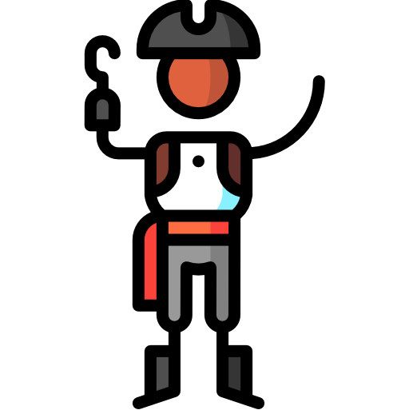<a href="maps_overview.md#colony--pioneers">Colony & Pioneers</a></h3><ul>
<li data-type="RP"><a href="maps/Colony.md">Colony</a></li>
<li data-type="RP"><a href="maps/Jungle_Colony.md">Jungle Colony</a></li>
<li data-type="RP"><a href="maps/Pioneers.md">Pioneers</a></li>
<li data-type="RP"><a href="maps/Bohemia.md">Bohemia</a></li>
<li data-type="RP"><a href="maps/Four_Colonies.md">Four Colonies</a></li>
</ul></section>
<section class="wiki-map-group"><h3>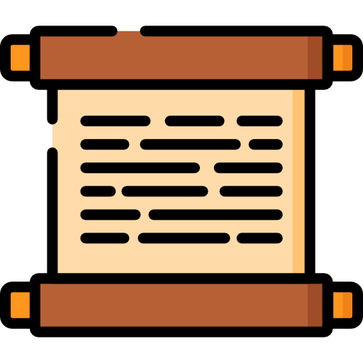<a href="maps_overview.md#roleplay-scenarios">Roleplay Scenarios</a></h3><ul>
<li data-type="RP"><a href="maps/Tribes.md">Tribes</a></li>
<li data-type="RP"><a href="maps/Hunt.md">Hunt</a></li>
<li data-type="RP"><a href="maps/Little_Creek_RP.md">Little Creek RP</a></li>
<li data-type="RP"><a href="maps/Gulag_13.md">Gulag 13</a></li>
</ul></section>
<section class="wiki-map-group"><h3>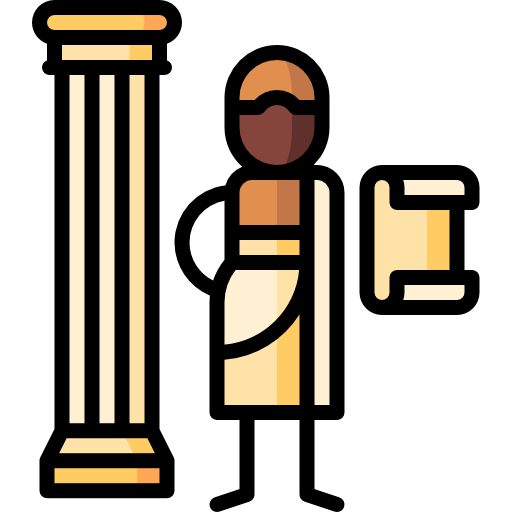<a href="maps_overview.md#pre-firearms-3000-bc-to-1650">Pre-Firearms (3000 BC to 1650)</a></h3><ul>
<li data-type="TDM"><a href="maps/Karak.md">Karak</a></li>
<li data-type="TDM"><a href="maps/Camp.md">Camp</a></li>
<li data-type="TDM"><a href="maps/Oasis.md">Trouble at the Oasis</a></li>
<li data-type="TDM"><a href="maps/Heraclea.md">Heraclea</a></li>
<li data-type="TDM"><a href="maps/Siege.md">Siege</a></li>
<li data-type="TDM"><a href="maps/Gladiators.md">Gladiators</a></li>
<li data-type="TDM"><a href="maps/Teutoburg.md">Teutoburg</a></li>
<li data-type="TDM"><a href="maps/Sammirhayeed.md">Sammir Hayeed</a></li>
<li data-type="TDM"><a href="maps/Two_Tribes.md">Two Tribes</a></li>
</ul></section>
<section class="wiki-map-group"><h3>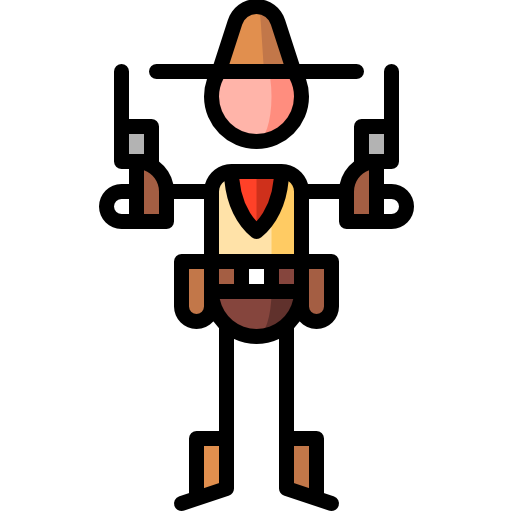<a href="maps_overview.md#early-firearms-1650-to-1930">Early Firearms (1650 to 1930)</a></h3><ul>
<li data-type="TDM"><a href="maps/Hill_203.md">Hill 203</a></li>
<li data-type="TDM"><a href="maps/Ypres.md">Ypres</a></li>
<li data-type="TDM"><a href="maps/Tsaritsyn.md">Tsaritsyn</a></li>
<li data-type="TDM"><a href="maps/Port_Arthur.md">Port Arthur</a></li>
<li data-type="TDM"><a href="maps/Santo_Tomas.md">Santo Tomas</a></li>
<li data-type="TDM"><a href="maps/Coloocan.md">Coloocan</a></li>
<li data-type="TDM"><a href="maps/Little_Creek_TDM.md">Little Creek TDM</a></li>
<li data-type="TDM"><a href="maps/Missionary_Ridge.md">Missionary Ridge</a></li>
<li data-type="TDM"><a href="maps/Naval.md">Naval</a></li>
<li data-type="TDM"><a href="maps/Supply_Raid.md">Supply Raid</a></li>
<li data-type="TDM"><a href="maps/Bridge.md">Bridge</a></li>
<li data-type="TDM"><a href="maps/Recife.md">Recife</a></li>
<li data-type="TDM"><a href="maps/Fields.md">Fields</a></li>
<li data-type="TDM"><a href="maps/Isla_Robusta.md">Isla Robusta</a></li>
<li data-type="TDM"><a href="maps/Sekigahara.md">Sekigahara</a></li>
</ul></section>
<section class="wiki-map-group"><h3>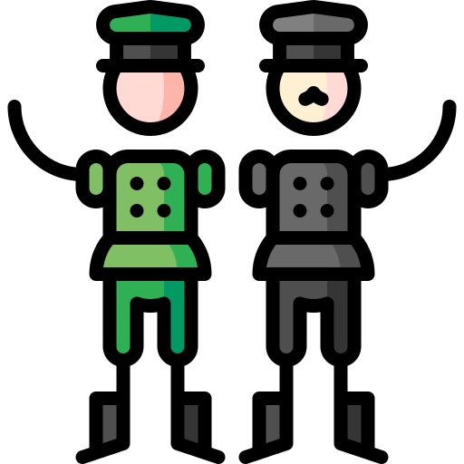<a href="maps_overview.md#world-war-ii-1931-to-1948">World War II (1931 to 1948)</a></h3><ul>
<li data-type="TDM"><a href="maps/Reichstag.md">Reichstag</a></li>
<li data-type="TDM"><a href="maps/Stalingrad.md">Stalingrad</a></li>
<li data-type="TDM"><a href="maps/Khalkyn_Gol.md">Khalkyn Gol</a></li>
<li data-type="TDM"><a href="maps/Kursk.md">Kursk</a></li>
<li data-type="TDM"><a href="maps/Intramuros.md">Intramuros</a></li>
<li data-type="TDM"><a href="maps/Rizal_Stadium.md">Rizal Stadium</a></li>
<li data-type="TDM"><a href="maps/Wake_Island.md">Wake Island</a></li>
<li data-type="TDM"><a href="maps/Nanjing.md">Nanjing</a></li>
<li data-type="TDM"><a href="maps/Omaha.md">Omaha</a></li>
</ul></section>
<section class="wiki-map-group"><h3>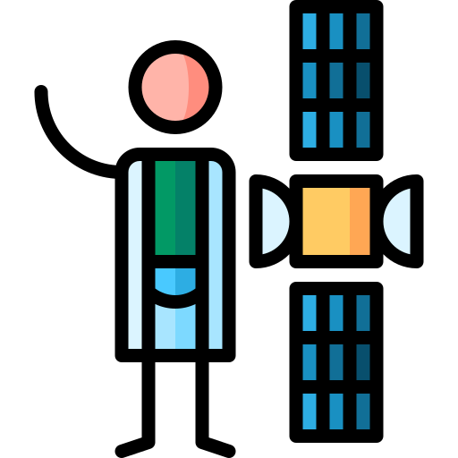<a href="maps_overview.md#modern-firearms-1949-to-2021">Modern Firearms (1949 to 2021)</a></h3><ul>
<li data-type="TDM"><a href="maps/Retreat.md">Retreat</a></li>
<li data-type="TDM"><a href="maps/Road_to_Dak_To.md">Road to Dak To</a></li>
<li data-type="TDM"><a href="maps/Compound.md">Compound</a></li>
<li data-type="TDM"><a href="maps/Alleyway.md">Alleyway</a></li>
<li data-type="TDM"><a href="maps/Arab_Town.md">Arab Town</a></li>
<li data-type="TDM"><a href="maps/Hostages.md">Hostages</a></li>
</ul></section>
<section class="wiki-map-group"><h3>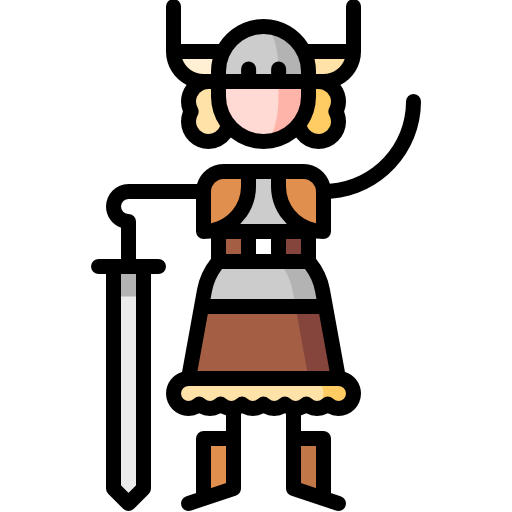<a href="maps_overview.md#pve">PvE</a></h3><ul>
<li data-type="RP"><a href="maps/Antarctica.md">Antarctica</a></li>
<li data-type="RP"><a href="maps/Lights_Out.md">Lights Out</a></li>
<li data-type="RP"><a href="maps/Cursed_Island.md">Cursed Island</a></li>
</ul></section>
<section class="wiki-map-group"><h3>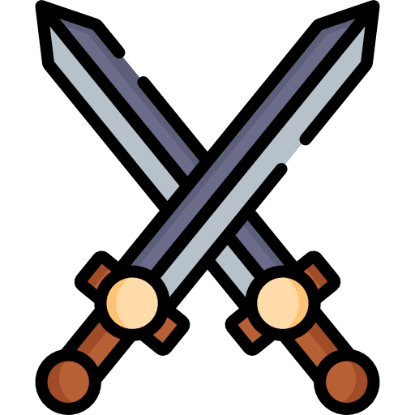<a href="maps_overview.md#battle-royale">Battle Royale</a></h3><ul>
<li data-type="TDM"><a href="maps/Battleroyale.md">Battleroyale</a></li>
</ul></section>

## Our mission

Civ13 brings people together to build civilizations, explore historical settings, and create stories through crafting, cooperation, diplomacy, and conflict.

Our mission is to make that experience deep, creative, and welcoming. New players should be able to ask questions, experienced players should have reasons to share what they know, and contributors should be able to improve the project without accepting personal abuse.

Read our [Mission and Community Standards](Mission_and_Community_Standards.md) for the principles we expect players, contributors, and staff to uphold.

## More

<section class="wiki-link-card"><h3><a href="Hotkeys.md">Hotkeys</a></h3>
Keyboard shortcuts for movement, intents and the crafting menu.
</section>
<section class="wiki-link-card"><h3><a href="Crafting_Skill_Level_Requirements.md">Skill requirements</a></h3>
Which crafting skill level each recipe and workbench needs.
</section>
<section class="wiki-link-card"><h3><a href="Food_Decay_Times.md">Food decay times</a></h3>
How long food keeps before it rots.
</section>
<section class="wiki-link-card"><h3><a href="developers/Civ13_MCP.md">Developers</a></h3>
Civ13 MCP setup for local source inspection, the <a href="developers/Mapping.md">mapping guide</a> and the <a href="https://civ13.github.io/Civ13/">developer API reference</a>.
</section>
<section class="wiki-link-card"><h3><a href="Contributing_to_the_Wiki.md">Contributing</a></h3>
How to fix a page or write a new guide.
</section>
<section class="wiki-link-card"><h3><a href="Games.md">Games and inspirations</a></h3>
Similar games and the projects Civ13 draws on.
</section>

