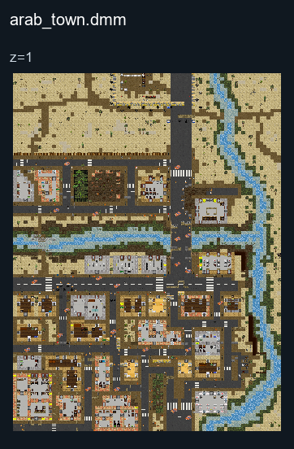

# Arab Town

## Map layout

<figure>

<figcaption>Static map layout of <code>arab_town.dmm</code>. Runtime lighting, generated objects and later sprite changes are not shown. 
Full-resolution layers: <a href="../images/maps/tdm-static-067478b82c7a/2013__arab_town/arab_town__z01__full.png">z=1 (2400 × 3200 PNG)</a>.
</figcaption>
</figure>

