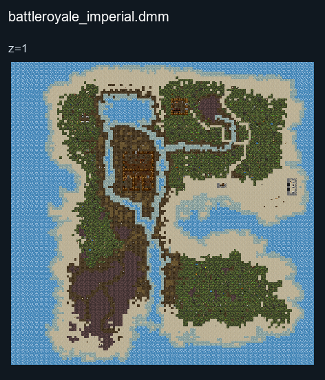
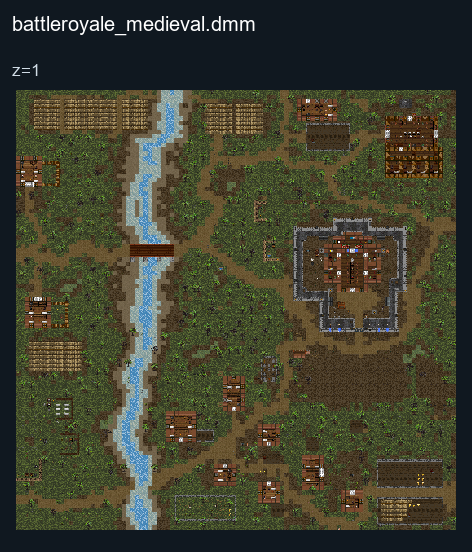
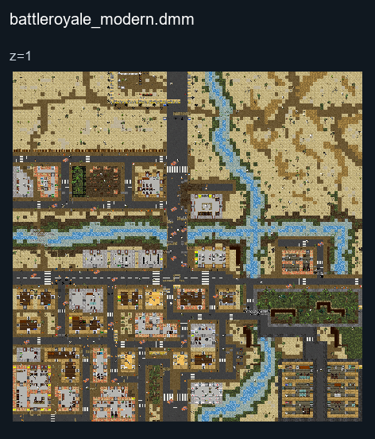

# Battleroyale

## Map layout

### Imperial

<figure>

<figcaption>Static map layout of <code>battleroyale_imperial.dmm</code>. Runtime lighting, generated objects and later sprite changes are not shown. 
Full-resolution layers: <a href="../images/maps/tdm-static-067478b82c7a/special__battleroyale_imperial/battleroyale_imperial__z01__full.png">z=1 (4000 × 4000 PNG)</a>.
</figcaption>
</figure>

### Medieval

<figure>

<figcaption>Static map layout of <code>battleroyale_medieval.dmm</code>. Runtime lighting, generated objects and later sprite changes are not shown. 
Full-resolution layers: <a href="../images/maps/tdm-static-067478b82c7a/special__battleroyale_medieval/battleroyale_medieval__z01__full.png">z=1 (3200 × 3200 PNG)</a>.
</figcaption>
</figure>

### Modern

<figure>

<figcaption>Static map layout of <code>battleroyale_modern.dmm</code>. Runtime lighting, generated objects and later sprite changes are not shown. 
Full-resolution layers: <a href="../images/maps/tdm-static-067478b82c7a/special__battleroyale_modern/battleroyale_modern__z01__full.png">z=1 (3200 × 3200 PNG)</a>.
</figcaption>
</figure>

Battle Royale is an individual survival scenario: the last surviving player wins. Watch the opening briefing and area-closure announcements, and move before the playable area contracts.

Read the [Battle Royale and Hunger Games guide](../gamemodes/Battle_Royale.md) for preparation, victory conditions and related event guidance.
