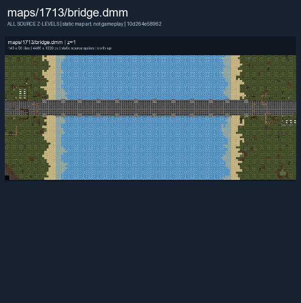

# Bridge

French and British armies face each other across the St. Charles River Bridge. This is the Bridge variant; [Fields](Fields.md) covers a separate battlefield.

Map selection depends on the server and current round. The images below show the authored layout.

## Map layout

<figure>

<figcaption>Static map layout of <code>bridge.dmm</code>. Runtime lighting, generated objects and later sprite changes are not shown. 
Full-resolution layers: <a href="../images/maps/early-static-c79792d002b9/1713__bridge/bridge__z01__full.png">z=1 (4,480 x 1,920 PNG)</a>.
</figcaption>
</figure>

See [Maps Overview](../maps_overview.md) for other layouts and [Team Combat](../gamemodes/Team_Combat.md) for general play.
