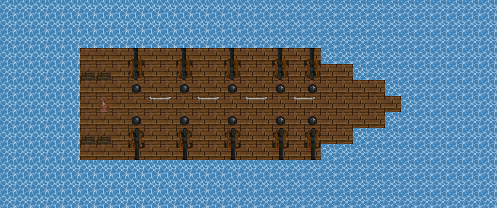

# Broadside

<figure>

<figcaption>The French ship at anchor at the start of a round.</figcaption>
</figure>

Two ships under sail on open sea: a French man-of-war against a pirate ship. Both sides start aboard their own ship at anchor, and when the signal gun fires the battle is on.

## Sailing

Each ship has a **tiller** at the stern, four masts and five guns on each side. Use the tiller to weigh anchor, ring a speed (slow or half ahead) and come about to the north, east, south or west. The ship carries everything aboard with her: crew, guns and stores. Only her own crew can steer her, and nobody can touch the tiller until the signal gun fires.

The two ships start in different lanes, so the usual plan is to steer alongside the enemy and fire on her as you pass.

## Broadsides

The guns are loaded when the round starts, and cannon balls lie beside each gun for reloading. The captain carries a **boatswain's call**: use it on deck, pick a side, and every loaded gun on that side fires one after another. When the enemy ship lies in a gun's line, its crew lay the gun on her deck. Otherwise each gun fires where it was aimed.

## Winning

- **Sink her:** shot breaks the planking, and a ship that loses too much of her deck goes down.
- **Take her:** board the enemy and hold her tiller for a minute with none of her crew near it.

If neither ship is taken after an hour, nobody wins.

Rejoining crewmen come aboard their own ship, wherever she has sailed.

French (Hostile) Pirates (Hostile)
