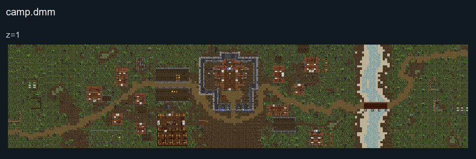

# Camp

## Map layout

<figure>

<figcaption>Static map layout of <code>camp.dmm</code>. Runtime lighting, generated objects and later sprite changes are not shown. 
Full-resolution layers: <a href="../images/maps/tdm-static-067478b82c7a/1013__camp/camp__z01__full.png">z=1 (6400 × 1440 PNG)</a>.
</figcaption>
</figure>

**Camp** is set in France, The British and The French are trying to
capture the castle in the middle of the map.

### Factions

  - The Kingdom of England, The English wear Red and Tan brown uniforms.
  - The Kingdom of France, The French wear blue and white uniforms.

### Leadership

Each side has a **Lord** and **Knight**, the Lord is in charge of the
entire faction, the Knight is usually a Marshal of their lord they have
to control the military.
