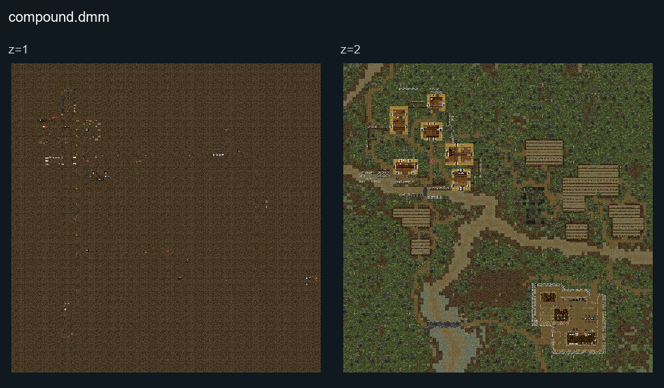

# Compound

## Map layout

<figure>

<figcaption>Static map layout of <code>compound.dmm</code>. Runtime lighting, generated objects and later sprite changes are not shown. 
Full-resolution layers: <a href="https://github.com/civ13/civ13-wiki/releases/download/assets/compound__z01__full.png">z=1 (3200 × 3200 PNG)</a> · <a href="https://github.com/civ13/civ13-wiki/releases/download/assets/compound__z02__full.png">z=2 (3200 × 3200 PNG)</a>.
</figcaption>
</figure>

## Huey drop-off

A UH-1 **Huey** waits on a pad at the American base. Click it to climb aboard (eight seats), then use **Talk to the pilot** in chat to pick a landing zone from nine parts of the map. Another way to call it: a soldier on the ground throws an M18 signal smoke and chooses **Landing zone for the Huey**, and the Huey sets down at the smoke. Lift-off gives the rest of the squad 15 seconds to run for it. At the landing zone everyone is put out around the Huey, and it flies back to the base for the next squad. It does not fly before the battle starts.

### How to contribute
If you have information about this map, please help us by [editing this page](https://github.com/civ13/civ13-wiki/edit/master/src/maps/Compound.md).
You will need a GitHub account to propose changes.
