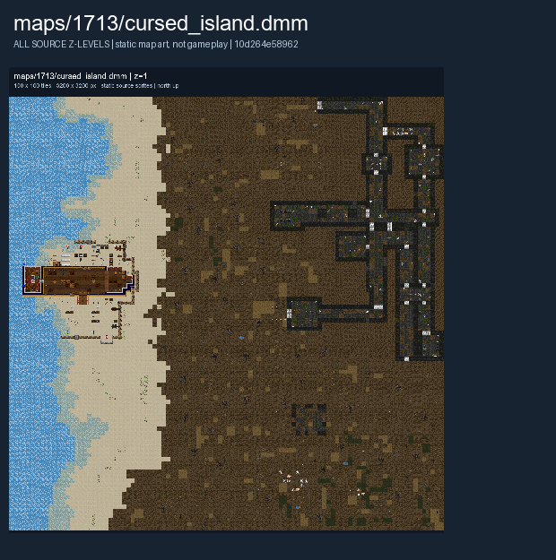

# Cursed Island

A shipwrecked crew must retrieve cursed treasure and return it to their ship. The [Island](Island.md) page covers a separate scenario.

The images below show the authored map layout.

## Map layout

<figure>

<figcaption>Static map layout of <code>cursed_island.dmm</code>. Runtime lighting, generated objects and later sprite changes are not shown. 
Full-resolution layers: <a href="../images/maps/early-static-c79792d002b9/1713__cursed_island/cursed_island__z01__full.png">z=1 (3,200 x 3,200 PNG)</a>.
</figcaption>
</figure>

See [Maps Overview](../maps_overview.md) for other layouts and [Survival Scenarios](../gamemodes/Survival_Scenarios.md) for general play.
