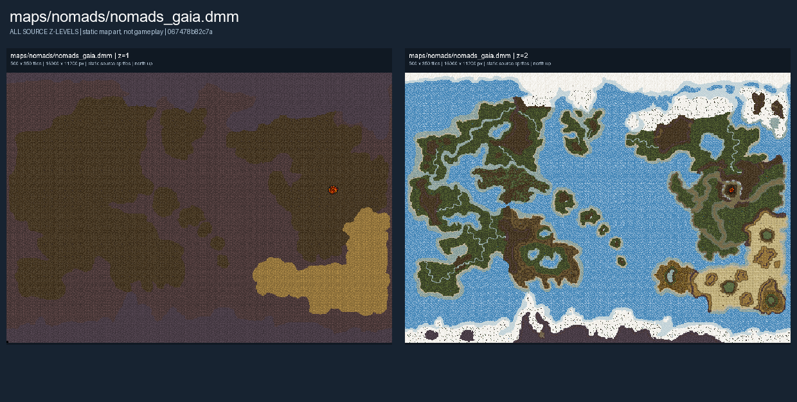

# Gaia

Gaia is the authored Nomads map named **Nomads (Gaia)**. Its surface is **z=2**; **z=1** is the underground layer.

**Map status:** Authored variant, outside the standard Nomads map-vote list. The authored layout shown here does not establish which map is currently hosted.

## Map layout

<figure>

<figcaption>Static map layout of <code>nomads_gaia.dmm</code>. Runtime lighting, generated objects and later sprite changes are not shown. 
Full-resolution layers: <a href="https://github.com/civ13/civ13-wiki/releases/download/assets/nomads_gaia__z01__full.png">z=1; underground (16,000 x 11,200 PNG)</a> · <a href="https://github.com/civ13/civ13-wiki/releases/download/assets/nomads_gaia__z02__full.png">z=2; surface (16,000 x 11,200 PNG)</a>.
</figcaption>
</figure>

## Hills

Gaia's surface has hills. Light comes from the north-west, so slopes facing north-west are lighter and slopes facing south-east are in shadow. Flat ground, water and beaches are not shaded.

The land follows the map. Beaches and marshes are low and flat, and the coastal plain behind them rolls into gentle hills. The rocky ranges are high plateaus: where a range stands close to the sea its sides are steep, a hard climb of a few tiles, while from inland and through the passes at the ends of a range the climb is long and gentle. Rocky shores can be cliffs, rivers run through gorges with one high bank, the desert's lakes sit in craters with steep rims, and long ridges cross the larger continents with a steep face on one side and an easy slope on the other.

Hills change how fast you walk:

- Climbing is slow, and each extra level of steepness costs more than the last. A gentle slope of one level per tile takes about half again as long as flat ground, two levels more than twice as long, and the steepest grades on Gaia about four times as long.
- Going downhill is quick: a gentle slope is about half again as fast as flat ground, and two levels per tile almost twice as fast. Drops steeper than that are picked down more carefully, so they are less of a gain.
- When you hold a direction and slide freely, your pace follows the slope under you smoothly, not one tile at a time. Keep going downhill and you build momentum: you get faster still, and the speed carries you across a few tiles of flat ground and partway up the next rise. Stopping or turning back loses it. With Tap To Step, quick taps feel the slope one tile at a time.
- Steep steps of three levels or more are tiring: scrambling up one spends some stamina, and the game tells you when you scramble up or pick your way down a steep slope.

For a long trip, going around a big hill can be faster than going over it, and a pass or a gentle inland slope is usually faster than scaling a range from its steep seaward side.

The Europe, Jungle, Desert and Asia maps have hills too, designed from their terrain in the same way.

Built floors and walls level the ground under them. Floors and roads you lay (wood, stone, tiles, dirt roads and the like) are not shaded, and walking onto, off or across them ignores the hill. Grass, dirt, snow, sand, rocky ground, gravel, mined floor and trenches keep it.

Hills also block your view. Ridges, cliffs and plateau edges hide whatever is behind them, so you can't see past a ridge or onto a plateau well above your eyes. Gentle slopes and small rises don't: you see over a low rise, though the ground just behind a rise about your own height may be hidden while a person standing there still shows. From high ground you see further down the slopes. Lying down lowers your eyes and hides more. Tall things show over a crest before the ground they stand on, so you may see someone's head or a treetop beyond a ridge. From high ground you can also see over lower walls, fences and trees into the open ground beyond them; the ground right behind a wall stays hidden, and you never see into a roofed building this way.

Bullets follow the hills too. A ridge between you and your target stops the shot, and a shot fired downhill that misses lands in the ground beyond. From well above them you can fire over lower cover, walls and people in your way, and over the roofs of buildings below you. On level ground cover works as usual. Hostile NPCs follow the same rule: they can't see you behind a ridge.

On hilly maps bullets also drop with range. Each weapon is sighted for a set distance (rifles about 12 tiles, pistols about 7, shotguns and muskets about 6, bows about 5); beyond it the shot falls lower the further it goes. Where you click on your target sets your aim: click higher on a distant target to hold over, or the shot lands short. Shooting steeply down from high ground is more forgiving.

### Tamping paths and grading hills

Craft a **stone rammer** from 2 stone (Tools, once you have studied **Basic Toolmaking**). Click bare dirt with it to pound the tile into **tamped earth** in a few seconds; stronger characters work faster. Tamped earth keeps the shape of the hill, but climbing onto it is about half as hard, and it never turns to mud in the rain. Clear grass with a shovel first, and clear any snow; the rammer will not work on a tile with a crop or a floor on it. A shovel breaks tamped earth back into loose dirt.

To change the ground itself, grade it one level at a time:

- **Cut:** use a shovel on **disarm** intent on dirt or tamped earth. After about 10 seconds the tile is one level lower and you get a pile of dirt.
- **Fill:** put a pile of dirt on a tile and use the stone rammer on it. The dirt is packed in, the tile rises one level and becomes tamped earth.

Each tile can be dug down or built up by at most two levels from the natural ground, so ridges and cliffs can be eased but not removed. Ground next to water, or with snow, a floor, a crop or anything solid on it, cannot be graded. Levelling an area means planning cuts and fills and carrying dirt from the high spots to the low ones.

New here? [Your First Day](../guides/Guide_to_Your_First_Day.md) covers getting a research book, food, water and shelter. For the other Nomads layouts, see [Nomads Maps](Nomads_Maps.md). For general play, see [Civilizations & Nomads](../gamemodes/Civilizations_and_Nomads.md).
