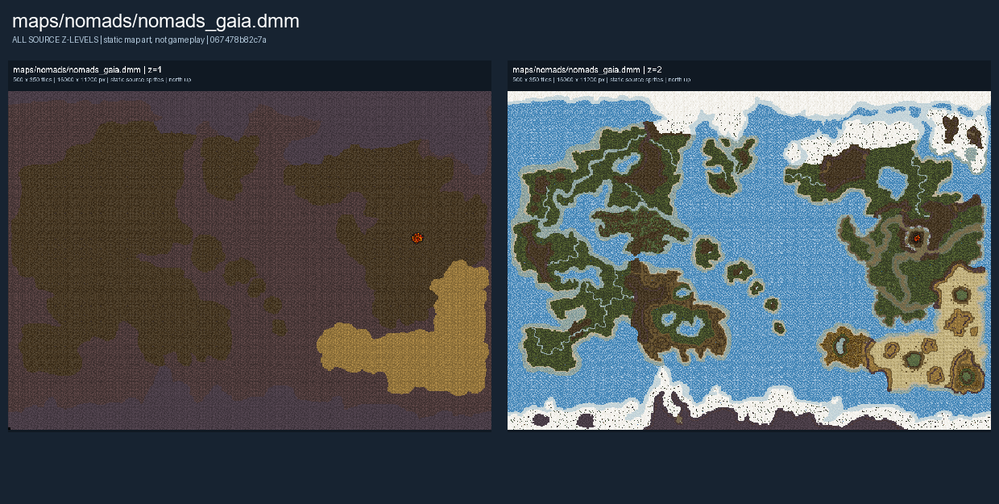

# Gaia

Gaia is the authored Nomads map named **Nomads (Gaia)**. Its surface is **z=2**; **z=1** is the underground layer.

**Map status:** Authored variant, outside the standard Nomads map-vote list. The authored layout shown here does not establish which map is currently hosted.

Gaia is one of the persistent lands in the same group as [North and South America](The_Americas.md), but new characters no longer start here: they start in North America. Reach Gaia as described in [Travel Between Lands](../guides/Guide_to_Travel.md).

## Map layout

<figure>

<figcaption>Static map layout of <code>nomads_gaia.dmm</code>. Runtime lighting, generated objects and later sprite changes are not shown. 
Full-resolution layers: <a href="https://github.com/civ13/civ13-wiki/releases/download/assets/nomads_gaia__z01__full.png">z=1; underground (16,000 x 11,200 PNG)</a> · <a href="https://github.com/civ13/civ13-wiki/releases/download/assets/nomads_gaia__z02__full.png">z=2; surface (16,000 x 11,200 PNG)</a>.
</figcaption>
</figure>

## What Gaia has that the Americas do not

- **An underground level** (z=1) below the surface, with rock to mine.
- **Taller buildings.** A roof can carry up to four floors above the ground.
- **A seabed under the deep ocean**, so [submarines](../guides/Guide_to_Boats.md#submarines) can dive, and [aircraft carriers](../guides/Guide_to_Aircraft_Carriers.md) and freighters with a hold below the waterline can be built.

## Hills

Gaia's surface has hills. Light comes from the north-west, so slopes facing north-west are lighter and slopes facing south-east are in shadow. Flat ground, water and beaches are not shaded.

The land follows the map. Beaches and marshes are low and flat, and the coastal plain behind them rolls into gentle hills. The rocky ranges are high plateaus: where a range stands close to the sea its sides are steep, a hard climb of a few tiles, while from inland and through the passes at the ends of a range the climb is long and gentle. Rocky shores can be cliffs, rivers run through gorges with one high bank, the desert's lakes sit in craters with steep rims, and long ridges cross the larger continents with a steep face on one side and an easy slope on the other.

Walking speed on slopes, tripping, sight lines, bullet drop, tamping paths, grading hills and the **Check Movement** verb work the same way here as on the Americas: see [Hills](The_Americas.md#hills).

## Weather

Gaia has the same seasons as other Nomads maps, but clear spells last longer: while the sky is clear, rain, snow and storms start only about half as often. Once bad weather has started it runs its usual course.

New here? [Your First Day](../guides/Guide_to_Your_First_Day.md) covers getting a research book, food, water and shelter. For the other Nomads layouts, see [Nomads Maps](Nomads_Maps.md). For general play, see [Civilizations & Nomads](../gamemodes/Civilizations_and_Nomads.md).
