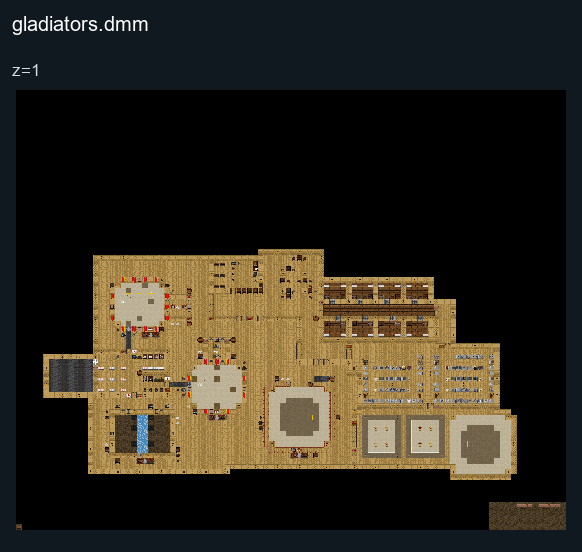

# Gladiators

## Map layout

<figure>

<figcaption>Static map layout of <code>gladiators.dmm</code>. Runtime lighting, generated objects and later sprite changes are not shown. 
Full-resolution layers: <a href="../images/maps/tdm-static-067478b82c7a/313bc__gladiators/gladiators__z01__full.png">z=1 (3200 × 2560 PNG)</a>.
</figcaption>
</figure>

A free-for-all scenario set in a Roman arena. Gladiators arrive from regions of the Roman Empire and fight for an emperor guarded by praetorians.

Read the [Gladiators guide](../gamemodes/Gladiators.md) for objectives and preparation.
