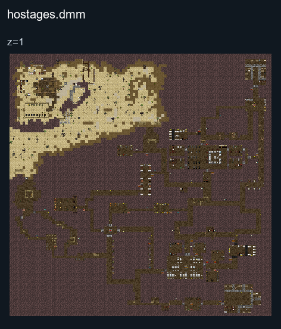

# Hostages

## Map layout

<figure>

<figcaption>Static map layout of <code>hostages.dmm</code>. Runtime lighting, generated objects and later sprite changes are not shown. 
Full-resolution layers: <a href="../images/maps/tdm-static-067478b82c7a/2013__hostages/hostages__z01__full.png">z=1 (3200 × 3200 PNG)</a>.
</figcaption>
</figure>

The rescue team tries to recover the hostages; the insurgents try to prevent the rescue. Coordinate with your leader and follow the round briefing and [server rules](../rules/Rules.md).

## Roles

| Role | Description | Difficulty |
| --- | --- | --- |
| SOF Team Leader | Coordinate the rescue team and monitor enemy communications. | Hard |
| SOF Medic | Treat wounded operators and support the rescue. | Medium |
| SOF Operator | Work with the team to reach and rescue the hostages. | Easy |
| Insurgent Leader | Coordinate the defenders by radio and prevent the rescue. | Hard |
| Insurgent | Defend the hostage area and follow your leader's orders. | Easy |
