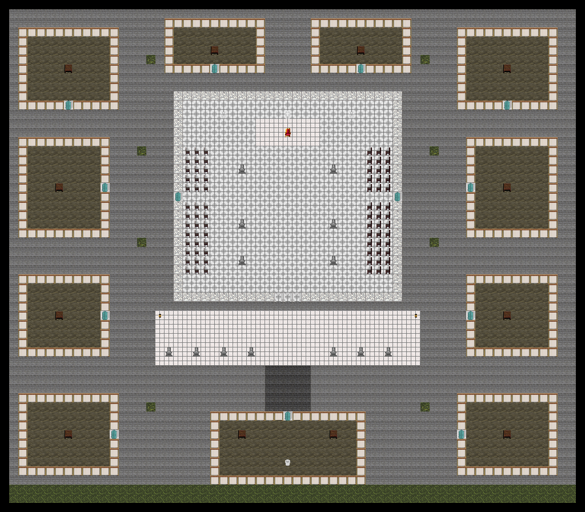

# The Ides of March

Rome, the fifteenth day of March, 44 B.C. The senate meets in the Curia of Pompey, and some of the senators carry daggers under their togas.

## Map layout

<figure>

<figcaption>The Curia of Pompey with its benches, Pompey's statue and Caesar's chair; the portico in front; Caesar's house to the south.</figcaption>
</figure>

## How to win

- **Conspirators** win the moment Caesar dies.
- **Caesar's party** wins if Caesar is still alive after 20 minutes.

For the first 2 minutes nobody can pass the doors of the Curia: the senators wait inside while Caesar's party gathers at his house.

## Roles

| Side | Role | Description |
| ---- | ---- | ----------- |
| Caesar's party | Dictator | Gaius Julius Caesar, in a purple toga and gold laurels. If he dies, the round is lost. |
| Caesar's party | Lictor | Caesar's attendants, armed with a staff. Keep the knives away from him. |
| Caesar's party | Amicus Caesaris | A friend of Caesar who stays at his side. |
| Conspirators | Praetor | Marcus Junius Brutus, who leads the plot and carries two daggers. |
| Conspirators | Senator | A senator sworn to the plot, with a pugio hidden in their toga. |

Everyone wears a white toga and speaks Latin, so watch who reaches into their toga. Daggers are carried in a pocket, where nobody else can see them, and blood from a stab stains the toga it lands on.
