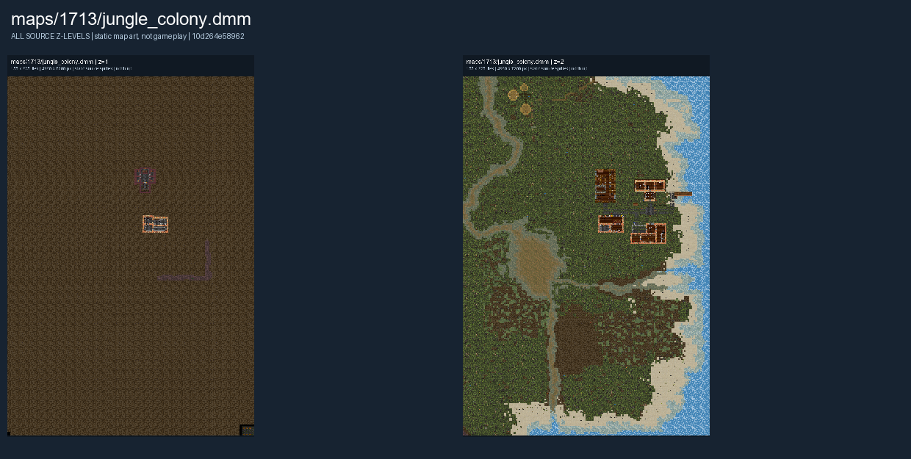

# Jungle Colony

Jungle Colony is a colonial settlement scenario in a jungle landscape. See [Colony Building](../gamemodes/Colony_Building.md) for general roleplay and settlement guidance.

The images below show the authored map layout.

## Map layout

<figure>

<figcaption>Static map layout of <code>jungle_colony.dmm</code>. Runtime lighting, generated objects and later sprite changes are not shown. 
Full-resolution layers: <a href="../images/maps/early-static-c79792d002b9/1713__jungle_colony/jungle_colony__z01__full.png">z=1 (4,960 x 7,200 PNG)</a> · <a href="../images/maps/early-static-c79792d002b9/1713__jungle_colony/jungle_colony__z02__full.png">z=2 (4,960 x 7,200 PNG)</a>.
</figcaption>
</figure>

See [Maps Overview](../maps_overview.md) for other layouts and [Colony Building](../gamemodes/Colony_Building.md) for general play.
