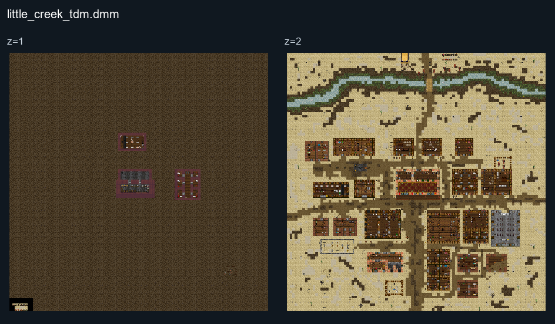

# Little Creek TDM

## Map layout

<figure>

<figcaption>Static map layout of <code>little_creek_tdm.dmm</code>. Runtime lighting, generated objects and later sprite changes are not shown. 
Full-resolution layers: <a href="../images/maps/tdm-static-067478b82c7a/1873__little_creek_tdm/little_creek_tdm__z01__full.png">z=1 (3200 × 3200 PNG)</a> · <a href="../images/maps/tdm-static-067478b82c7a/1873__little_creek_tdm/little_creek_tdm__z02__full.png">z=2 (3200 × 3200 PNG)</a>.
</figcaption>
</figure>

## ROLES

| ROLE    | IMAGE | DESCRIPTION                                                                                                     | DIFFICULTY |
| ------- | ----- | --------------------------------------------------------------------------------------------------------------- | ---------- |
| Sheriff |       | Command your men to protect the bank from those outlaws!                                                       | HARD       |
| Deputy  |       | Listen to your Sheriff, equip yourself with guns, barricade the city, and protect the bank.                     | MEDIUM     |
| Outlaws |       | Basically, you need to rob the bank, and avoid or kill those who protect it, and get as much money as you can! | WILD WEST. |