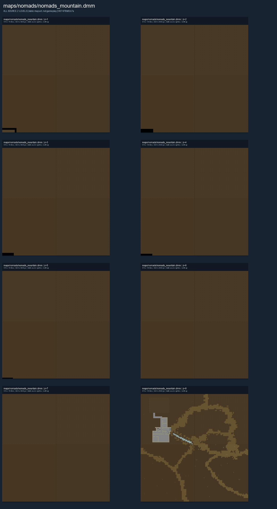

# Mountain

**Nomads (Mountain)** has eight authored z-levels. Each level is shown and linked separately below.

**Map status:** Authored variant, outside the standard Nomads map-vote list. The authored layout shown here does not establish which map is currently hosted.

## Map layout

<figure>

<figcaption>Static map layout of <code>nomads_mountain.dmm</code>. Runtime lighting, generated objects and later sprite changes are not shown. 
Full-resolution layers: <a href="../images/maps/nomads-authored-10d264e58962/nomads__nomads_mountain/nomads_mountain__z01__full.png">z=1 (3,840 x 3,840 PNG)</a> · <a href="../images/maps/nomads-authored-10d264e58962/nomads__nomads_mountain/nomads_mountain__z02__full.png">z=2 (3,840 x 3,840 PNG)</a> · <a href="../images/maps/nomads-authored-10d264e58962/nomads__nomads_mountain/nomads_mountain__z03__full.png">z=3 (3,840 x 3,840 PNG)</a> · <a href="../images/maps/nomads-authored-10d264e58962/nomads__nomads_mountain/nomads_mountain__z04__full.png">z=4 (3,840 x 3,840 PNG)</a> · <a href="../images/maps/nomads-authored-10d264e58962/nomads__nomads_mountain/nomads_mountain__z05__full.png">z=5 (3,840 x 3,840 PNG)</a> · <a href="../images/maps/nomads-authored-10d264e58962/nomads__nomads_mountain/nomads_mountain__z06__full.png">z=6 (3,840 x 3,840 PNG)</a> · <a href="../images/maps/nomads-authored-10d264e58962/nomads__nomads_mountain/nomads_mountain__z07__full.png">z=7 (3,840 x 3,840 PNG)</a> · <a href="../images/maps/nomads-authored-10d264e58962/nomads__nomads_mountain/nomads_mountain__z08__full.png">z=8 (3,840 x 3,840 PNG)</a>.
</figcaption>
</figure>

For the other Nomads layouts, see [Nomads Maps](Nomads_Maps.md). For general play, see [Civilizations & Nomads](../gamemodes/Civilizations_and_Nomads.md).
