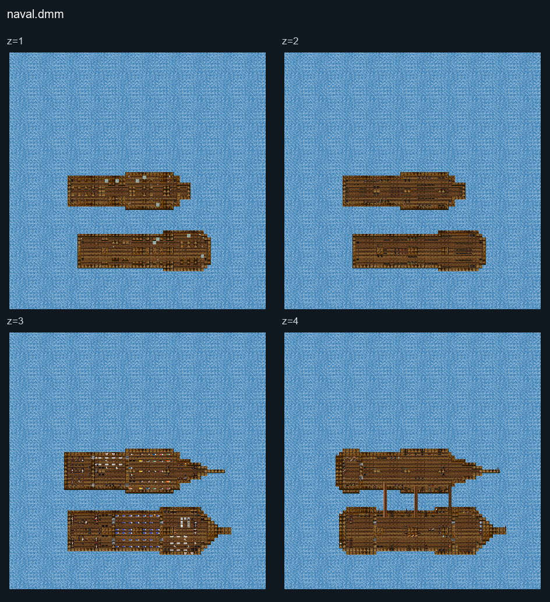

# Naval

## Map layout

<figure>

<figcaption>Static map layout of <code>naval.dmm</code>. Runtime lighting, generated objects and later sprite changes are not shown. 
Full-resolution layers: <a href="../images/maps/tdm-static-067478b82c7a/1713__naval/naval__z01__full.png">z=1 (2400 × 2400 PNG)</a> · <a href="../images/maps/tdm-static-067478b82c7a/1713__naval/naval__z02__full.png">z=2 (2400 × 2400 PNG)</a> · <a href="../images/maps/tdm-static-067478b82c7a/1713__naval/naval__z03__full.png">z=3 (2400 × 2400 PNG)</a> · <a href="../images/maps/tdm-static-067478b82c7a/1713__naval/naval__z04__full.png">z=4 (2400 × 2400 PNG)</a>.
</figcaption>
</figure>

This map is a Naval Conflict between the French and Pirates. The Round
ends when one side controls the other's ship.

French (Hostile) Pirates (Hostile)