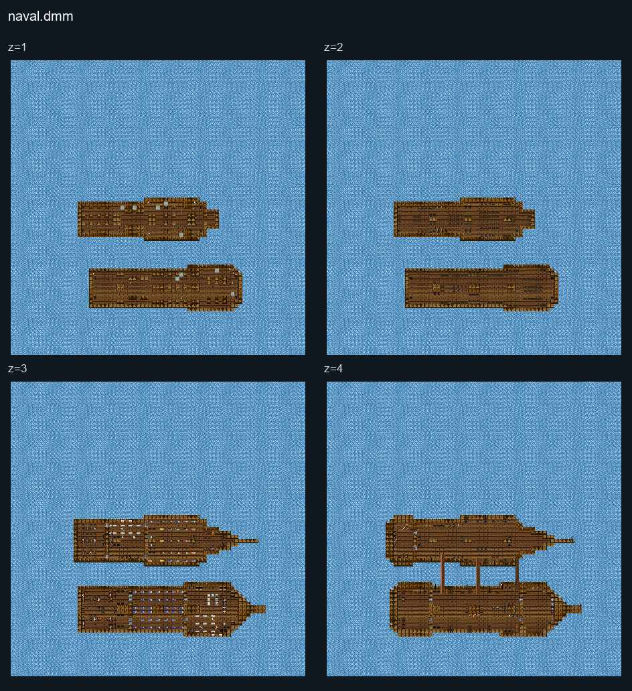

# Naval

## Map layout

<figure>

<figcaption>Static map layout of <code>naval.dmm</code>. Runtime lighting, generated objects and later sprite changes are not shown. 
Full-resolution layers: <a href="https://github.com/civ13/civ13-wiki/releases/download/assets/naval__z01__full.png">z=1 (2400 × 2400 PNG)</a> · <a href="https://github.com/civ13/civ13-wiki/releases/download/assets/naval__z02__full.png">z=2 (2400 × 2400 PNG)</a> · <a href="https://github.com/civ13/civ13-wiki/releases/download/assets/naval__z03__full.png">z=3 (2400 × 2400 PNG)</a> · <a href="https://github.com/civ13/civ13-wiki/releases/download/assets/naval__z04__full.png">z=4 (2400 × 2400 PNG)</a>.
</figcaption>
</figure>

This map is a Naval Conflict between the French and Pirates. The Round
ends when one side controls the other's ship.

## Broadsides

Each ship has six guns facing the enemy. Gun crews load and aim their own guns, and the captain carries a **boatswain's call**: use it on deck, pick a side, and every loaded gun on that side of your ship fires one after another. Guns nobody aimed fire straight out from the side of the ship. The call needs a short rest between broadsides, and no gun fires before the battle starts.

French (Hostile) Pirates (Hostile)