# Nomads Maps

## Temperate

<figure>
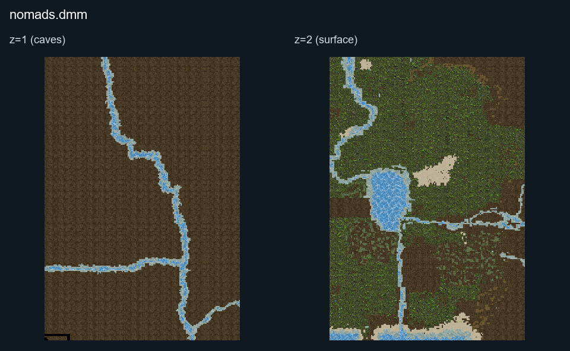
<figcaption>Static map layout of <code>nomads.dmm</code>. Runtime lighting, generated objects and later sprite changes are not shown. 
Full-resolution layers: <a href="../images/maps/static-58404f5bd16e/nomads__nomads/nomads__z01__full.png">z=1 (caves) (4960 × 7200 PNG)</a> · <a href="../images/maps/static-58404f5bd16e/nomads__nomads/nomads__z02__full.png">z=2 (surface) (4960 × 7200 PNG)</a>.
</figcaption>
</figure>

This is the classic map, using the same map as the Civilizations map.

  - The map climate is temperate, with plenty of forests, rivers,
    overland mines, and farming space.
  - The northern part of the map contains most of the plains, while the
    southern part has most of the swamps and some beaches.
  - You may encounter mice, rabbits, bears, turkeys, cows, goats,
    snakes, deer, fish, frogs, leeches, horses, and alligators.
  - The round always starts in Spring.

## Desert

<figure>
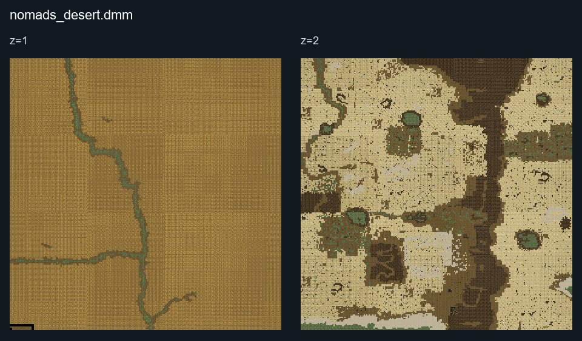
<figcaption>Static map layout of <code>nomads_desert.dmm</code>. Runtime lighting, generated objects and later sprite changes are not shown. 
Full-resolution layers: <a href="../images/maps/static-58404f5bd16e/nomads__nomads_desert/nomads_desert__z01__full.png">z=1 (7200 × 7200 PNG)</a> · <a href="../images/maps/static-58404f5bd16e/nomads__nomads_desert/nomads_desert__z02__full.png">z=2 (7200 × 7200 PNG)</a>.
</figcaption>
</figure>

  - In this map, the whole area is a desert with some sparse water
    sources and farming plots.
  - Water management is important here, as is control of the rare
    farmable areas around rivers and swamps.
  - You may encounter mice, bears, goats, snakes, frogs, leeches,
    horses, camels, and alligators.
  - The round always starts in the Wet Season.

## Jungle

<figure>
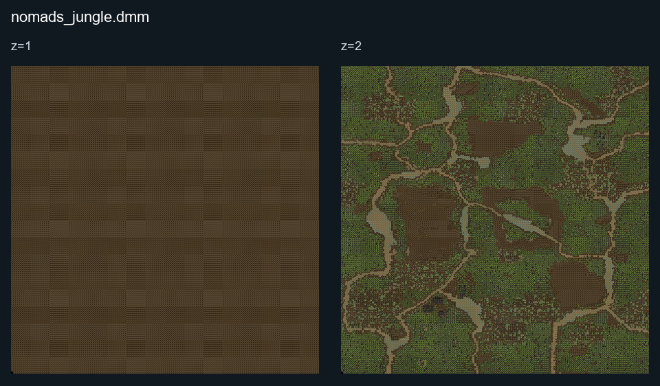
<figcaption>Static map layout of <code>nomads_jungle.dmm</code>. Runtime lighting, generated objects and later sprite changes are not shown. 
Full-resolution layers: <a href="../images/maps/static-58404f5bd16e/nomads__nomads_jungle/nomads_jungle__z01__full.png">z=1 (9600 × 9600 PNG)</a> · <a href="../images/maps/static-58404f5bd16e/nomads__nomads_jungle/nomads_jungle__z02__full.png">z=2 (9600 × 9600 PNG)</a>.
</figcaption>
</figure>

A dense tropical rainforest. You can only farm on the floodplains and during the dry
season. Wildlife is deadly here\! Stay away from panthers, mosquitoes
(as they carry malaria) and ants (will eat your food). Crossing rivers
without a bridge is considered unsafe - piranhas are abundant.

## Divide (Jungle-Desert)

<figure>
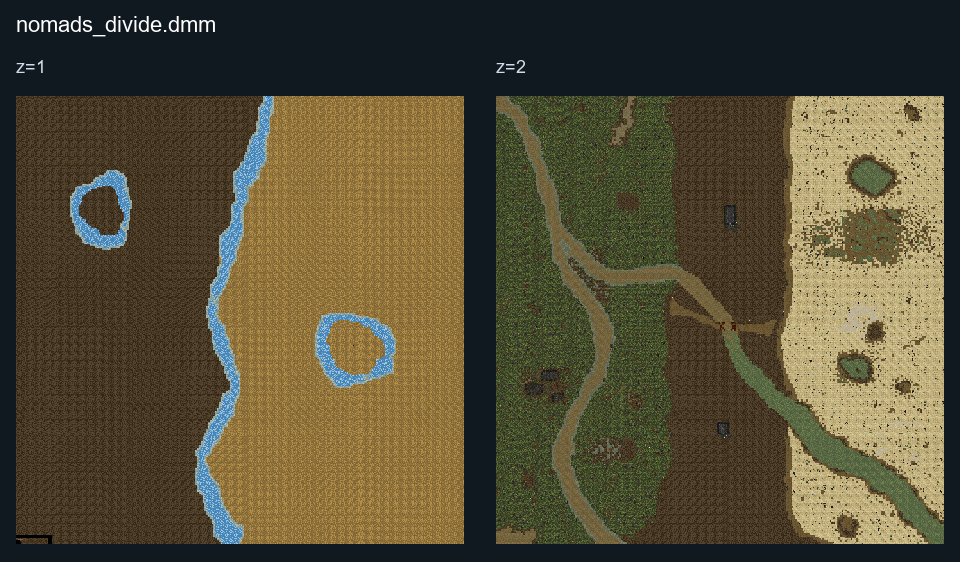
<figcaption>Static map layout of <code>nomads_divide.dmm</code>. Runtime lighting, generated objects and later sprite changes are not shown. 
Full-resolution layers: <a href="../images/maps/static-58404f5bd16e/nomads__nomads_divide/nomads_divide__z01__full.png">z=1 (8000 × 8000 PNG)</a> · <a href="../images/maps/static-58404f5bd16e/nomads__nomads_divide/nomads_divide__z02__full.png">z=2 (8000 × 8000 PNG)</a>.
</figcaption>
</figure>

Jungle biome on West side, Desert biome on East side, separated by
mineable mountains and a small patch of clear land filled with
alligators.

## Ice Age

<figure>
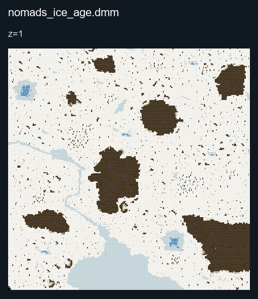
<figcaption>Static map layout of <code>nomads_ice_age.dmm</code>. Runtime lighting, generated objects and later sprite changes are not shown. 
Full-resolution layers: <a href="../images/maps/static-067478b82c7a/nomads__nomads_ice_age/nomads_ice_age__z01__full.png">z=1 (9600 × 9600 PNG)</a>.
</figcaption>
</figure>

Snow plains with frozen rivers and lakes. Rock is more abundant than wood. You may encounter wolves, deer, bears, penguins, goats, mammoths, and dogs. Summer lasts only 1/4 of the year, the rest is winter.

## Continental

<figure>
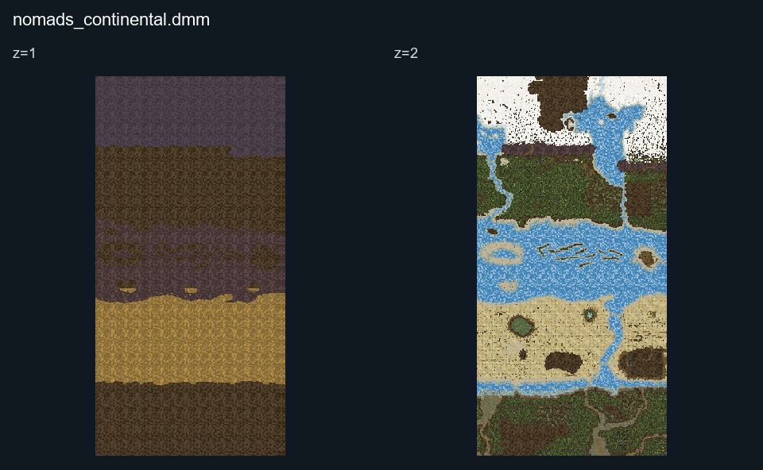
<figcaption>Static map layout of <code>nomads_continental.dmm</code>. Runtime lighting, generated objects and later sprite changes are not shown. 
Full-resolution layers: <a href="../images/maps/static-067478b82c7a/nomads__nomads_continental/nomads_continental__z01__full.png">z=1 (6400 × 12800 PNG)</a> · <a href="../images/maps/static-067478b82c7a/nomads__nomads_continental/nomads_continental__z02__full.png">z=2 (6400 × 12800 PNG)</a>.
</figcaption>
</figure>

## Pangea

<figure>
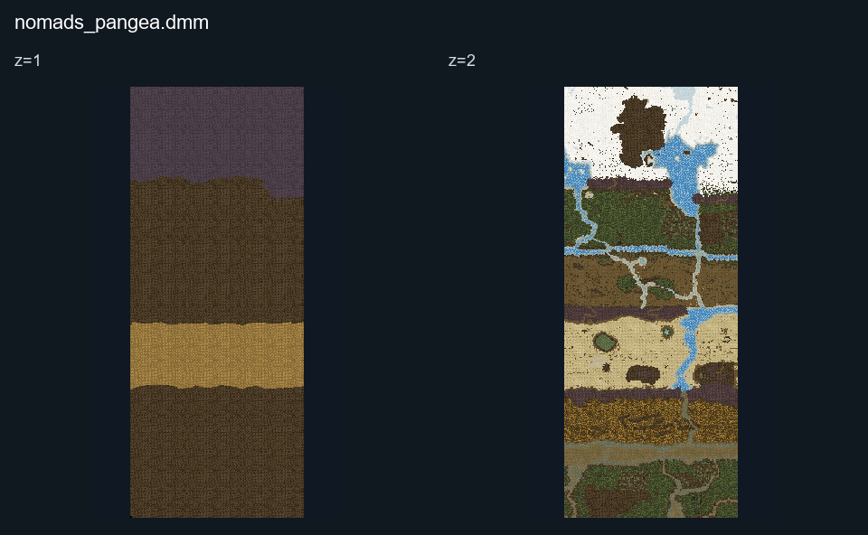
<figcaption>Static map layout of <code>nomads_pangea.dmm</code>. Runtime lighting, generated objects and later sprite changes are not shown. 
Full-resolution layers: <a href="../images/maps/static-067478b82c7a/nomads__nomads_pangea/nomads_pangea__z01__full.png">z=1 (6400 × 16000 PNG)</a> · <a href="../images/maps/static-067478b82c7a/nomads__nomads_pangea/nomads_pangea__z02__full.png">z=2 (6400 × 16000 PNG)</a>.
</figcaption>
</figure>

A combined map with no oceans dividing the biomes, excluding mountain ranges.

The biomes are, from North to South:

Tundra, Taiga, Temperate, Semi-Arid, Desert, Savannah, and Jungle

## New World

<figure>
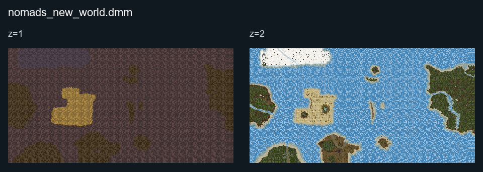
<figcaption>Static map layout of <code>nomads_new_world.dmm</code>. Runtime lighting, generated objects and later sprite changes are not shown. 
Full-resolution layers: <a href="../images/maps/static-067478b82c7a/nomads__nomads_new_world/nomads_new_world__z01__full.png">z=1 (12608 × 6400 PNG)</a> · <a href="../images/maps/static-067478b82c7a/nomads__nomads_new_world/nomads_new_world__z02__full.png">z=2 (12608 × 6400 PNG)</a>.
</figcaption>
</figure>

Everyone starts on the eastern continent. Crossing to the western islands requires something better than a simple raft.

## Mediterranean

<figure>
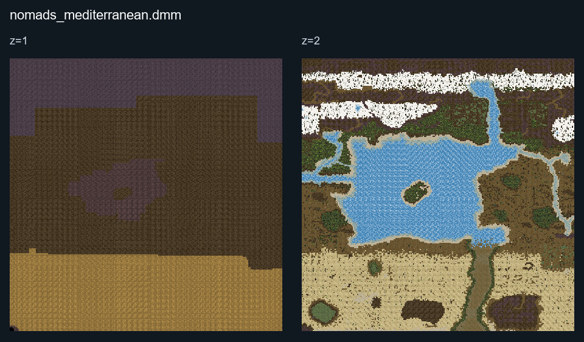
<figcaption>Static map layout of <code>nomads_mediterranean.dmm</code>. Runtime lighting, generated objects and later sprite changes are not shown. 
Full-resolution layers: <a href="../images/maps/static-067478b82c7a/nomads__nomads_mediterranean/nomads_mediterranean__z01__full.png">z=1 (8000 × 8000 PNG)</a> · <a href="../images/maps/static-067478b82c7a/nomads__nomads_mediterranean/nomads_mediterranean__z02__full.png">z=2 (8000 × 8000 PNG)</a>.
</figcaption>
</figure>

## Island

<figure>
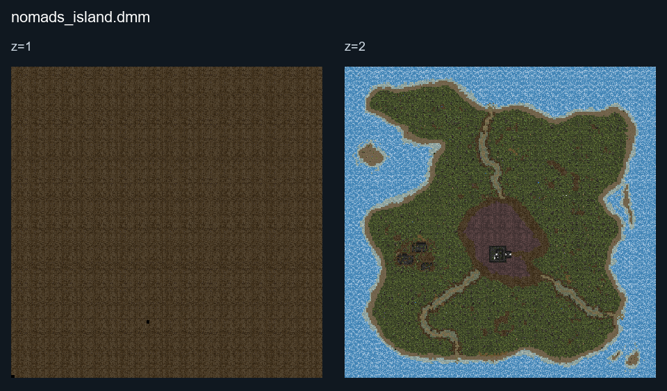
<figcaption>Static map layout of <code>nomads_island.dmm</code>. Runtime lighting, generated objects and later sprite changes are not shown. 
Full-resolution layers: <a href="../images/maps/static-067478b82c7a/nomads__nomads_island/nomads_island__z01__full.png">z=1 (6400 × 6400 PNG)</a> · <a href="../images/maps/static-067478b82c7a/nomads__nomads_island/nomads_island__z02__full.png">z=2 (6400 × 6400 PNG)</a>.
</figcaption>
</figure>

## Isle 

A small island for 10-15 players, divided by a lava region, jungle/part swamp, and  tundra region.

## Europe

<figure>
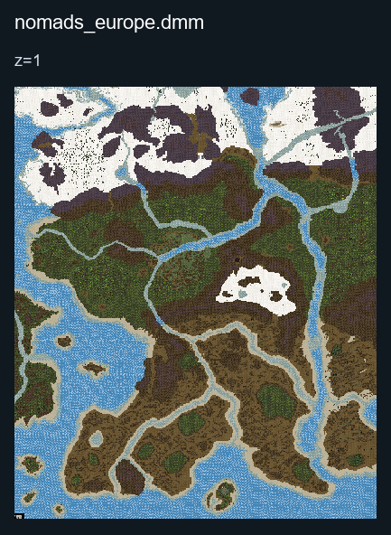
<figcaption>Static map layout of <code>nomads_europe.dmm</code>. Runtime lighting, generated objects and later sprite changes are not shown. 
Full-resolution layers: <a href="../images/maps/static-067478b82c7a/nomads__nomads_europe/nomads_europe__z01__full.png">z=1 (12000 × 14304 PNG)</a>.
</figcaption>
</figure>

A map based off of the European continent, it has a northern region covered in snow based off of Scandinavia and northern Russia..

There is even a temperate biome based off of central europe (France/Germany/northern Balkans), and a semi arid region based off the Mediterranean regions (Iberian peninsula, Italy, and Greece).

Large rivers cover the continent and 7x7 water ways for bridges(tanks and cars) exist on the large rivers.

Section of Nomads_World project (1/4)

## Africa

<figure>
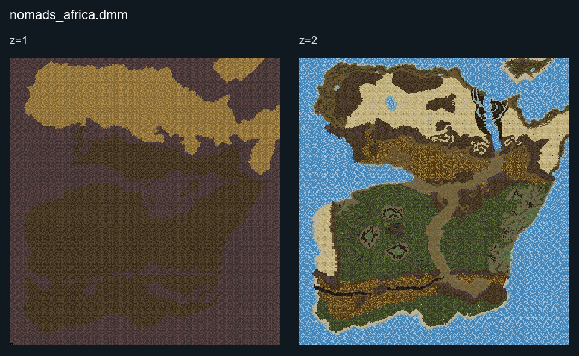
<figcaption>Static map layout of <code>nomads_africa.dmm</code>. Runtime lighting, generated objects and later sprite changes are not shown. 
Full-resolution layers: <a href="../images/maps/static-58404f5bd16e/nomads__nomads_africa/nomads_africa__z01__full.png">z=1 (10912 × 11616 PNG)</a> · <a href="../images/maps/static-58404f5bd16e/nomads__nomads_africa/nomads_africa__z02__full.png">z=2 (10912 × 11616 PNG)</a>.
</figcaption>
</figure>

Based off of all of Africa: Desert, Savannah, Jungle, Savannah.

Section of Nomads_World project (2/4)

## North America

<figure>
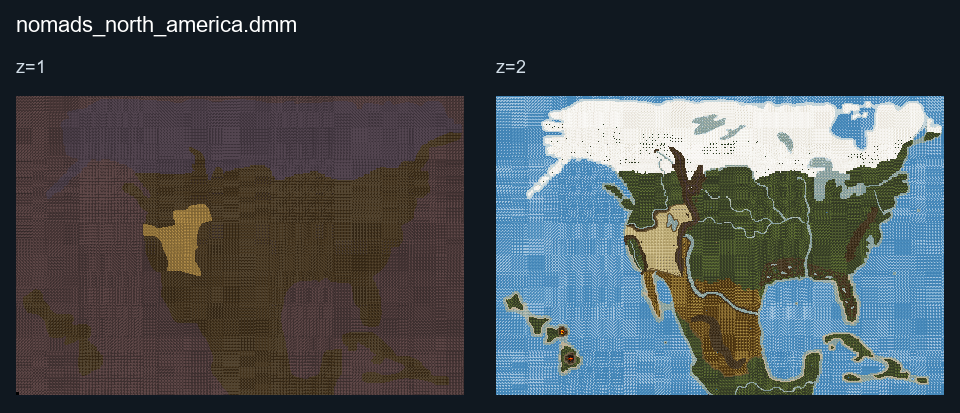
<figcaption>Static map layout of <code>nomads_north_america.dmm</code>. Runtime lighting, generated objects and later sprite changes are not shown. 
Full-resolution layers: <a href="../images/maps/static-067478b82c7a/nomads__nomads_north_america/nomads_north_america__z01__full.png">z=1 (14400 × 9600 PNG)</a> · <a href="../images/maps/static-067478b82c7a/nomads__nomads_north_america/nomads_north_america__z02__full.png">z=2 (14400 × 9600 PNG)</a>.
</figcaption>
</figure>

This map represents North America, from snowy Canada through the temperate United States to the warmer, more arid regions of Mexico. A small island chain to the west represents Hawaii.

Choose your settlement with the local climate in mind: northern regions need cold-weather preparation, while drier regions make access to water especially important. See the [Starter Guide](../Starter_Guide.md) for food, water and shelter, and [Winter and Long Rounds](../guides/Guide_to_Survival.md) for staying warm.

Section of Nomads_World project (3/4).

## Asia

<figure>
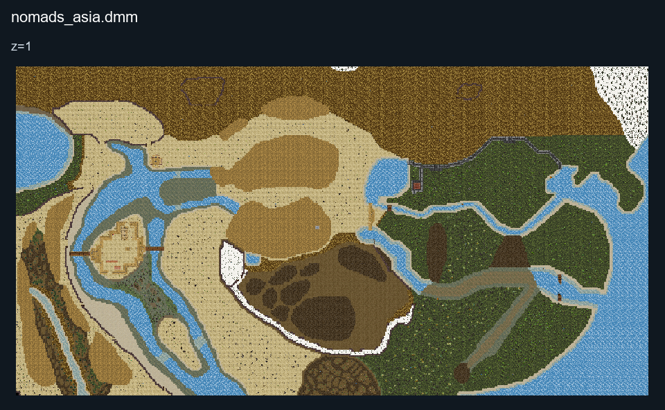
<figcaption>Static map layout of <code>nomads_asia.dmm</code>. Runtime lighting, generated objects and later sprite changes are not shown. 
Full-resolution layers: <a href="../images/maps/static-58404f5bd16e/nomads__nomads_asia/nomads_asia__z01__full.png">z=1 (15680 × 8160 PNG)</a>.
</figcaption>
</figure>

## Karafuto

<figure>
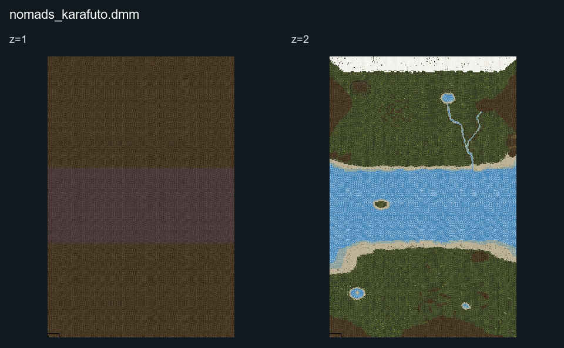
<figcaption>Static map layout of <code>nomads_karafuto.dmm</code>. Runtime lighting, generated objects and later sprite changes are not shown. 
Full-resolution layers: <a href="../images/maps/static-067478b82c7a/nomads__nomads_karafuto/nomads_karafuto__z01__full.png">z=1 (9600 × 14400 PNG)</a> · <a href="../images/maps/static-067478b82c7a/nomads__nomads_karafuto/nomads_karafuto__z02__full.png">z=2 (9600 × 14400 PNG)</a>.
</figcaption>
</figure>
