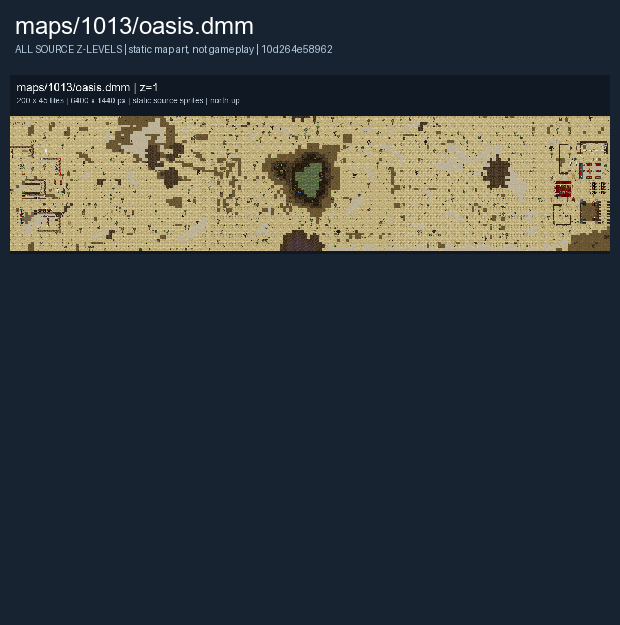

# Trouble at the Oasis

The Crusader and Arabic Caliphate armies compete for an oasis in a desert battlefield.

The images below show the authored map layout.

## Map layout

<figure>

<figcaption>Static map layout of <code>oasis.dmm</code>. Runtime lighting, generated objects and later sprite changes are not shown. 
Full-resolution layers: <a href="../images/maps/early-static-c79792d002b9/1013__oasis/oasis__z01__full.png">z=1 (6,400 x 1,440 PNG)</a>.
</figcaption>
</figure>

See [Maps Overview](../maps_overview.md) for other layouts and [Team Combat](../gamemodes/Team_Combat.md) for general play.
