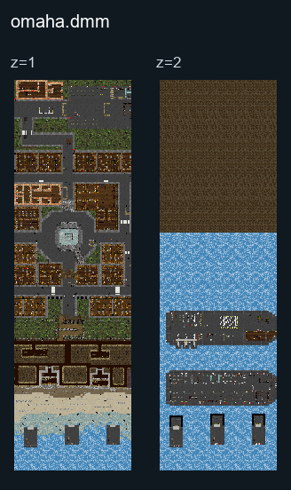

# Omaha

## Map layout

<figure>

<figcaption>Static map layout of <code>omaha.dmm</code>. Runtime lighting, generated objects and later sprite changes are not shown. 
Full-resolution layers: <a href="../images/maps/tdm-static-067478b82c7a/1943__omaha/omaha__z01__full.png">z=1 (1920 × 6400 PNG)</a> · <a href="../images/maps/tdm-static-067478b82c7a/1943__omaha/omaha__z02__full.png">z=2 (1920 × 6400 PNG)</a>.
</figcaption>
</figure>

### How to contribute
If you have information about this map, please help us by [editing this page](https://github.com/civ13/civ13-wiki/edit/master/src/maps/Omaha.md).
You will need a GitHub account to propose changes.
