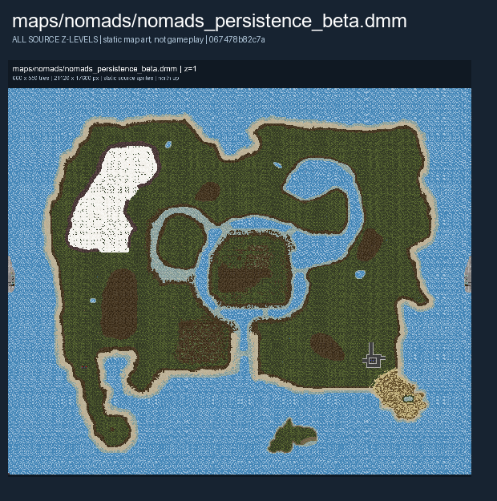

# Nations RP (Persistence Beta)

**Nations RP (Persistence BETA)** is authored as `nomads_persistence_beta.dmm`. It is a separate layout from [Gaia](Gaia.md).

**Map status:** Authored variant, outside the standard Nomads map-vote list. The authored layout shown here does not establish which map is currently hosted.

## Map layout

<figure>

<figcaption>Static map layout of <code>nomads_persistence_beta.dmm</code>. Runtime lighting, generated objects and later sprite changes are not shown. 
Full-resolution layers: <a href="../images/maps/nomads-authored-10d264e58962/nomads__nomads_persistence_beta/nomads_persistence_beta__z01__full.png">z=1 (21,120 x 17,600 PNG)</a>.
</figcaption>
</figure>

For the other Nomads layouts, see [Nomads Maps](Nomads_Maps.md). For general play, see [Civilizations & Nomads](../gamemodes/Civilizations_and_Nomads.md).
