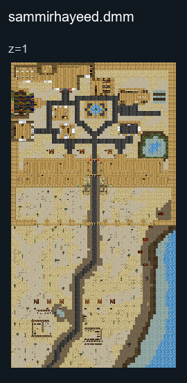

# Sammir Hayeed

## Map layout

<figure>

<figcaption>Static map layout of <code>sammirhayeed.dmm</code>. Runtime lighting, generated objects and later sprite changes are not shown. 
Full-resolution layers: <a href="../images/maps/tdm-static-067478b82c7a/1013__sammirhayeed/sammirhayeed__z01__full.png">z=1 (2080 × 3840 PNG)</a>.
</figcaption>
</figure>

A middle eastern Palace that had come under siege by Christdom's
Crusaders, will you defend the sultanate or plunder it?