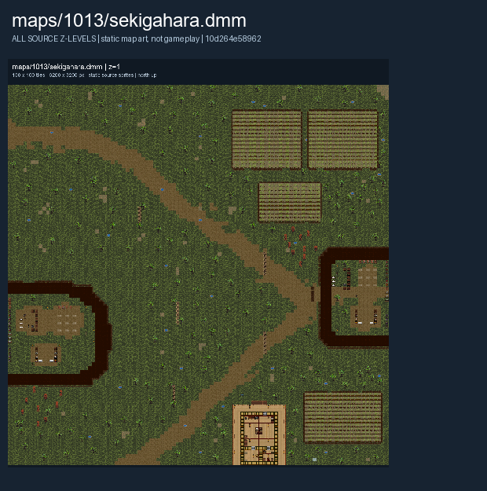

# Sekigahara

The Eastern Army and Western Army face each other outside Sekigahara.

Map selection depends on the server and current round. The images below show the authored layout.

## Map layout

<figure>

<figcaption>Static map layout of <code>sekigahara.dmm</code>. Runtime lighting, generated objects and later sprite changes are not shown. 
Full-resolution layers: <a href="../images/maps/early-static-c79792d002b9/1013__sekigahara/sekigahara__z01__full.png">z=1 (3,200 x 3,200 PNG)</a>.
</figcaption>
</figure>

See [Maps Overview](../maps_overview.md) for other layouts and [Team Combat](../gamemodes/Team_Combat.md) for general play.
