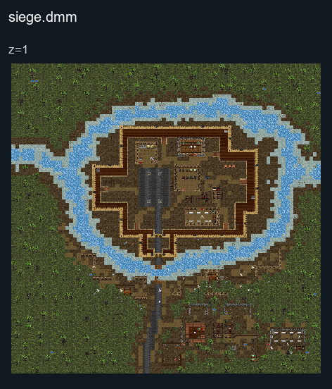

# Siege

## Map layout

<figure>

<figcaption>Static map layout of <code>siege.dmm</code>. Runtime lighting, generated objects and later sprite changes are not shown. 
Full-resolution layers: <a href="../images/maps/tdm-static-067478b82c7a/313bc__siege/siege__z01__full.png">z=1 (2560 × 2560 PNG)</a>.
</figcaption>
</figure>

## Setting

This Game mode is set in lower Italia(Italy) before the Roman Republic
became the Empire we all love and adore, the Romans are here to capture
a Greek colonies' castle, while the Greeks have established a long-term
defense of their castle.

### Roman Roles

| Roles                            | Image | Description                                                          | Difficulty |
| -------------------------------- | ----- | -------------------------------------------------------------------- | ---------- |
| Centurion (Roman Commander)      |       | Plan a strategy to crush Greek's Castle, command your Squad Leaders. | Very Hard  |
| Decurion (Roman Squad Leader)    |       | Follow commander's orders and command your men.                      | Hard       |
| Signifer (Roman Standard Bearer) |       | Follow Squad Leader's orders and kill the Greeks.                    | Medium     |
| Legionarius (Main Infantry)      |       | Follow Squad Leader's orders and kill the greek defenders.           | Medium     |
| Saggitarius (Light Archer)       |       | Assist others and follow your Squad Leader's orders.                 | Easy       |

### WIP Greek Roles

| Roles                            | Image | Description                                                               | Difficulty |
| -------------------------------- | ----- | ------------------------------------------------------------------------- | ---------- |
| Centurion (Roman Commander)      |       | Plan a strategy to crush the roman's assault, command your Squad Leaders. | Very Hard  |
| Decurion (Roman Squad Leader)    |       | Follow commander's orders and command your men.                           | Hard       |
| Signifer (Roman Standard Bearer) |       | Follow Squad Leader's orders and kill the roman invaders.                 | Medium     |
| Legionarius (Main Infantry)      |       | Follow Squad Leader's orders and kill the roman invaders.                 | Medium     |
| Saggitarius (Light Archer)       |       | Assist others and follow your Squad Leader's orders.                      | Easy       |