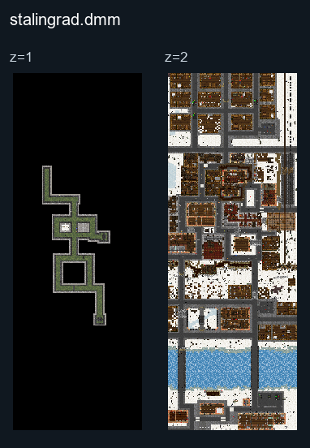

# Stalingrad

## Map layout

<figure>

<figcaption>Static map layout of <code>stalingrad.dmm</code>. Runtime lighting, generated objects and later sprite changes are not shown. 
Full-resolution layers: <a href="https://github.com/civ13/civ13-wiki/releases/download/assets/stalingrad__z01__full.png">z=1 (2880 × 8000 PNG)</a> · <a href="https://github.com/civ13/civ13-wiki/releases/download/assets/stalingrad__z02__full.png">z=2 (2880 × 8000 PNG)</a>.
</figcaption>
</figure>

The vote list also offers **Central Stalingrad** (Smallingrad), a smaller cut of the same battle for lower player counts.

## Central Stalingrad changes each round

In Central Stalingrad, two open areas can change from round to round. Each is either left as it is or gets one of these, picked before the round starts:

- **Central avenue:** spilled rubble heaps, or a line of czech hedgehogs with barbed wire on both sides.
- **Southern square:** shell craters with rubble, or tire barricades and sandbag nests.

Every change is mirrored, so both sides meet the same obstacles. When an area has changed, a line in chat says so in the lobby and again when the round starts.

### How to contribute
If you have information about this map, please help us by [editing this page](https://github.com/civ13/civ13-wiki/edit/master/src/maps/Stalingrad.md).
You will need a GitHub account to propose changes.
