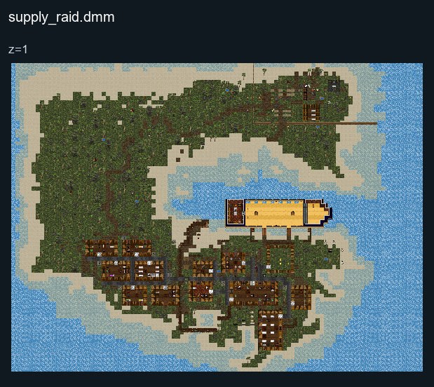

# Supply Raid

## Map layout

<figure>

<figcaption>Static map layout of <code>supply_raid.dmm</code>. Runtime lighting, generated objects and later sprite changes are not shown. 
Full-resolution layers: <a href="../images/maps/tdm-static-067478b82c7a/1713__supply_raid/supply_raid__z01__full.png">z=1 (3200 × 2400 PNG)</a>.
</figcaption>
</figure>

This map is a battle in the Caribbean between the British and the local
hostile Natives.

British (Hostile) Natives (Hostile)