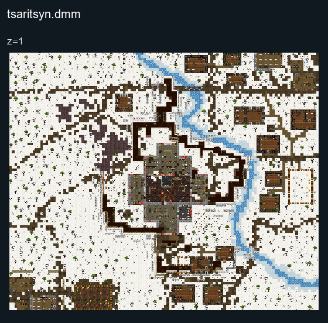
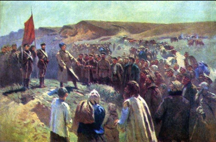

# Tsaritsyn

## Map layout

<figure>

<figcaption>Static map layout of <code>tsaritsyn.dmm</code>. Runtime lighting, generated objects and later sprite changes are not shown. 
Full-resolution layers: <a href="../images/maps/tdm-static-067478b82c7a/1903__tsaritsyn/tsaritsyn__z01__full.png">z=1 (3840 × 3200 PNG)</a>.
</figcaption>
</figure>

The Battle of Tsaritsyn was a military confrontation between Bolshevik
forces and the White Army during the Russian Civil War. It was for
control of the significant city and port on the Volga River in
southwestern Russia. The battle resulted in a Bolshevik victory.

White Army (Tsar Loyalist Army) ,Red Army (Bolsheviks)

