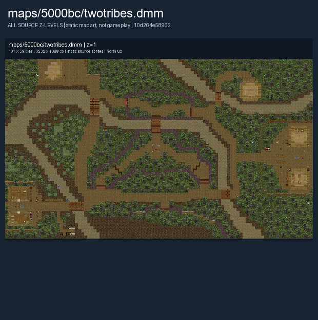

# Two Tribes

The Red and Blue tribes contest the central shrine. The [Tribes](Tribes.md) page covers a separate scenario.

Map selection depends on the server and current round. The images below show the authored layout.

## Map layout

<figure>

<figcaption>Static map layout of <code>twotribes.dmm</code>. Runtime lighting, generated objects and later sprite changes are not shown. 
Full-resolution layers: <a href="../images/maps/early-static-c79792d002b9/5000bc__twotribes/twotribes__z01__full.png">z=1 (3,232 x 1,888 PNG)</a>.
</figcaption>
</figure>

See [Maps Overview](../maps_overview.md) for other layouts and [Team Combat](../gamemodes/Team_Combat.md) for general play.
